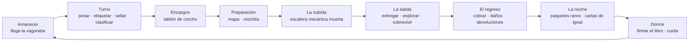
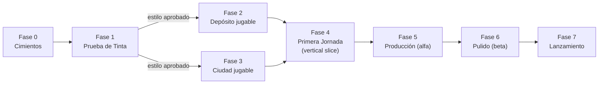

<div align="center">

# RUTA DE TIZA

*Título provisional · repositorio de trabajo `Metro_S.T.A.L.K.E.R`*

**Un juego en primera persona sobre repartir paquetes en una ciudad que alguien borró.**

Gestión acogedora en una estafeta bajo tierra · Exploración de terror en la superficie · 3D con estilo de ilustración entintada

</div>

> No eres soldado. No eres un héroe. No tienes armas.
> Tienes una mochila demasiado pequeña, una tiza, una cuerda y una lista de direcciones.
> Y alguien, al otro lado de la niebla, lleva semanas esperando su paquete.

---

## Índice

0. [Estado del proyecto](#0-estado-del-proyecto)
1. [El concepto](#1-el-concepto)
2. [Pilares de diseño](#2-pilares-de-diseño)
3. [Dos mitades claramente divididas](#3-dos-mitades-claramente-divididas)
4. [El bucle de juego: una jornada](#4-el-bucle-de-juego-una-jornada)
5. [El Depósito: gestión](#5-el-depósito-gestión)
6. [La Ciudad: exploración y terror](#6-la-ciudad-exploración-y-terror)
7. [Mundo y narrativa](#7-mundo-y-narrativa)
8. [Dirección de arte: ilustración entintada](#8-dirección-de-arte-ilustración-entintada)
9. [Interfaz: sin cajas de texto](#9-interfaz-sin-cajas-de-texto)
10. [Audio](#10-audio)
11. [Arquitectura técnica (Godot 4)](#11-arquitectura-técnica-godot-4)
12. [Plan por fases](#12-plan-por-fases)
13. [Hoja de Desarrollo](#13-hoja-de-desarrollo)
14. [Riesgos y mitigaciones](#14-riesgos-y-mitigaciones)
15. [Preguntas abiertas](#15-preguntas-abiertas)
16. [Propiedad intelectual](#16-propiedad-intelectual)
17. [Glosario](#17-glosario)

---

## 0. Estado del proyecto

| | |
|---|---|
| **Fase actual** | Preproducción: plan y preguntas abiertas |
| **Motor** | Godot 4 (la versión estable exacta se fija en la Fase 0) |
| **Plataforma objetivo** | PC (Windows y Linux), con Steam Deck como referencia de rendimiento |
| **Siguiente hito** | H0 · *Hola, Tumánsk* (Fase 0) |

### Decisiones tomadas

| Tema | Decisión | Por qué |
|---|---|---|
| Motor | **Godot 4** con GDScript tipado | Libre y sin royalties. Escenas, scripts y datos son texto, así que todo el proyecto se puede escribir, revisar y versionar. El renderer Forward+ tiene lo necesario para un estilo no fotorrealista: shaders propios, post-proceso, niebla volumétrica y decals. |
| Estilo visual | **Ilustración entintada** | Contornos de tinta, tramado y trazo vivo. El estilo puede reaccionar al miedo y a la tinta, así que deja de ser solo decoración y pasa a dar información al jugador. |
| Defensa | **Herramientas, no armas. No se puede matar.** | Con un arma desaparece la sensación de peligro. Cada amenaza se resuelve con ingenio, preparación, sigilo o huida. |
| Espacio | **Mochila pequeña en cuadrícula** | Cada salida obliga a decidir: más paquetes (dinero) o más herramientas (seguridad). Hay poco sitio y poco margen. |
| Producción 3D | **Modelos generados por código** (Blender 5 como módulo de Python, más generación dentro del motor) | Calidad consistente y reproducible. Cada asset es una "receta" versionada que se puede retocar y regenerar. |

### Próximos pasos

1. Responder las [preguntas abiertas](#15-preguntas-abiertas).
2. **Fase 0**: proyecto, pipelines de arte y verificación automática.
3. **Fase 1**: la *Prueba de Tinta*, con las primeras capturas del estilo final para aprobarlas.

---

## 1. El concepto

### Premisa

Han pasado nueve años desde **la Noche del Borrón**. Aquella noche, una niebla negra y espesa como la tinta subió desde los túneles del metro y cubrió **Tumánsk**, una ciudad de bloques de hormigón, tranvías y mosaicos. Quien quedó atrapado en ella no murió: quedó **tachado**.

Los supervivientes viven en enclaves aislados: un patio vecinal amurallado, un hospital, un mercado cubierto, estaciones de metro selladas. No hay teléfonos ni una radio fiable. Lo único que todavía los une es **el correo**.

Llegas a la **Estafeta Nº 9**, una oficina postal improvisada en el vestíbulo de una estación de metro abandonada. Buscas un techo y algo de comer. El antiguo cartero, **Ignat**, desapareció hace un mes en una de sus rutas. Dejó una montaña de paquetes que llega hasta el techo, clientes desesperados y un cuaderno lleno de símbolos de tiza que nadie entiende.

Firmas el contrato como **Suplente**. A partir de ahora, el correo depende de ti.

### En una frase

*Una estafeta acogedora bajo tierra y una ciudad de pesadilla en la superficie: organiza el correo de día y atraviesa la niebla para entregar cada paquete.*

### Qué hace el jugador

- **En el Depósito**: descarga la vagoneta que llega por el túnel; pesa, embala, etiqueta, sella y clasifica; atiende la ventanilla; elige encargos; restaura y decora la estafeta.
- **En la Ciudad**: prepara la mochila, sube por la escalera mecánica muerta, cruza la niebla, entrega, recoge historias y vuelve. Si puede.

---

## 2. Pilares de diseño

1. **Dos mundos, un mismo trazo.** El depósito es el hogar: luz ámbar, líneas limpias, colores cálidos. La ciudad es lo desconocido: frío, niebla, líneas que tiemblan. El lenguaje visual es el mismo; las emociones, opuestas.
2. **Eres frágil.** No hay armas y no se mata. Hay preparación, ingenio, sigilo y huida. Todo obstáculo tiene más de una solución.
3. **Prepararse también es jugar.** La mochila es pequeña. Elegir qué llevar, y qué dejar, es la decisión más importante de cada salida.
4. **Cada paquete cuenta una historia.** Los paquetes son objetos físicos, personales y a veces extraños. El correo atrasado esconde la historia de la estafeta.
5. **El dibujo está vivo.** El estilo es información: el trazo tiembla con el miedo, la tinta mancha la imagen y la luz "redibuja" el mundo.
6. **Sin cajas de texto.** Toda la interfaz es un objeto del mundo: papel, cartón, tiza, sellos, cuerda o tu propio cuerpo.

---

## 3. Dos mitades claramente divididas

| | **El Depósito** (gestión) | **La Ciudad** (exploración) |
|---|---|---|
| Emoción | Calma, rutina, satisfacción, hogar | Miedo, incertidumbre, vulnerabilidad |
| Ritmo | Sin tiempos ni penalizaciones durante el turno | Tensión con picos; el reloj de la Crecida |
| Luz | Ámbar, lámparas colgantes, resplandor suave | Tu linterna, farolas de sodio que parpadean, oscuridad |
| Trazo | Contorno firme, temblor casi imperceptible | Contorno nervioso, tramado denso, manchas |
| Color | Cálido y saturado | Frío y desaturado, con acentos de sodio |
| Sonido | Radio, generador, palomas, papel | Viento, goteo, susurros, tu respiración |
| Interfaz | Objetos sobre la mesa: libro, tablón, mapa | Casi nada: tus manos, tu reloj, tu mapa de papel |
| Verbos | Pesar, etiquetar, sellar, ordenar, decorar | Marcar, escuchar, esconderse, trepar, abrir, huir |

**La frontera es física**: una puerta estanca y **la escalera mecánica muerta** que sube a la superficie. Mientras la subes, la imagen cambia poco a poco: el color se enfría, el trazo empieza a temblar y la música del depósito se apaga. Bajarla de vuelta es el momento de alivio.

---

## 4. El bucle de juego: una jornada



1. **Amanecer.** La vagoneta del correo llega por el túnel con sacas de otras estaciones. La descargas.
2. **Turno.** Pesas, embalas, etiquetas, sellas y clasificas. Atiendes la ventanilla. Sin prisa: en el depósito el tiempo no corre.
3. **Encargos.** Eliges en el tablón qué vas a entregar a pie. Cuantas más gotas de tinta tiene un encargo, más paga… y más cuesta volver.
4. **Preparación.** Trazas la ruta en el mapa de pared y llenas la mochila. Cada hueco cuenta.
5. **La subida.** Cruzas la puerta estanca y subes la escalera. El mundo cambia.
6. **La salida.** Entregas, exploras, recoges lo que encuentras y evitas lo que vive en la niebla. Vigila el reloj: se acercan la Crecida y la noche.
7. **El regreso.** Cobras, revisas daños, procesas devoluciones y anotas en el mapa lo que has aprendido.
8. **La noche.** Examinas los paquetes raros en el cuarto oscuro, lees las cartas de Ignat, decoras y mejoras la estafeta.
9. **Dormir.** Firmas el libro de registro (se guarda la partida) y pagas la cuota. Mañana llega otra vagoneta.

### Peligro de los encargos

El peligro se marca con **1 a 5 gotas de tinta** dibujadas en la ficha. Más gotas significan más paga, más rarezas y más historia. *(Valores iniciales; se equilibran en la Fase 6.)*

| Gotas | Ejemplo | Paga relativa |
|---|---|---|
| ● | Un sobre a Los Bloques, de día | ×1 |
| ●● | Una caja al Mercado Cubierto, de día | ×2 |
| ●●● | Un paquete frágil al Río, al atardecer | ×3,5 |
| ●●●● | Medicinas al Hospital Nº 3, de noche | ×6 |
| ●●●●● | Un paquete raro a la Imprenta, entrega en mano | ×10 |

---

## 5. El Depósito: gestión

### 5.1 La Estafeta Nº 9

El depósito empieza **abandonado**: polvo, cajas hasta el techo, bombillas fundidas. Cada mejora lo llena de vida: luz, calor, plantas, carteles y objetos que traes de la ciudad.

| Espacio | Función | Disponible |
|---|---|---|
| Vestíbulo y ventanilla | Clientes, mapa de pared, tablón de encargos | Desde el inicio |
| Andén | La vagoneta del correo llega con sacas y sale con paquetes clasificados | Desde el inicio |
| Almacén | Estanterías y casilleros; **la Montaña**, el correo atrasado de Ignat | Desde el inicio |
| Cuarto de Ignat | Tu cama (dormir y guardar), su cuaderno, sus cosas | Desde el inicio |
| Taller | Fabricar y reparar herramientas | Mejora |
| Cuarto oscuro | Examinar paquetes raros por la noche | Mejora |
| Sala del generador | Luz y calor; consume combustible | Mejora (hay que repararla) |
| Palomar | Palomas mensajeras para cartas cortas a enclaves cercanos | Mejora |
| Líneas de vagoneta | Nuevos destinos sin ir a pie (reparando vías) | Mejoras |

### 5.2 Trabajar un paquete

Cada paquete es un objeto físico con **peso, tamaño, fragilidad, destino, contenido y estado**, y a veces con **rarezas**.

1. **Recibir.** Llega de la vagoneta o de la ventanilla, con un **formulario de envío** rellenado a mano por el cliente.
2. **Pesar.** En la báscula de aguja. El peso fija el franqueo.
3. **Embalar.** Caja acolchada, papel, cinta (se arrastra), cordel (se ata), lacre.
4. **Etiquetar.** Etiqueta de destino con el emblema y el color del enclave. Cada enclave tiene además una forma, para que se distinga también sin color. Marcas **FRÁGIL**, **PESADO**, **NO ABRIR DE NOCHE**.
5. **Sellar y decorar.** Sellos de franqueo y pegatinas, colocados donde quieras. No hay una forma correcta. A los clientes les gustan los paquetes bonitos: dan propinas y mejoran tu reputación.
6. **Clasificar.** En los casilleros por destino, en la vagoneta o en tu mochila si la entrega es a pie.

Si un paquete llega dañado, mojado o manchado de tinta, puede volver **devuelto**, con la queja del cliente escrita en la caja.

### 5.3 La ventanilla y los clientes

- Los clientes hablan a través del cristal. Su voz llega amortiguada (un murmullo, sin voces grabadas) y lo que dicen aparece en **papelitos escritos a mano**.
- El **formulario de envío** es el diálogo principal. Cada cliente tiene su letra, sus faltas de ortografía, sus tachones y sus dibujos. Lo que escriben, y lo que tachan, cuenta su historia.
- Clientes recurrentes con pequeños arcos. Ejemplos para el vertical slice:
  - **Doña Zina**: teje calcetines para un nieto al que no ve desde hace años. Paga con té, que te ayuda a recuperar la calma.
  - **Lev, el relojero**: envía mecanismos delicadísimos. Su arco desbloquea un reloj de bolsillo mejorado.
  - **Olia**: una niña que escribe cartas a su madre, ingresada en el Hospital Nº 3. Su arco lleva a una de las entregas más duras del juego.
  - **El señor del abrigo gris**: paga demasiado por enviar paquetes sellados a la Imprenta. Nunca se le ve la cara.

### 5.4 Encargos, economía y reputación

- **Tablón de corcho**: fichas de encargo clavadas con chinchetas. Indican destino, gotas de peligro, paga, plazo en días y condiciones especiales ("entrega en mano", "solo de noche", "no exponer a la luz").
- **Moneda**: **fichas**, las viejas fichas de bronce del metro.
- **Cuota diaria**: raciones y combustible para el generador. Las deudas no provocan "game over": si no pagas, la estafeta se enfría y se apaga (vienen menos clientes y por la noche no recuperas la calma) hasta que te pongas al día. *(Pendiente de confirmar: [pregunta 6](#15-preguntas-abiertas).)*
- **Reputación por enclave**: desbloquea mejores encargos, herramientas (el Hospital da vendas; el Mercado vende tizas de colores) y rutas.

### 5.5 Mejoras y restauración

Como en Cat Mail Co., cada mejora desbloquea **destinos, herramientas o habilidades del oficio**: reparar una línea de vagoneta (un destino seguro nuevo), una báscula de precisión, una máquina de etiquetas, una cinta transportadora entre el andén y el almacén, una estufa, la radio, el palomar, el cuarto oscuro, el taller…

Y **decoración libre**: carteles, plantas bajo una lámpara, objetos que traes de la ciudad como recuerdo. La estafeta se organiza como quieras.

### 5.6 La noche en la estafeta: los paquetes raros

En Cat Mail Co. la luna revela secretos. Aquí, la noche despierta a los **paquetes raros**, objetos que ha tocado la tinta.

- Algunos **susurran** (y atraen a lo que vive en la niebla). Otros **pesan más de noche**, **se mueven**, **escarchan** lo que tienen al lado o **manchan** de tinta a los demás paquetes si les da la luz.
- En el **cuarto oscuro** los examinas con un **estetoscopio** (para escuchar el interior), una **lámpara** (para ver cómo reaccionan a la luz) y la **báscula** (para comparar su peso de día y de noche).
- Lo que descubres decide cómo manipularlos: caja de plomo, papel negro, atado con cordel, lejos de los demás…
- En la ciudad tienen consecuencias. Uno que susurra atrae a los Tachados. Otro, en cambio, apunta siempre hacia su destinatario, como una brújula.

### 5.7 La Montaña: el correo atrasado de Ignat

El correo retrasado esconde la historia. A medida que despejas **la Montaña** aparecen cartas sin entregar, notas de Ignat, objetos personales y páginas de su cuaderno con **el código de tiza** que usaba para marcar la ciudad. Algunas cartas abren **encargos de historia**.

---

## 6. La Ciudad: exploración y terror

### 6.1 Principios del terror

- **Incertidumbre antes que sustos.** No hay minimapa, ni marcadores de enemigos, ni barras de vida. La información llega por el sonido, por la luz y por lo que has dibujado tú.
- **Mostrar poco.** Las criaturas se intuyen: siluetas, garabatos, manchas, ruidos. El estilo entintado permite sugerir en lugar de enseñar.
- **Tensión y alivio.** Los **refugios** marcan el ritmo: pequeñas habitaciones selladas donde enciendes una vela, respiras y escribes en tu cuaderno.
- **La ciudad recuerda.** Tus marcas de tiza, tus cuerdas, tus escaleras y las puertas que forzaste siguen ahí la próxima vez. La lluvia borra la tiza poco a poco. La Crecida lo cambia todo.
- **Siempre hay otra forma.** Una puerta cerrada se abre con ganzúas (silencio, pero lleva tiempo), con la palanca (ruido), con una llave encontrada, subiendo con una cuerda hasta la ventana de arriba o yendo por otra ruta.

### 6.2 La mochila: no hay sitio para todo

- **Cuadrícula** (6×5 al principio, ampliable) donde encajan paquetes y herramientas según su forma. Se prepara con calma en la mesa del depósito.
- **Cinturón** con 3 huecos de acceso inmediato. Para todo lo demás hay que **arrodillarse y abrir la mochila**, que es lento, hace ruido y te deja expuesto.
- **Peso**: cuanta más carga, más lento vas, más ruido haces y antes te quedas sin aliento. **Fragilidad**: correr, saltar o caerse daña lo frágil.
- Lo voluminoso (la escalera plegable, los tablones) va **atado por fuera**: ocupa menos cuadrícula, pero hace ruido y se engancha.

### 6.3 Herramientas: el catálogo inicial

No hay armas. Hay oficio.

| Categoría | Herramienta | Para qué sirve | Coste o riesgo |
|---|---|---|---|
| Orientación | **Tiza** (blanca; después, de colores) | Flechas, símbolos y trazo libre en paredes y suelos. Las marcas se quedan entre salidas | Se gasta; la lluvia la borra |
| | **Polvo de tiza** | Lanzado al aire, dibuja el contorno de lo invisible | Pocas cargas |
| | **Carrete de hilo** | Hilo guía para volver por niebla cerrada o por zonas en blanco | Longitud limitada |
| | **Brújula** | Orientarse. Enloquece cerca de las Erratas, así que también sirve para detectarlas | — |
| | **Mapa de papel** | Se dibuja solo a medida que exploras. Hace falta luz para leerlo | — |
| | **Reloj de bolsillo** | La hora y el aviso de la Crecida | — |
| Luz | **Linterna de pilas** | Silenciosa | Pilas escasas |
| | **Linterna de dinamo** | Nunca se agota | Darle a la manivela hace ruido |
| | **Farol de aceite** | Luz amplia que mantiene a raya la tinta; se puede colgar | Se ve desde lejos |
| | **Velas y cerillas** | Puntos de luz fijos, refugios, caminos marcados | Se consumen |
| Acceso | **Ganzúas** | Abrir cerraduras en silencio (minijuego táctil) | Se rompen; el miedo hace temblar las manos |
| | **Palanca** | Forzar puertas y cajas. No es un arma: no se puede golpear con ella | Mucho ruido |
| | **Cizalla** | Cortar cadenas y alambradas | Pesa |
| | **Cuerda** | Bajar por huecos, atar puertas para bloquearlas, tender pasos | Se puede dejar como atajo permanente |
| | **Escalera plegable** | Ventanas altas y balcones; se puede dejar puesta | Enorme y ruidosa |
| | **Tablón** | Puentes entre azoteas y sobre suelos hundidos | Voluminoso |
| | **Martillo y clavos** | Cerrar puertas y ventanas, reparar escalones | Ruido |
| Sigilo | **Lanzables** (latas, botellas, piedras) | Distraer con ruido | — |
| | **Despertador de cuerda** | Lo dejas, te alejas… y suena donde tú ya no estás | Ocupa sitio |
| | **Campanillas con hilo** | Alarma: las cuelgas en un pasillo y sabrás si algo pasa | — |
| | **Espejo de bolsillo** | Mirar tras las esquinas y bajo las puertas | — |
| | **Zapatos de suela de goma** | Pasos más silenciosos | Es equipo, no una estadística |
| Cuerpo | **Vendas** | Cortes y sangrado | — |
| | **Agua limpia** | Lavar la tinta de las manos | Pesa |
| | **Termo de té** | Recuperar la calma | Un uso por salida |
| | **Foto de familia** | Mirarla te calma, y cuenta quién eras | — |
| Paquetes | **Caja acolchada, caja de plomo, papel negro, arnés** | Proteger lo frágil, aislar lo raro, cargar lo enorme | Sitio y peso |

**Se progresa con equipo y conocimiento, no con estadísticas.** No subes de nivel. Mejoras porque tienes mejores herramientas, conoces la ciudad, entiendes a las criaturas y sabes leer el código de Ignat.

### 6.4 Lo que vive en la niebla

Ninguna criatura se puede matar. Todas se pueden entender.

| Criatura | Cómo es | Qué la atrae | Cómo sobrevivir |
|---|---|---|---|
| **Tachados** | Personas que la tinta cubrió de garabatos. Son ciegos | El sonido | Moverse despacio, distraer, esconderse, cerrar puertas |
| **Borrones** | Invisibles; solo se ven sus goteos. Apagan las luces cercanas | La luz | Polvo de tiza para verlos; apagar la linterna (y quedarte a oscuras…) |
| **Garabatos** | Enjambres pequeños en los sitios oscuros. Emborronan tus marcas de tiza | La oscuridad | Luz fija: farol, velas |
| **Goteras** | Cuelgan del techo de escaleras y túneles como tinta a punto de caer | El ruido justo debajo | Mirar arriba; lanzar algo para que caigan antes |
| **Mirones** | Siluetas inmóviles en ventanas lejanas. Si te ven, despiertan a todas las criaturas durante un rato | Tu luz en su línea de visión | Luces apagadas, espejo, rutas a cubierto |
| **El Cartero** | Una figura con una saca al hombro que recorre tus rutas. ¿Es Ignat? | — | Es parte de la historia. No se explica aquí |

### 6.5 Las Erratas

Son lugares donde el dibujo del mundo está mal hecho. Funcionan a la vez como puzles ambientales y como peligros.

- **Bucle**: un pasillo o una escalera que se repite. La tiza te dice que ya pasaste por ahí. A veces, para salir, hay que caminar con los ojos cerrados y guiarse solo por el sonido.
- **Puerta dibujada**: algunas puertas son solo dibujos; algunos dibujos son puertas.
- **Página en blanco**: zonas borradas hasta quedar en papel blanco, sin líneas ni color. Solo se ven tu tiza y tu hilo.
- **Eco**: tus pasos se repiten unos segundos después, donde ya no estás.
- **Charco de tinta**: te frena, te mancha y esconde cosas.
- **Calco**: dos habitaciones idénticas… casi. Hay que encontrar la diferencia para dar con la salida.
- **Corrección con tiza**: en algunas Erratas, la tiza puede **corregir el dibujo**: cerrar una grieta, completar una puerta, unir una escalera. Es lo más parecido a un poder que vas a tener.

### 6.6 La Crecida

Cada cierto tiempo, la tinta sube. Hay avisos: suenan las campanas de la ciudad, se oye un rumor de papeles, las palomas huyen. Tienes unos minutos para **subir** (a pisos altos o azoteas) o para **encerrarte** en un refugio. Cuando la tinta baja, la ciudad ha cambiado: hay Erratas nuevas, las criaturas están en otros sitios y la tiza de las zonas bajas está emborronada.

### 6.7 Tu cuerpo es la interfaz

- **Miedo**: no hay barra. Se nota en las manos, que tiemblan (la linterna, la ganzúa, el trazo de la tiza); en la respiración, que se oye; en el sonido, que se apaga; y **en el propio dibujo**, porque el trazo tiembla más y el tramado invade los bordes de la imagen. Se recupera con luz, en los refugios, con el té y con la foto.
- **Mancha**: la tinta se acumula **en tus manos**. Mírate las manos para saber cuánta llevas: primero en los dedos, luego en las muñecas, luego por los brazos. Con mucha mancha oyes cosas que no están y ves cosas que no existen. Se lava con agua limpia.
- **Heridas**: cortes (se tratan con vendas) y torceduras (cojeas). Se ven en el cuerpo y en el movimiento de la cámara.
- **Si te atrapan**: la tinta llena la pantalla y despiertas en el depósito, porque alguien te encontró. Tu mochila se queda donde caíste y puedes volver a por ella. Una pequeña mancha de tinta ya no se va de tu mano. *(El modelo de muerte está pendiente de confirmar: [pregunta 5](#15-preguntas-abiertas).)*

### 6.8 Distritos de Tumánsk

| # | Distrito | Peligro | Qué lo hace especial | Enclave |
|---|---|---|---|---|
| 0 | **Andén 9** | — | La estafeta. Bajo tierra, cálida, segura | Estafeta Nº 9 |
| 1 | **Los Bloques** | ●–●● | Patios, escaleras con buzones, columpios oxidados, tendederos, azoteas conectadas | Patio 14 |
| 2 | **El Mercado Cubierto** | ●● | Un laberinto de puestos y lonas | Los Feriantes |
| 3 | **El Río y los Puentes** | ●●● | La niebla se acumula en lo bajo; pasarelas y barcas | La Esclusa |
| 4 | **Los Túneles** | ●●●–●●●● | Vías, galerías inundadas, otras estaciones | Andén 4 |
| 5 | **Hospital Nº 3** | ●●●● | Pasillos interminables; Borrones | Las Enfermeras |
| 6 | **La Imprenta Estatal** | ●●●●● | Rotativas, bobinas de papel, cubas de tinta. ¿El origen? | — |
| 7 | **La Torre de Radio** | ●●●●● | Por encima de la niebla. El final | — |

Los distritos se construyen **a mano** (no de forma procedural) para cuidar cada rincón, pero tienen elementos dinámicos: Erratas que se desplazan, criaturas que cambian de zona, y puertas y atajos que persisten.

---

## 7. Mundo y narrativa

- **El misterio central**: qué fue la Noche del Borrón y qué le pasó a Ignat. Circulan rumores: la Imprenta Estatal, los niveles profundos del metro, una emisión de radio que nadie llegó a escuchar entera.
- **Cómo se cuenta**: sin cinemáticas largas. A través del correo atrasado (cartas, paquetes, notas), de los formularios y papelitos de los clientes, del entorno (casas vacías, buzones, carteles) y del **rastro de tiza de Ignat** por la ciudad, que aprendes a leer con su cuaderno.
- **Tono**: melancolía y ternura en el depósito; terror y pérdida fuera. La gente sigue enviando calcetines, cartas de amor y medicinas. Por eso vale la pena salir.
- **Finales**: 2 o 3, según qué entregas y qué paquetes decides abrir (o no abrir). *(Por ahora es un esbozo; se detalla en la Fase 5.)*

---

## 8. Dirección de arte: ilustración entintada

### 8.1 ¿Qué estilo usa Cat Mail Co.?

Pertenece al **3D estilizado** (*stylized* en inglés), una rama del **renderizado no fotorrealista** (NPR). En sus capturas se ve lo siguiente:

- Formas **robustas y algo exageradas**: estanterías gruesas, cajas con los bordes suavizados.
- **Colores planos con degradados suaves** y texturas sencillas, casi pintadas a mano, sin contornos marcados.
- **Ilustraciones 2D sobre objetos 3D**: sellos, etiquetas, pegatinas y mapas. Buena parte del encanto sale de ahí.
- **Luz cálida** de lámparas, con resplandor y sombras suaves.

### 8.2 Nuestro estilo

Partimos de esa base (formas robustas, calidez, ilustraciones sobre objetos) y le añadimos **tinta**.

| Capa | Qué es | Cómo se hace en Godot 4 |
|---|---|---|
| Sombreado por bandas (*cel shading*) | 2 o 3 tonos por material, con rampas de color. Luz cálida, sombra fría | Shader `spatial` propio con función `light()` y una textura de rampa |
| Contorno de tinta | Líneas en siluetas y pliegues, de grosor variable y trazo irregular | Post-proceso a partir de profundidad y normales (`CompositorEffect`), más casco invertido en personajes y objetos clave |
| Tramado | Sombras hechas con rayas, como un grabado. Más densas cuanto más oscuro y cuanto más miedo | Texturas de tramado (*tonal art maps*) mezcladas según la iluminación |
| Trazo vivo (*line boil*) | El contorno tiembla como en una animación dibujada a mano | Ruido animado a 8–12 fps, a saltos y no de forma continua |
| Papel | Grano de papel sutil sobre toda la imagen y viñeta de tinta en los bordes | Post-proceso final |
| Color por zona | Paletas limitadas y gradación propia de cada zona | LUT por zona, mezcladas en las transiciones |
| Niebla pintada | Niebla volumétrica posterizada, con manchas animadas | `FogVolume` + shader `fog` |
| Ilustraciones sobre objetos | Etiquetas, sellos, carteles, mosaicos | Nodos `Decal` + texturas generadas por código (SVG) |

### 8.3 Lenguaje de formas

- **Nada es perfectamente recto.** Las recetas de modelado añaden imperfección controlada: bordes un poco torcidos y grosores exagerados.
- **Biseles generosos** y normales suavizadas, para que el sombreado por bandas quede limpio.
- **Siluetas legibles**: cada objeto se reconoce por su sombra.
- **Arquitectura de paneles** (bloques prefabricados, brutalismo) y **mosaicos de metro** propios. La arquitectura post-soviética es modular por naturaleza, ideal para generarla por código.
- **Personajes**: proporciones robustas, cabezas algo grandes, ropa por capas (bufandas, gorros, gafas) y **rostros 2D** sobre modelos 3D, para que las expresiones sean claras y fáciles de animar.

### 8.4 Escenarios: reglas de construcción

- **Cada espacio tiene una historia visible**: quién vivía ahí y qué pasó.
- **Hitos para orientarse en la niebla**: la Torre de Radio iluminada, un tranvía rojo volcado, el mosaico de la estación, la chimenea de la Imprenta.
- **Detalle de ilustración**: muchos objetos pequeños con carácter (tendederos, macetas, buzones, carteles) en lugar de texturas complejas.
- **Composición por planos**, como una ilustración: primer plano oscuro, plano medio iluminado y fondo perdido en la niebla.
- **La luz guía**: la luz cálida atrae; la luz fría, o la ausencia de luz, avisa de peligro.
- **Verticalidad**: azoteas, escaleras y sótanos. La Crecida empuja hacia arriba.
- **Un depósito que crece**: del abandono a la vida, mejora a mejora.

### 8.5 Paletas

**Depósito: "Ámbar y azulejo"**

| Uso | Color | Hex |
|---|---|---|
| Papel | Crema | `#F2E6CF` |
| Tinta | Negro violáceo | `#1B1A22` |
| Lámpara | Ámbar | `#E8A33D` |
| Cartón | Terracota | `#C2603F` |
| Madera | Nogal | `#8A5A3B` |
| Azulejo de metro | Verde azulado | `#2F6F73` |
| Sello | Rojo | `#C8323C` |
| Señalética | Cobalto | `#2D4A8A` |

**Ciudad: "Niebla y sodio"**

| Uso | Color | Hex |
|---|---|---|
| Niebla | Gris verdoso | `#9AA7A6` |
| Hormigón | Gris cálido | `#7D7F7A` |
| Sombra | Azul pizarra | `#2A3440` |
| Farola | Sodio | `#F0A04B` |
| Vegetación | Musgo | `#5E6B4A` |
| Tinta viva | Negro con brillo violeta | `#0E0D14` / `#4B3A7A` |
| Tiza | Blanco hueso | `#EDEDE6` |

Regla: **el rojo sello** se reserva para lo importante: peligro, confirmaciones, la etiqueta de un paquete urgente.

### 8.6 Parámetros por estado (punto de partida para la Fase 1)

| Parámetro | Depósito | Ciudad | Pánico o Errata |
|---|---|---|---|
| Trazo vivo | 4 fps, muy sutil | 8 fps | 12 fps, amplio |
| Grosor del contorno (a 1080p) | 1,5–2 px | 2–3 px | 3–5 px, roto |
| Tramado | Solo en sombras profundas | En sombras medias | Invade la imagen desde los bordes |
| Saturación | 100 % | 60 % | 30 % |
| Papel | Sutil | Visible | Manchas de tinta |

### 8.7 Referencias (inspiración, no copia)

- **Cat Mail Co.**: calidez, tactilidad, pegatinas, mobiliario robusto.
- **Yuri Norstein, *El erizo en la niebla* (1975)**: la niebla como misterio y como miedo.
- **Ilustración infantil de Europa del Este (años 60 y 70)**: tramados, texturas, color limitado.
- **Grabado y xilografía**: sombras hechas de líneas.
- **Carteles constructivistas**: señalética, tipografía, composición de la interfaz.
- **Mike Mignola**: negros masivos y siluetas para el terror.
- **Arquitectura de paneles y estaciones de metro con mosaicos**: escenarios.

---

## 9. Interfaz: sin cajas de texto

### 9.1 Reglas

1. **Todo es un objeto.** Si algo hay que mostrarlo, es papel, cartón, tiza, un sello, un hilo o una parte de tu cuerpo.
2. **Nunca un rectángulo con texto encima.** El texto vive en papeles con textura, escrito a mano o a máquina.
3. **Iconos dibujados**, con el mismo grosor de trazo que el mundo 3D.
4. **Animación con peso**: los papeles se deslizan, rebotan y se asientan; los sellos golpean; las hojas pasan.
5. **Accesible sin romper la estética**: tamaño de texto ajustable, texto "limpio" para dislexia, subtítulos en tiras de papel, trazo vivo reducible y colores siempre acompañados de forma.

### 9.2 Qué es cada cosa

| Función | Objeto |
|---|---|
| Menú principal | La ventanilla al amanecer, con el libro de registro abierto sobre el mostrador. Apagar la lámpara es salir del juego |
| Nueva partida | Firmar el contrato de Suplente |
| Guardar | Firmar el libro de registro antes de dormir |
| Opciones | La radio: diales para el volumen, el brillo y la sensibilidad |
| Pausa, diario y bestiario | Tu cuaderno de bolsillo, con bocetos y notas a mano |
| Encargos | Fichas en el tablón de corcho |
| Planificar la ruta | El mapa de pared, con chinchetas e hilo rojo |
| Cuentas y reputación | El libro de registro |
| Inventario | La mochila abierta, en 3D, sobre la mesa o en el suelo |
| Avisos | Una postal que asoma por la esquina de la pantalla |
| Confirmar | Un sello de goma: **APROBADO** |
| Hora y Crecida | El reloj de bolsillo |
| Salud, miedo y tinta | Tus manos |
| Interactuar | Un punto de tiza que se convierte en un pequeño icono dibujado (mano, lupa, tiza, ganzúa) |
| Pantallas de carga | Postales ilustradas de los distritos, con notas de Ignat |

### 9.3 Tipografía

Candidatas con licencia libre (OFL); se validan en la Fase 1.

- **Manuscrita** (notas y formularios): una familia del tipo *Caveat* o *Kalam*, con una "letra" distinta para cada cliente.
- **Máquina de escribir** (documentos oficiales): del tipo *Courier Prime*.
- **Rotulación** (carteles y sellos): condensada y geométrica, de inspiración constructivista, del tipo *Oswald*.
- Requisito: soporte para cirílico en la rotulación del mundo.

---

## 10. Audio

- **Depósito**: la radio (música propia, de época), el zumbido del generador, las palomas, la tetera, el papel, el cartón, la cinta adhesiva, el golpe del sello.
- **Ciudad**: el viento entre ventanas rotas, goteos, crujidos, el rumor de papeles (señal de tinta), susurros, tus pasos según el suelo, tu respiración y tu corazón. **El silencio también es una herramienta.**
- **Técnica**: sonido 3D con oclusión (filtro paso bajo calculado con raycasts), reverberación según el tipo de espacio (escalera, túnel, nave), mezcla dinámica según el miedo y ambiente por capas.
- **Fuentes**: librerías libres de derechos (los paquetes de Sonniss para la GDC, Freesound CC0), foley grabado por nosotros (papel, cartón y cinta se graban bien con un móvil) y música por encargo o propia. *(Ver la [pregunta 15](#15-preguntas-abiertas).)*

---

## 11. Arquitectura técnica (Godot 4)

### 11.1 Decisiones técnicas

- **Godot 4** con el renderer **Forward+** (Vulkan). La versión exacta se fija en la Fase 0 y no se cambia sin motivo.
- **GDScript con tipado estático** obligatorio. C++ (GDExtension) solo si algún sistema lo necesita por rendimiento.
- **Los datos son recursos** (`Resource` guardados como `.tres`): paquetes, encargos, clientes, herramientas, criaturas, Erratas y cartas. Se crean y se editan como texto.
- **Escenas pequeñas y componibles**, que se comunican mediante señales y un `EventBus`.

### 11.2 Estructura del repositorio

```text
/
├── project.godot
├── addons/                  # plugins (tests, utilidades)
├── assets/
│   ├── models/              # .glb generados (no se editan a mano)
│   ├── textures/            # rampas, tramados, papel, ruido
│   ├── shaders/             # toon, contorno, tramado, niebla, tinta, papel
│   ├── materials/
│   ├── ui/                  # SVG y PNG generados
│   ├── fonts/
│   └── audio/               # music/, ambience/, sfx/, ui/
├── data/                    # recursos .tres: el contenido del juego
├── scenes/                  # depot/, city/, ui/, characters/, props/, debug/
├── scripts/
│   ├── core/                # autoloads y utilidades
│   ├── depot/               # paquetes, báscula, etiquetado, clientes, economía
│   ├── city/                # jugador, herramientas, IA, Erratas, Crecida
│   └── ui/
├── tools/
│   ├── blender/             # recetas de modelos (bpy) → .glb
│   ├── svg/                 # generadores de ilustración 2D (rough.js)
│   ├── textures/            # generadores de texturas (numpy, Pillow)
│   └── capture/             # capturas automáticas para revisión
├── tests/
└── docs/                    # GDD vivo, guía de estilo, registro de decisiones
```

### 11.3 Sistemas principales

| Sistema | Responsabilidad |
|---|---|
| `EventBus` | Señales globales: paquete entregado, Crecida, miedo… |
| `GameState` | Día, fichas, reputación, banderas de historia |
| `SaveSystem` | Guardado versionado, incluido el estado del mundo (tiza, cuerdas, puertas, mochilas perdidas) |
| `SceneRouter` | Cambios de escena con transición de tinta |
| `StyleDirector` | Parámetros del estilo en tiempo real (trazo, tramado, paleta) según la zona, el miedo y la tinta |
| `AudioDirector` | Capas de ambiente, música, mezcla dinámica y oclusión |
| `TimeOfDay` | La jornada, la noche y el ciclo de la Crecida |
| `Interaction` | Raycast, componentes `Interactable`, coger y soltar objetos físicos |
| `PackageSystem` | Datos y estado de los paquetes, daños, decoraciones |
| `JobBoard` | Generación de encargos: peligro, paga, plazos |
| `Backpack` | Cuadrícula, peso, ruido, fragilidad |
| `Perception` | El ruido y la luz que emite el jugador, y cómo los perciben las criaturas |
| `CreatureAI` | Máquinas de estados y navegación |
| `Errata` | Componentes de anomalía reutilizables |
| `FearSystem` / `InkSystem` | Miedo y mancha, y su efecto en las manos, la cámara, el estilo y el audio |

### 11.4 Pipelines de producción de arte

Todo se genera por código y todo queda versionado.

- **3D**: recetas en Python ejecutadas con **Blender 5 como módulo** (`bpy`, se instala con pip). Producen geometría con biseles e imperfección controlada, colores por vértice, UVs, colisiones y LODs, y la exportan a `.glb`. Godot la importa sola: un script post-importación asigna los materiales NPR y las colisiones según el sufijo del nombre. Hay recetas de props (cajas, estanterías, lámparas, báscula…), un **kit modular de arquitectura** (paneles, ventanas, balcones, escaleras, túneles), personajes de medio cuerpo y criaturas (formas base con rasgos dibujados).
- **2D**: generadores SVG en Node con **rough.js**, que da un aspecto dibujado a mano. Producen etiquetas, sellos, pegatinas, iconos, carteles, mapas y marcos de papel. Godot importa SVG directamente; se usa PNG cuando haga falta.
- **Texturas**: scripts de Python (numpy y Pillow) para el grano de papel, los tramados, las rampas y el ruido de pincel. Además, horneado en Blender (oclusión y curvatura) para conseguir bordes gastados con aspecto pintado.
- **Revisión visual**: cada cambio visual viene acompañado de **capturas automáticas** de escenas de prueba, para que puedas revisar el aspecto sin abrir el motor.

### 11.5 Calidad

- `gdlint` y `gdformat` (de gdtoolkit) en cada cambio.
- Tests unitarios sin pantalla (GUT o gdUnit4; se decide en la Fase 0) para la lógica: economía, mochila, encargos, guardado.
- GitHub Actions: lint, tests y builds de Windows y Linux como artefactos descargables.

### 11.6 Rendimiento objetivo

| Plataforma | Resolución | Objetivo |
|---|---|---|
| PC media (GTX 1060 / RX 580) | 1080p | 60 fps |
| Steam Deck | 800p | 40–60 fps |
| PC baja | 720p | 30 fps en calidad baja |

---

## 12. Plan por fases



Cada fase tiene un **objetivo**, unas **tareas** (con un ID para seguirlas en la [Hoja de Desarrollo](#13-hoja-de-desarrollo)), un **entregable** y un **criterio de salida**. No se pasa a la fase siguiente sin cumplir el criterio.

### Fase 0: Cimientos · tamaño S

**Objetivo**: un proyecto que arranca, pipelines que producen assets sin pasos manuales y verificación automática.

- [ ] **F0-01** Instalar Godot 4 (versión estable fijada) en el entorno de desarrollo y en CI.
- [ ] **F0-02** Crear el proyecto: Forward+, estructura de carpetas, capas de física y de render con nombre, mapa de controles (teclado y ratón, y mando).
- [ ] **F0-03** Convenciones: `snake_case` para archivos, `PascalCase` para clases, tipado estático obligatorio, formato de commits y plantilla de PR con capturas.
- [ ] **F0-04** Autoloads base, como esqueletos con tests: `EventBus`, `GameState`, `SaveSystem`, `SceneRouter` y `Settings`.
- [ ] **F0-05** Pipeline 3D: Blender 5 (`bpy`) y una receta de ejemplo → `.glb` → importación automática con materiales y colisión.
- [ ] **F0-06** Pipeline 2D: generador SVG con rough.js (una etiqueta de ejemplo).
- [ ] **F0-07** Pipeline de texturas: papel, tramado y rampa de ejemplo.
- [ ] **F0-08** Capturas automáticas de escenas, renderizadas sin pantalla, para la revisión visual.
- [ ] **F0-09** CI en GitHub Actions: lint, tests y builds de Windows y Linux.
- [ ] **F0-10** Carpeta `docs/`: GDD vivo (este README se divide cuando crezca), guía de estilo y registro de decisiones.

**Entregable**: *Hola, Tumánsk*: una escena con una caja de cartón generada por receta, importada sola, con su captura y un test en verde.
**Criterio de salida**: un asset va de la receta al juego sin tocar nada a mano; la CI está en verde; las capturas son reproducibles.

### Fase 1: La Prueba de Tinta (puerta de estilo) · tamaño M

**Objetivo**: fijar y aprobar el aspecto final antes de producir contenido. Es la fase más importante, porque todo lo demás se construye encima.

- [ ] **F1-01** Shader de sombreado por bandas con rampas por material: luz cálida, sombra fría y luz de borde.
- [ ] **F1-02** Contorno por post-proceso (profundidad y normales), con grosor variable y trazo irregular.
- [ ] **F1-03** Contorno por casco invertido para objetos clave y personajes.
- [ ] **F1-04** Tramado en las sombras (*tonal art maps*), con densidad controlable.
- [ ] **F1-05** Trazo vivo a saltos (4, 8 y 12 fps), controlado por `StyleDirector`.
- [ ] **F1-06** Papel, viñeta de tinta y gradación de color por zona (LUT).
- [ ] **F1-07** Niebla pintada (`FogVolume` + shader) y material de "tinta viva".
- [ ] **F1-08** Kit inicial de props por receta: cajas (3 tamaños), estantería, casilleros, mostrador, lámpara colgante, báscula, farola, banco, puerta y un módulo de fachada de paneles.
- [ ] **F1-09** Diorama A: *La ventanilla al amanecer* (depósito).
- [ ] **F1-10** Diorama B: *El patio en la niebla* (ciudad).
- [ ] **F1-11** Panel de depuración para cambiar en vivo el miedo, la mancha, la hora y la zona, y ver cómo reacciona el estilo.
- [ ] **F1-12** Primeras piezas de interfaz en el estilo final: etiqueta de destino, sello, ficha de encargo y postal.
- [ ] **F1-13** Selección de tipografías y prueba de legibilidad.
- [ ] **F1-14** Guía de estilo con los parámetros definitivos, más capturas y un vídeo corto.

**Entregable**: dos dioramas a calidad final y la guía de estilo con los valores fijados.
**Criterio de salida**: **tú apruebas el estilo**. Si no convence, se itera aquí; nunca se produce contenido sobre un estilo sin aprobar.

### Fase 2: El Depósito jugable · tamaño L

**Objetivo**: que procesar un paquete sea un placer táctil.

- [ ] **F2-01** Controlador en primera persona, versión depósito: tranquila y sin estamina.
- [ ] **F2-02** Interacción: raycast, componentes `Interactable` y resaltado con contorno de tiza.
- [ ] **F2-03** Física de objetos: coger, soltar, girar y lanzar. El peso se nota.
- [ ] **F2-04** Modelo de datos del paquete: peso, tamaño, fragilidad, destino, contenido, estado, rarezas y decoraciones.
- [ ] **F2-05** Báscula de aguja y tabla de franqueo.
- [ ] **F2-06** Etiquetado: destino (emblema, color y forma) y marcas FRÁGIL, PESADO y NO ABRIR DE NOCHE.
- [ ] **F2-07** Sellos y pegatinas con colocación libre (proyectados con decals).
- [ ] **F2-08** Embalaje: cinta (arrastrar), cordel (atar), papel y caja acolchada.
- [ ] **F2-09** Estanterías y casilleros; clasificación libre.
- [ ] **F2-10** Vagoneta del andén: llegada, descarga, carga y salida.
- [ ] **F2-11** Ventanilla: un cliente, con su formulario de envío manuscrito y papelitos de diálogo.
- [ ] **F2-12** Tablón de corcho y libro de registro, diegéticos.
- [ ] **F2-13** Respuesta táctil: sonidos de papel y cartón, golpe del sello, polvo y microanimaciones.

**Entregable**: el depósito con geometría provisional pero ya con el estilo aplicado, y un paquete que recorre todo el proceso.
**Criterio de salida**: 5 paquetes procesados de principio a fin sin una sola caja de texto, y una prueba con 2 o 3 personas: "¿da gusto?".

### Fase 3: La Ciudad jugable · tamaño L

**Objetivo**: una ruta corta que dé miedo de verdad.

- [ ] **F3-01** Controlador de ciudad: agacharse, asomarse, correr con aliento y hacer ruido según el suelo, la velocidad y el peso.
- [ ] **F3-02** Luz: linternas de pilas y de dinamo. La luz afecta a la tinta y a las criaturas.
- [ ] **F3-03** Tiza: símbolos y trazo libre sobre superficies; las marcas persisten y la lluvia las borra.
- [ ] **F3-04** Mochila en cuadrícula y cinturón de 3 huecos. Abrirla en la ciudad es lento.
- [ ] **F3-05** Cuerda, ganzúas (minijuego táctil) y palanca (ruidosa).
- [ ] **F3-06** Lanzables y despertador de cuerda (distracción por sonido).
- [ ] **F3-07** IA del Tachado: oído con oclusión, estados (deambular, investigar, cazar, buscar) y navegación.
- [ ] **F3-08** Erratas de prueba: Bucle y Página en blanco.
- [ ] **F3-09** Miedo: manos, linterna y trazo que tiemblan; respiración; estilo que reacciona.
- [ ] **F3-10** Mancha en las manos y lavado.
- [ ] **F3-11** Audio de terror: oclusión, reverberación por espacio y ambiente dinámico.
- [ ] **F3-12** Distrito *Los Bloques*, parcial: un patio, una escalera de 5 pisos con buzones, 3 viviendas y una azotea.

**Entregable**: una ruta de entrega de 10 a 15 minutos.
**Criterio de salida**: en las pruebas, la gente se mueve despacio y duda antes de apagar la linterna, y una misma puerta cerrada se resuelve de al menos 3 formas.

### Fase 4: Primera Jornada (vertical slice) · tamaño XL

**Objetivo**: el juego completo en miniatura, a calidad final. Sirve como demo pública.

- [ ] **F4-01** Ciclo de jornada: amanecer → turno → preparación → subida → salida → regreso → noche → dormir.
- [ ] **F4-02** Economía: fichas, cuota diaria y reputación por enclave.
- [ ] **F4-03** Generador de encargos: gotas de peligro, paga, plazos y condiciones.
- [ ] **F4-04** Paquetes raros y cuarto oscuro: estetoscopio, lámpara y báscula nocturna.
- [ ] **F4-05** Guardado y carga con el estado del mundo: tiza, cuerdas, puertas, escaleras y mochilas perdidas.
- [ ] **F4-06** La escalera mecánica muerta: transición gradual del estilo, el sonido y la música.
- [ ] **F4-07** Menú principal diegético, opciones en la radio y pausa en el cuaderno.
- [ ] **F4-08** Mapa de pared (chinchetas e hilo rojo) y mapa de bolsillo que se dibuja solo.
- [ ] **F4-09** Segunda criatura (Borrón) con el polvo de tiza, y primera versión de la Crecida.
- [ ] **F4-10** Narrativa: la llegada y el contrato, las cartas 1 a 5 de Ignat y la primera marca de su rastro de tiza.
- [ ] **F4-11** Personajes de la ventanilla: 3 clientes de medio cuerpo con rostros 2D expresivos.
- [ ] **F4-12** Rendimiento, accesibilidad básica y textos en español (con el inglés preparado).

**Contenido**: el depósito (vestíbulo, andén, almacén y cuarto de Ignat), Los Bloques completo, 8 herramientas, 2 criaturas, 3 Erratas, 3 clientes y 1 enclave.
**Entregable**: una demo de 45 a 60 minutos.
**Criterio de salida**: se puede completar sin errores bloqueantes, cumple el rendimiento objetivo y la juegan al menos 5 personas externas, cuyas opiniones se recogen.

### Fase 5: Producción (alfa) · tamaño XXL

**Objetivo**: todo el contenido dentro del juego.

- [ ] **F5-01** Distritos: Mercado, Río, Túneles, Hospital, Imprenta y Torre.
- [ ] **F5-02** Enclaves (5, más el Andén 9) y unos 20 clientes recurrentes con sus arcos.
- [ ] **F5-03** Catálogo completo de herramientas (unas 25) y taller para fabricar y reparar.
- [ ] **F5-04** Criaturas restantes (Garabatos, Goteras, Mirones) y El Cartero.
- [ ] **F5-05** Todas las Erratas (unas 12) y la corrección con tiza.
- [ ] **F5-06** Mejoras del depósito (unas 20): salas, líneas de vagoneta, palomar, cuarto oscuro y decoración libre.
- [ ] **F5-07** Sellos y pegatinas coleccionables (unos 40). Opcional: diseñar tus propios sellos.
- [ ] **F5-08** Historia completa: unas 60 cartas, el rastro de Ignat y 2 o 3 finales.
- [ ] **F5-09** Clima, Crecida completa y eventos especiales.

**Entregable**: el juego, completable de principio a fin.
**Criterio de salida**: todo el contenido está dentro, aunque falte pulido.

### Fase 6: Pulido (beta) · tamaño L

- [ ] **F6-01** Equilibrio de la economía y de la curva de peligro.
- [ ] **F6-02** Rendimiento (Steam Deck) y opciones gráficas.
- [ ] **F6-03** Accesibilidad completa.
- [ ] **F6-04** Traducción al inglés.
- [ ] **F6-05** Mezcla final de audio.
- [ ] **F6-06** Tutorial integrado en el mundo: notas de Ignat y primeras jornadas guiadas.
- [ ] **F6-07** Pruebas externas y corrección de errores.
- [ ] **F6-08** Logros.

**Criterio de salida**: sin errores graves conocidos y con el rendimiento objetivo en todas las plataformas.

### Fase 7: Lanzamiento y después · tamaño M

- [ ] **F7-01** Página de Steam: cápsulas ilustradas, capturas y tráiler.
- [ ] **F7-02** Demo pública (el vertical slice pulido).
- [ ] **F7-03** Lanzamiento de la 1.0 y parches.
- [ ] **F7-04** Después del lanzamiento: modo foto, distritos nuevos y, quizá, cooperativo.

---

## 13. Hoja de Desarrollo

### 13.1 Hitos

| Hito | Fase | Entregable | Criterio de salida | Tamaño | Estado |
|---|---|---|---|---|---|
| **H0 · Hola, Tumánsk** | 0 | Proyecto, pipelines y CI | Un asset va de la receta al juego sin pasos manuales | S | ⬜ |
| **H1 · Prueba de Tinta** | 1 | 2 dioramas y guía de estilo | Estilo aprobado por ti | M | ⬜ |
| **H2 · Primer paquete** | 2 | Depósito jugable | 5 paquetes procesados sin cajas de texto | L | ⬜ |
| **H3 · Primera ruta** | 3 | Ruta de 10 a 15 minutos | Da miedo; 3 soluciones por obstáculo | L | ⬜ |
| **H4 · Primera Jornada** | 4 | Vertical slice de 45 a 60 minutos | 5 o más testers externos; rendimiento objetivo | XL | ⬜ |
| **H5 · Alfa** | 5 | Contenido completo | Completable de principio a fin | XXL | ⬜ |
| **H6 · Beta** | 6 | Juego pulido | Sin errores graves | L | ⬜ |
| **H7 · 1.0** | 7 | Lanzamiento | Publicado | M | ⬜ |

**Leyenda.** Estado: ⬜ pendiente · 🟨 en curso · ✅ hecho · ⛔ bloqueado. El tamaño es relativo (S, M, L, XL, XXL); se convertirá a semanas cuando hayamos medido el ritmo real en las Fases 0 y 1.

### 13.2 Contenido objetivo

| Elemento | Vertical slice (Fase 4) | Versión 1.0 |
|---|---|---|
| Distritos | 1 (Los Bloques) | 7, más el depósito |
| Enclaves | 1, más el Andén 9 | 5, más el Andén 9 |
| Clientes recurrentes | 3 | Unos 20 |
| Herramientas | 8 | Unas 25 |
| Criaturas | 2 | 5, más El Cartero |
| Erratas | 3 | Unas 12 |
| Mejoras del depósito | 3 | Unas 20 |
| Sellos y pegatinas | 10 | Unos 40 |
| Cartas de historia | 5 | Unas 60 |
| Duración | 45–60 minutos | 10–15 horas |

### 13.3 Lista de recortes

Si hay que reducir el alcance, se recorta en este orden:

1. El diseñador de sellos propios.
2. El palomar.
3. La Torre de Radio como distrito completo (el final pasaría a una sola escena).
4. Las Erratas avanzadas (Calco, Eco).
5. El clima variable (se quedaría solo la lluvia).
6. Un enclave (La Esclusa se fusionaría con el Mercado).

**No se recortan nunca**: el estilo, la mochila, la tiza, la tactilidad del depósito y el diseño de sonido.

### 13.4 Cómo trabajamos

1. Cada sesión parte de una tarea de esta hoja, identificada por su ID.
2. La implemento en una rama, con tests y capturas.
3. Tú revisas las capturas o la build y das el visto bueno.
4. Se marca la tarea y se actualiza la hoja.
5. Las decisiones importantes quedan registradas en `docs/`.

**Qué necesito de ti**: aprobar el estilo (Fase 1); probar las builds en tu PC, porque desde el entorno de desarrollo solo puedo ver capturas y no jugar en tiempo real; resolver las dudas de diseño; y opinar en las pruebas.

---

## 14. Riesgos y mitigaciones

| Riesgo | Impacto | Mitigación |
|---|---|---|
| Que el arte generado por código no alcance la calidad buscada | Alto | Puerta de estilo en la Fase 1. El shader hace buena parte del trabajo. Iteración a base de capturas y recetas reutilizables. Si un asset clave no llega al nivel, se modela a mano en Blender o se encarga |
| Animar personajes y criaturas | Alto | Clientes de medio cuerpo tras la ventanilla. Animación "a saltos", como en el dibujo animado, que disimula imperfecciones. Criaturas que casi no se ven |
| Dos juegos en uno (alcance) | Alto | El vertical slice como prueba, la lista de recortes y sistemas compartidos entre las dos mitades |
| Choque entre el tono acogedor y el terror | Medio | Una frontera física (la escalera) y una regla clara: el hogar es sagrado. Pruebas tempranas |
| Coste del post-proceso en rendimiento | Medio | Presupuesto por efecto, calidad escalable y pruebas en Steam Deck desde la Fase 4 |
| El entorno de desarrollo en la nube no tiene GPU | Medio | Render por software para las capturas; pruebas en tiempo real en tu PC |
| Audio | Medio | Librerías libres, foley propio y música por encargo |
| Propiedad intelectual | Alto si se publica | Nombre, mundo, criaturas y arte propios (ver la [sección 16](#16-propiedad-intelectual)) |

---

## 15. Preguntas abiertas

Cada pregunta lleva una propuesta por defecto. Si te parece bien, basta con decir "ok".

### Identidad y mundo

| # | Pregunta | Propuesta |
|---|---|---|
| 1 | ¿Te gusta el título provisional *Ruta de Tiza*? Alternativas: *Sin Remitente*, *Estafeta Nº 9*, *Último Envío* | *Ruta de Tiza* |
| 2 | La catástrofe es **la Tinta**, algo sobrenatural ligado al estilo de dibujo. ¿O prefieres algo más "realista" (radiación, química), más cerca de Metro o S.T.A.L.K.E.R.? | La Tinta: une el arte, las mecánicas y la historia |
| 3 | Ciudad ficticia post-soviética (Tumánsk). ¿Rótulos en cirílico decorativo o todo en español? | Cirílico decorativo; todo lo importante, legible en tu idioma |
| 4 | Protagonista: ¿anónimo (el Suplente, que firma con su nombre) o un personaje con nombre y voz propios? | Anónimo, con el nombre que firmas en el contrato |

### Jugabilidad

| # | Pregunta | Propuesta |
|---|---|---|
| 5 | ¿Qué pasa al morir? **A**: despiertas en el depósito, tu mochila queda en la ciudad y te queda una mancha permanente en la mano. **B**: *Legado*: otro Suplente ocupa tu puesto. **C**: A por defecto y B como modo difícil | C |
| 6 | El depósito, ¿100 % relajado como Cat Mail Co., o con una cuota diaria suave (comida y combustible) sin "game over"? | Cuota suave |
| 7 | ¿Hay humanos hostiles (saqueadores) o solo amenazas sobrenaturales? | Solo sobrenaturales en la 1.0; humanos neutrales con los que se puede negociar |
| 8 | ¿Cuánto dura una salida típica: 10–20 minutos o 30–60? | 15–25 minutos |
| 9 | ¿Puede el terror entrar alguna vez en el depósito? | No durante el juego normal (el hogar es sagrado); sí en un único momento clave de la historia |
| 10 | Cooperativo (Cat Mail Co. admite hasta 4 jugadores): ¿lo quieres? | No en la 1.0. Si lo quieres, hay que decidirlo ahora, porque cambia la arquitectura |
| 11 | ¿Te gusta poder "corregir" las Erratas con tiza, lo único mágico que tendrás? | Sí, limitado a las Erratas |

### Producción

| # | Pregunta | Propuesta |
|---|---|---|
| 12 | ¿El objetivo es publicarlo en Steam o es un proyecto personal o de portfolio? | Steam, con el vertical slice como demo pública |
| 13 | Plataformas: ¿bastan PC (Windows y Linux) y Steam Deck, o quieres consolas? | PC y Steam Deck |
| 14 | Idiomas: ¿primero español y después inglés? | Sí |
| 15 | Música y sonido: ¿tienes a alguien, o prefieres librerías libres y música por encargo? | Librerías libres y música por encargo a partir del vertical slice |
| 16 | ¿Qué PC tienes? Sirve para fijar el rendimiento objetivo, ya que tú probarás las builds | — |
| 17 | ¿Convierto esta Hoja de Desarrollo en Issues y un Project de GitHub? | Sí |

---

## 16. Propiedad intelectual

*Metro* y *S.T.A.L.K.E.R.* son marcas registradas de sus propietarios, y *Cat Mail Co.* es obra de sus autores. Aquí funcionan como inspiración de tono, mecánicas y ambiente. Este juego tiene nombre, mundo, personajes, criaturas, arte y música propios: no usa sus nombres, personajes, logotipos, música, mapas ni assets. El nombre del repositorio puede quedarse como nombre de trabajo interno, pero el juego se publicará con su propio título.

---

## 17. Glosario

| Término | Significado |
|---|---|
| **Suplente** | Tú. El sustituto del cartero desaparecido |
| **Estafeta Nº 9** | La oficina postal en el vestíbulo de la estación Andén 9. Tu hogar |
| **Tumánsk** | La ciudad |
| **Noche del Borrón** | La catástrofe de hace nueve años |
| **Tinta** | La niebla negra que lo cubre todo |
| **Mancha** | La tinta que se acumula en tus manos |
| **Tachados, Borrones, Garabatos, Goteras, Mirones** | Lo que vive en la niebla |
| **El Cartero** | Una figura con una saca. ¿Ignat? |
| **Errata** | Lugar donde el dibujo del mundo está mal hecho |
| **Crecida** | La subida periódica de la tinta |
| **Enclave** | Comunidad de supervivientes y destino de los envíos |
| **Refugio** | Habitación sellada y segura en la ciudad |
| **Vagoneta** | El vehículo que trae y lleva el correo por los túneles |
| **La Montaña** | La pila de correo atrasado que dejó Ignat |
| **Fichas** | La moneda: viejas fichas de bronce del metro |
| **Gotas** | La escala de peligro de los encargos, de 1 a 5 |
