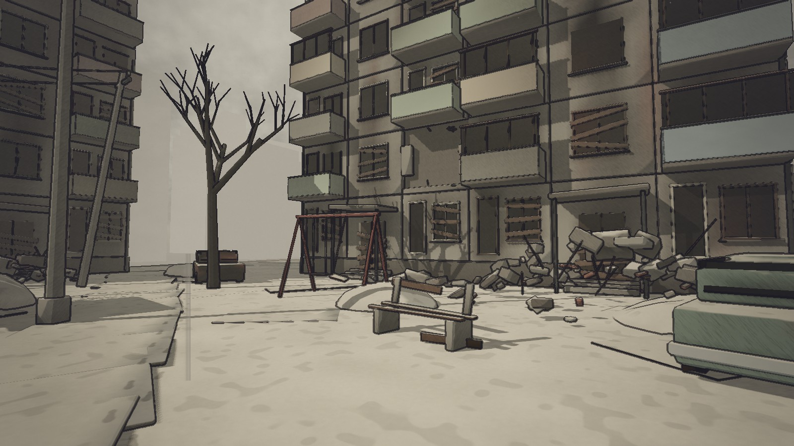
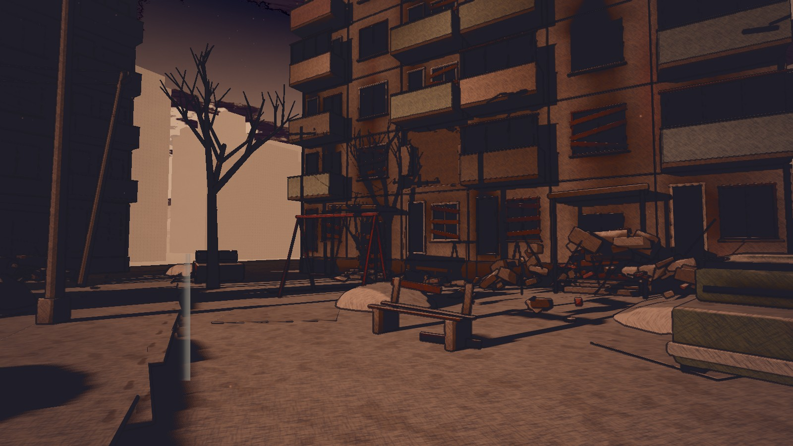
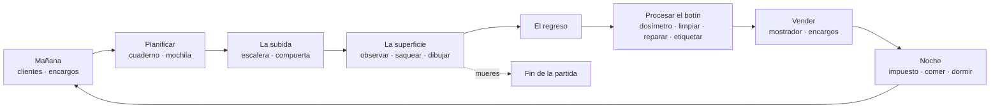
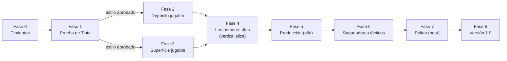

<div align="center">

# TUMANSK

*Título de trabajo · repositorio `Metro_S.T.A.L.K.E.R`*

**Supervivencia táctica en primera persona: sube a la superficie de una ciudad soviética arrasada, saquea lo que puedas y vuelve vivo a tu depósito.**

Gestión acogedora bajo tierra · Exploración de terror en la superficie · 3D con estilo de ilustración entintada

</div>

> Tu padre subió una última vez y no volvió.
> Lo único que heredaste es un depósito sucio en una estación de metro.
> Arriba está todo lo que necesitas para sobrevivir. Y todo lo que puede matarte.

---

## Índice

0. [Estado del proyecto](#0-estado-del-proyecto)
1. [El concepto](#1-el-concepto)
2. [Pilares de diseño](#2-pilares-de-diseño)
3. [Dos mitades claramente divididas](#3-dos-mitades-claramente-divididas)
4. [El bucle de juego: un día](#4-el-bucle-de-juego-un-día)
5. [El Depósito: gestión](#5-el-depósito-gestión)
6. [La Superficie: táctica y terror](#6-la-superficie-táctica-y-terror)
7. [Las amenazas](#7-las-amenazas)
8. [Mundo y narrativa](#8-mundo-y-narrativa)
9. [Dirección de arte: ilustración entintada](#9-dirección-de-arte-ilustración-entintada)
10. [Interfaz: sin cajas de texto](#10-interfaz-sin-cajas-de-texto)
11. [Audio](#11-audio)
12. [Cooperativo](#12-cooperativo)
13. [Arquitectura técnica (Godot 4)](#13-arquitectura-técnica-godot-4)
14. [Plan por fases](#14-plan-por-fases)
15. [Hoja de Desarrollo](#15-hoja-de-desarrollo)
16. [Riesgos y mitigaciones](#16-riesgos-y-mitigaciones)
17. [Preguntas abiertas](#17-preguntas-abiertas)
18. [Propiedad intelectual](#18-propiedad-intelectual)
19. [Glosario](#19-glosario)

---

## 0. Estado del proyecto

| | |
|---|---|
| **Fase actual** | Fase 0 terminada · Fase 1 (*Prueba de Tinta*) en curso |
| **Motor** | Godot 4.7.2 |
| **Plataforma** | PC (Windows; la build de Linux sale casi gratis) |
| **Idioma** | Solo español |
| **Calidad objetivo** | Lista para publicarse, aunque por ahora no se publique |
| **Equipo de referencia** | Ryzen 7 8700G con su gráfica integrada (Radeon 780M) |
| **Siguiente hito** | H1 · *Prueba de Tinta* (Fase 1) |

**Para abrirlo**: instala Godot 4.7.2, importa `project.godot` y pulsa F5. Se abre el visor del estilo: ← → cambian de diorama, C de cámara y ↑ ↓ suben o bajan el miedo. Todo lo demás (herramientas, órdenes, pipelines) está en [docs/DESARROLLO.md](docs/DESARROLLO.md).

### Así se ve ahora (Prueba de Tinta, primera pasada)

| | |
|---|---|
|  |  |
|  |  |

Todo lo que se ve (estanterías, cajas, persiana, bloques de paneles, árboles, coche) está generado por código. La guía de estilo con los valores actuales está en [docs/ESTILO.md](docs/ESTILO.md).

### Decisiones tomadas

| Tema | Decisión |
|---|---|
| Título | **Tumansk** (título de trabajo) |
| Premisa | Subes a la superficie a **saquear**. Lo que encuentras lo limpias, lo reparas, lo guardas y lo vendes en tu **depósito**, dentro de una estación de metro |
| Objetivo final | **Llegar a la zona más lejana y saber qué le pasó a tu padre.** Es muy difícil: exige el mejor equipo (máscaras, muchos filtros), conocer bien los caminos y llegar al final de la partida |
| Clima | **Invierno largo, con nieve.** Las huellas son información: tú ves las de los demás y ellos ven las tuyas |
| Mundo | Posapocalipsis tras una **guerra atómica**, en **Tumansk**, una gran ciudad soviética inspirada en Moscú. Sin año |
| Historia | Mínima. No se nombra la estación ni hay facciones |
| Protagonista | Hijo o hija de un stalker, de los que suben a buscar lo que queda. Demasiado joven para el oficio. Se llama como tú, y eliges si es chico o chica al firmar la escritura |
| Tu padre | En la superficie hay pocos rastros suyos, y ambiguos. La respuesta está al final |
| Estación | Siempre segura. Solo se recorre un trozo pequeño: el depósito, el pasillo de delante y la salida |
| Moneda | **Rublos** |
| Supervivencia | **Impuesto diario** suave por el local y **comer** cada día. El agua la da la estación |
| Muerte | **Permanente.** Si mueres, pierdes la partida. En cooperativo, quien muere queda fuera y la partida sigue mientras quede alguien vivo |
| Mapas | **No existen.** Los dibujas tú en tu cuaderno |
| Rutas | **Siempre hay varias** para llegar a un mismo sitio |
| Defensa | **Herramientas, no armas.** No se puede matar |
| Enemigos | **Pocos y de gran calidad.** Los humanos son muy inteligentes, pero nunca saben nada que no hayan percibido. Los saqueadores matan |
| Cooperativo | **Arquitectura preparada desde el primer día**, de 2 a 4 jugadores |
| Motor | **Godot 4.7.2** con GDScript tipado |
| Estilo visual | **Ilustración entintada** |
| Producción 3D | **Modelos generados por código**: Blender 5 como módulo de Python, más generación dentro del motor |

### Próximos pasos

1. **Fase 1**: la *Prueba de Tinta*, con las primeras capturas del estilo final para que las apruebes.
2. Responder las [preguntas abiertas](#17-preguntas-abiertas) que quedan.

---

## 1. El concepto

### Premisa

Después de la guerra, la gente de Tumansk se refugió en el metro. Arriba quedó una ciudad de avenidas anchas, bloques de hormigón y nieve sucia, donde el aire y la radiación matan despacio y lo que vive entre las ruinas mata rápido.

Algunos suben de todos modos. En la estación los llaman **stalkers**: buscan lo que queda (medicinas, comida, herramientas, piezas) y lo venden abajo. Tu padre era uno de ellos. Cuando enfermó tuvo que dejarlo, pero un día subió una última vez y no volvió. No sabes nada de él.

Lo único que heredas es un **depósito** en la estación: un local que él compró y nunca llegó a usar. Está sucio, lleno de telarañas y de cajas desordenadas. Eres demasiado joven para el oficio. Pero el impuesto hay que pagarlo, y hay que comer.

### En una frase

*Un depósito que levantar bajo tierra y una ciudad muerta que saquear arriba: planifica cada salida, dibuja tus propios mapas y vuelve vivo.*

### Qué hace el jugador

- **En el Depósito**: limpia y restaura el local; procesa el botín (mide la radiación, descontamina, repara, pesa, etiqueta y ordena); atiende el mostrador; acepta encargos; paga el impuesto y come.
- **En la Superficie**: observa, planifica, se mueve sin ser visto, saquea, dibuja su mapa y vuelve antes de que se acaben la luz, el aire o la suerte.

---

## 2. Pilares de diseño

1. **Dos mundos, un mismo trazo.** El depósito es el hogar: luz ámbar, líneas limpias, colores cálidos. La superficie es hostil: frío, ceniza, líneas que tiemblan.
2. **Tajante.** La muerte es definitiva. Cada salida a una zona nueva exige un plan; ir de frente se paga con la partida.
3. **Tu mapa lo dibujas tú.** No hay mapas, ni minimapa, ni marcadores. Lo que sabes de la ciudad está en tu cuaderno, dibujado por ti.
4. **Siempre hay otra ruta.** A cada objetivo se llega de varias formas: por la calle, por dentro de los edificios, por los tejados o por debajo.
5. **Eres frágil.** No hay armas y no se mata. Hay información, preparación, sigilo y huida.
6. **Enemigos justos.** Pocos, de gran calidad, y nunca hacen trampa: solo saben lo que ven, oyen o huelen.
7. **Pequeño pero impecable.** Poco espacio, muy bien hecho. Calidad antes que cantidad, en todo.
8. **Sin cajas de texto.** Toda la interfaz es un objeto del mundo.

---

## 3. Dos mitades claramente divididas

| | **El Depósito** (gestión) | **La Superficie** (exploración) |
|---|---|---|
| Emoción | Calma, rutina, satisfacción, hogar | Miedo, incertidumbre, vulnerabilidad |
| Ritmo | Sin prisa durante el día de trabajo | Tensión constante: la luz del día y los filtros se acaban |
| Luz | Lámparas de taller, bombillas desnudas, calor | Cielo gris, nieve, tu linterna, oscuridad |
| Trazo | Contorno firme, temblor casi imperceptible | Contorno nervioso, tramado denso |
| Color | Cálido y saturado | Frío y desaturado: ceniza, óxido, hormigón |
| Sonido | La radio, el murmullo de la estación, herramientas | Viento, nieve que cruje, el dosímetro, tu respiración dentro de la máscara |
| Interfaz | Objetos sobre la mesa: cuaderno, libro de cuentas, tablón | Casi nada: tus manos, tu reloj, tu dosímetro, tu cuaderno |
| Verbos | Limpiar, reparar, etiquetar, ordenar, vender | Observar, dibujar, escuchar, esconderse, trepar, abrir, huir |

**La frontera es física**: la **escalera mecánica parada** y la **compuerta hermética** de la estación. Mientras subes, la imagen cambia poco a poco: el color se enfría, el trazo empieza a temblar y la radio del depósito se apaga a tu espalda. Bajar de vuelta es el momento de alivio.

---

## 4. El bucle de juego: un día



1. **Mañana.** Subes la persiana metálica del depósito. Los clientes compran, te venden cosas y dejan **encargos**.
2. **Planificar.** Sobre la mesa repasas tus mapas, eliges objetivo, ruta y una alternativa, y preparas la mochila. Cada hueco que ocupa una herramienta es un hueco menos para el botín.
3. **La subida.** Escalera mecánica, compuerta. El mundo cambia.
4. **La superficie.** Observas, te mueves, saqueas, dibujas lo que descubres y evitas lo que no puedes vencer. Mientras tanto, se acaban la luz del día y los filtros.
5. **El regreso.** Si vuelves.
6. **Procesar el botín.** Dosímetro, descontaminación, reparación, peso, etiqueta, estantería.
7. **Vender.** Cumples encargos, vendes y cobras.
8. **Noche.** Pagas el impuesto, comes y duermes. Al dormir se guarda la partida.

### Duración de las salidas

| Etapa | Duración típica |
|---|---|
| Primeras salidas | 10–20 minutos |
| Salidas planificadas | 30–60 minutos |
| Zonas avanzadas | Unos 60 minutos |

### Encargos y peligro

Cuanto más peligroso es un encargo, más paga y más difícil es volver. *(Valores iniciales; se equilibran en la Fase 7.)*

| Peligro | Ejemplo | Paga relativa |
|---|---|---|
| ● | Latas de conserva de los quioscos de la plaza | ×1 |
| ●● | Una radio de un piso de Los Bloques | ×2 |
| ●●● | Antibióticos de la farmacia de un bloque con Inquilino | ×3,5 |
| ●●●● | Piezas de los grandes almacenes de la avenida, territorio de saqueadores | ×6 |
| ●●●●● | Insulina del hospital | ×10 |

---

## 5. El Depósito: gestión

### 5.1 El espacio

Pequeño a propósito: pocos metros cuadrados, cuidados al milímetro.

| Rincón | Qué hay |
|---|---|
| Mostrador | La persiana metálica que se sube cada mañana, el mostrador, la vitrina, la caja de los rublos |
| Almacén | Estanterías, cajas, ganchos y redes. El espacio es limitado: ordenarlo bien es parte del juego |
| Banco de trabajo | Reparaciones, piezas, herramientas |
| Descontaminación | Pila, cepillos, bolsas, el dosímetro |
| Para dormir | Un catre, una estufa, tus cosas |
| Mesa de planificación | Tu cuaderno y el tablero de la pared, con tus páginas y el hilo de las rutas |

**La estación**, de la que solo se recorre un trozo: el pasillo frente al depósito, el puesto de comida de al lado, el tablón de avisos, la escalera mecánica y la compuerta. El resto (gente, humo, luces) se ve y se oye, pero no se recorre.

### 5.2 El primer día: limpiar

Funciona como tutorial y, como en Cat Mail Co., tiene que dar gusto:

- Quitar telarañas, barrer, fregar, sacar la basura.
- Vaciar las cajas desordenadas del antiguo dueño. Entre los trastos aparecen tus primeras herramientas y algo de mercancía.
- Cambiar una bombilla, desatascar la persiana con una palanca, encender la estufa.
- Al acabar, el depósito ha pasado del abandono a ser un negocio. Ver el antes y el después es parte de la recompensa.

### 5.3 Procesar el botín

Lo que en Cat Mail Co. es pesar, sellar y etiquetar paquetes, aquí es preparar lo que traes de arriba:

1. **Vaciar la mochila** sobre la mesa.
2. **Inspeccionar**: girar el objeto, leer sus etiquetas, ver en qué estado está.
3. **Medir la radiación** con el dosímetro. Lo contaminado se **descontamina** (lavar, cepillar, embolsar) o se aparta: vale menos y es peligroso tenerlo cerca.
4. **Reparar** en el banco, con minijuegos táctiles: atornillar, limpiar contactos, coser, cambiar piezas aprovechando las de otros objetos rotos.
5. **Pesar**: la chatarra y los metales se venden al peso.
6. **Etiquetar**: escribes el precio a mano en una etiqueta de cartón y la atas con cordel. Las cajas llevan el icono de su categoría.
7. **Ordenar** en las estanterías: medicinas, comida, herramientas, electrónica, ropa, chatarra.

### 5.4 El mostrador y los clientes

- Pocos clientes, todos de la estación, que vuelven una y otra vez: compran, te venden, regatean y dejan encargos.
- Hablan poco y con la voz amortiguada; lo que dicen aparece en notas y papelitos escritos a mano.
- Algunos ejemplos: un relojero que busca piezas, una madre que necesita antibióticos para su hijo, un anciano que te pide la foto que dejó en su antiguo piso.

### 5.5 Encargos

- Se cuelgan como fichas en un tablón de corcho: qué quieren, cuánto pagan, el plazo y **pistas, no mapas**. Por ejemplo: "Bloque 7, cuarto piso, la puerta con un gato pintado". Encontrarlo es cosa tuya.
- Cuanto más peligrosa es la zona, mejor pagan.

### 5.6 Economía

- **Rublos.**
- **Impuesto diario** a la estación por el local. Es suave, pero si la deuda se acumula, la estación precinta el depósito (no puedes vender) hasta que pagues.
- **Comida**: hay que comer cada día, lo que compres en el puesto de al lado o lo que encuentres arriba. Sin comer te debilitas: menos aliento y más temblor. Varios días sin comer, y mueres.
- **Precios**: dependen del estado del objeto, de su contaminación y de la demanda. Los encargos pagan más que la venta suelta.

### 5.7 Mejoras

- Más estanterías, ganchos y redes: más capacidad en el mismo local.
- Herramientas para el banco, que permiten más reparaciones.
- Una pila de descontaminación mejor, la estufa, la radio, mejor luz, una vitrina en el mostrador.
- Equipo: una mochila más grande (se cose en el banco), ropa de abrigo, una máscara mejor.
- Personalización: carteles, una planta bajo la lámpara, objetos que traes de arriba. El depósito es tu sitio.

---

## 6. La Superficie: táctica y terror

### 6.1 Principios

- **Planificar o morir.** Antes de entrar en una zona nueva hay que observarla desde lejos y desde arriba.
- **Incertidumbre.** Sin minimapa, sin marcadores, sin barras de vida. La información llega por la vista, el oído y tu cuaderno.
- **Mostrar poco.** Las amenazas se intuyen antes de verse: huellas, ruidos, restos.
- **Tensión y alivio.** Hay pocos sitios donde respirar y dibujar: un piso que cierras con llave, una azotea sin accesos.
- **La ciudad cambia entre salidas.** El mapa base es fijo, pero lo que hay en él no: clima, hora, patrullas, la jauría que se desplaza, campamentos nuevos.

### 6.2 Tu mapa lo dibujas tú

- **No hay mapas en el juego.** Ni encontrados, ni comprados, ni en pantalla.
- **El cuaderno** tiene páginas cuadriculadas. Dibujas con lápiz, goma, regla y lápices de colores, y puedes añadir pequeños símbolos (peligro, entrada, botín, radiación, refugio, "visto a las 14:20") y notas escritas.
- **Instrumentos que ayudan**: la **brújula** (para orientar el mapa), el **podómetro** (para medir distancias en pasos), el **reloj** (para anotar los horarios de las patrullas) y los **prismáticos** (para observar desde las alturas).
- **Dónde se dibuja**: en el depósito, con calma; en la superficie, solo en un sitio seguro, porque abrir el cuaderno lleva tiempo y hace falta luz. El miedo hace temblar el trazo.
- **Planificar**: en el depósito pegas páginas en el tablero de la pared y marcas las rutas con hilo. Siempre una ruta principal y otra de escape.
- **Si mueres, el cuaderno se pierde contigo.** Lo que aprendiste solo queda en tu cabeza.

### 6.3 Siempre hay otra ruta

Reglas de diseño de niveles:

- Cada objetivo tiene al menos tres accesos: por la calle, por el interior de los edificios, por los tejados o por el subsuelo.
- Cada ruta tiene su perfil: rápida y expuesta, lenta y segura, ruidosa, o que exige una herramienta (cuerda, tablón, cizalla, ganzúas).
- Hay puntos altos desde los que observar antes de entrar.
- Hay pocos pasos obligados, y son peligrosos: los saqueadores también los conocen.
- Puedes crear tus propios atajos (una cuerda que dejas colgada, un tablón entre azoteas, una puerta forzada)… y otros también pueden usarlos.

### 6.4 Sigilo: qué te delata

| Factor | Ejemplos |
|---|---|
| Ruido | Correr, nieve que cruje, cristales, escaleras metálicas, agua, lo que llevas suelto en la mochila |
| Luz | Tu linterna se ve desde muy lejos |
| Silueta | En un tejado, recortado contra el cielo, se te ve desde toda la avenida |
| Rastro | Huellas en la nieve, tu olor si el viento sopla hacia ellos, sangre |
| Clima | El viento y la lluvia tapan ruidos; la nieve que cae borra huellas; la ventisca esconde a todos |

### 6.5 La mochila

- Es una **cuadrícula** (6×5 al empezar, ampliable) donde encajan herramientas y botín según su forma.
- El **cinturón** tiene 3 huecos de acceso rápido. Para todo lo demás hay que arrodillarse y abrir la mochila, que es lento y te deja expuesto.
- **Peso**: cuanta más carga, más lento vas, más ruido haces y antes te quedas sin aliento. Lo frágil (cristal, electrónica) se rompe si corres o te caes.
- Lo que va mal guardado suena: latas, herramientas sueltas. Empaquetar bien también es sigilo.

### 6.6 Herramientas

No hay armas. No hay magia. Hay oficio.

| Categoría | Herramienta | Para qué sirve | Coste o riesgo |
|---|---|---|---|
| Información | **Cuaderno y lápices** | Tus mapas, tus notas, tus planes | Hacen falta luz y un sitio seguro |
| | **Brújula** | Orientar el mapa, y orientarte tú | — |
| | **Podómetro** | Contar pasos para dibujar a escala | — |
| | **Reloj de pulsera** | La hora, la luz que queda, los horarios de las patrullas | — |
| | **Prismáticos** | Observar desde lejos y desde las alturas | El reflejo del cristal puede delatarte |
| | **Estetoscopio** | Escuchar a través de paredes y puertas | Te obliga a quedarte quieto |
| | **Dosímetro** | Medir la radiación del entorno y de los objetos | Sus chasquidos se oyen |
| | **Tiza** | Marcar rutas y peligros en las paredes | Los saqueadores también ven tus marcas |
| Luz | **Linterna de pilas** | Luz silenciosa | Pilas escasas; se ve desde muy lejos |
| | **Linterna de dinamo** | Luz que nunca se agota | Darle a la manivela hace ruido |
| | **Velas y cerillas** | Luz fija para dibujar o trabajar | Se consumen y delatan |
| Acceso | **Ganzúas** | Abrir cerraduras en silencio (minijuego táctil) | Se rompen; el miedo hace temblar las manos |
| | **Palanca** | Forzar puertas y cajas. No es un arma: no se puede golpear con ella | Mucho ruido |
| | **Cizalla** | Cortar cadenas y alambradas | Pesa |
| | **Cuerda** | Bajar por huecos y fachadas, atar puertas | Se puede dejar puesta como atajo |
| | **Tablón** | Puentes entre azoteas y sobre suelos hundidos | Voluminoso |
| | **Martillo y clavos** | Condenar trampillas y puertas, reparar escalones | Ruido |
| | **Navaja** | Cortar hilos trampa, cuerdas y telas. No sirve para atacar | — |
| Sigilo | **Lanzables** (latas, botellas, piedras) | Distraer con ruido | — |
| | **Despertador de cuerda** | Lo dejas, te alejas… y suena donde tú ya no estás | Ocupa sitio |
| | **Campanillas con hilo** | Alarma: sabrás si algo pasa por tu ruta de escape | — |
| | **Espejo de bolsillo** | Mirar tras las esquinas y bajo las puertas | — |
| | **Cebo** (carne) | Distraer a la Jauría | Es tu comida |
| Supervivencia | **Máscara y filtros** | Respirar donde el aire está contaminado | Ves y oyes menos; los filtros se acaban |
| | **Vendas y botiquín** | Cortes, mordeduras, sangrado | — |
| | **Pastillas antirradiación** | Reducir la dosis acumulada | Escasas y caras |
| | **Ropa de abrigo** | Aguantar el frío | Abulta |
| Carga | **Bolsas y cajas acolchadas** | Aislar lo contaminado y proteger lo frágil | Ocupan sitio |

**Se progresa con equipo y conocimiento, no con estadísticas.** No subes de nivel: mejoras porque tienes mejores herramientas, conoces mejor la ciudad y entiendes mejor lo que vive en ella.

### 6.7 Peligros del entorno

- **Radiación**: zonas calientes y objetos contaminados. El dosímetro cruje. La dosis se acumula y trae náuseas, debilidad y, al final, la muerte. Se combate con pastillas y con tiempo.
- **Aire**: en algunas zonas hace falta la máscara. Los filtros duran poco, y con la máscara puesta ves menos, oyes menos y tu respiración se oye.
- **Frío**: un invierno largo te quita aliento y te hace temblar.
- **La noche**: más oscura, más fría y con más movimiento. Volver de noche casi nunca es buena idea.
- **Estructuras**: suelos podridos, escaleras rotas, techos que ceden.

### 6.8 Tu cuerpo es la interfaz

- **Miedo**: no hay barra. Se nota en las manos, que tiemblan (la linterna, la ganzúa, el lápiz); en la respiración, que se oye; en el sonido, que se apaga; y en el propio dibujo, porque el trazo tiembla y el tramado invade los bordes de la imagen.
- **Heridas**: cortes, mordeduras y torceduras, que se tratan con vendas y botiquín. La sangre deja rastro.
- **Hambre**: el estómago suena y las manos tiemblan.
- **Radiación**: los chasquidos del dosímetro y, si te pasas, las náuseas.
- **Aire**: la máscara se empaña y se agrieta, y la respiración se ahoga cuando el filtro se agota.

### 6.9 La muerte

- Hay **un solo guardado**, que se hace al dormir. Si sales del juego en mitad de una salida, la partida se guarda en ese punto y no se puede volver atrás.
- **Si mueres, la partida se borra.**
- La última imagen es el depósito cerrado, con un cartel escrito a mano por alguien de la estación.

### 6.10 Las zonas de Tumansk

Las zonas se hacen **a mano**, sin generación procedural, con mucha densidad y varias rutas. Están ordenadas por distancia a la estación: cuanto más lejos, más peligro y más valor.

| # | Zona | Salida típica | Qué hay | Amenazas | Botín |
|---|---|---|---|---|---|
| 0 | **La Estación** | — | Tu depósito, el pasillo, la escalera, la compuerta | Ninguna: es segura | — |
| 1 | **La Plaza** | 10–20 min | La salida del metro, quioscos, un paso subterráneo, el primer patio | La Jauría (a veces), radiación leve | Latas, ropa, chatarra |
| 2 | **Los Bloques** | 20–40 min | Un microdistrito de bloques de paneles, una escuela, una farmacia de barrio | El Inquilino, la Jauría | Medicinas básicas, herramientas, objetos personales |
| 3 | **La Avenida y el Mercado** | 30–60 min | Avenida de ocho carriles, grandes almacenes, mercado cubierto, pasos subterráneos | Saqueadores, el Llamador, la Jauría | Ropa, comida, electrónica |
| 4 | **La Zona Industrial** | 45–60 min | Fábrica, playa de vías, almacenes | Un campamento de saqueadores, radiación alta | Herramientas, combustible, componentes |
| 5 | **El Hospital** | Unos 60 min | Un hospital de varias plantas | El Inquilino, el Llamador, saqueadores | Medicinas valiosas |
| 6 | **La Zona Cero** *(nombre provisional)* | La gran expedición | La zona más lejana, donde cayó la bomba: radiación extrema y aire irrespirable. Aquí está la respuesta sobre tu padre | Todas, más el entorno | El final del juego |
| — | **Los túneles** | Variable | Túneles hacia estaciones abandonadas: rutas alternativas para llegar a otras zonas | Oscuridad, agua, el Llamador | — |

### 6.11 La gran expedición

Llegar a la zona más lejana es el objetivo del juego y tiene que costar muchísimo. No se consigue en una salida improvisada, sino al final de la partida y tras mucha preparación:

- **Equipo**: la mejor máscara, muchos filtros, ropa de abrigo, pastillas antirradiación y todo lo que hayas ido consiguiendo.
- **Conocimiento**: tus mapas, las rutas que te sabes de memoria, los horarios de las patrullas y dónde viven las amenazas.
- **Escondites** *(propuesta)*: en salidas anteriores puedes dejar provisiones escondidas a lo largo del camino (filtros, comida, vendas) para recogerlas durante la gran expedición. Los saqueadores también pueden encontrarlas.

---

## 7. Las amenazas

Son pocas y de gran calidad. Cada una se trata como un pequeño proyecto propio: biología, sentidos, comportamiento, las señales que deja para que las anotes en tu cuaderno, y su propia animación y su propio sonido.

**Reglas:**

1. Ninguna sabe dónde estás si no te ha percibido.
2. Todas dejan señales antes de dejarse ver.
3. Ninguna se puede matar; todas se pueden entender.
4. También se enfrentan entre ellas, y eso se puede aprovechar.

### 7.1 La Jauría

- **Qué es.** Perros asilvestrados que la radiación ha deformado: más grandes de lo que deberían, con calvas y bultos. Cazan en manada, guiados por una hembra.
- **Dónde.** Avenidas, parques, descampados y patios grandes. De día y al atardecer.
- **Cómo perciben.** Sobre todo por el olfato, así que el viento decide. También por la vista (detectan el movimiento) y el oído.
- **Cómo cazan.** Te tantean desde lejos, te rodean y te cortan la huida. Si corres, te persiguen. Un rastro de sangre lo siguen sin descanso.
- **Señales.** Huellas y excrementos, huesos roídos, aullidos al atardecer, cuervos sobre un cadáver.
- **Cómo sobrevivir.** Avanzar con el viento de cara, no correr nunca delante de ellos, subir a un piso alto y cerrar la puerta, cruzar agua para cortar el rastro, sacrificar comida como cebo.
- **Por qué da miedo.** Nunca está sola. Cuando ves un perro, los demás ya te están rodeando.

### 7.2 El Inquilino

- **Qué es.** Algo alto y delgadísimo, de articulaciones largas y piel pálida, casi ciego. Ocupa un edificio entero y lo convierte en su territorio. En la estación se dice que "ese bloque tiene inquilino".
- **Dónde.** Grandes bloques de viviendas, y también otros edificios grandes, como el hospital.
- **Cómo percibe.** Por las vibraciones que viajan por la estructura (pisadas, golpes, objetos que caen) y por el oído.
- **Cómo caza.** Se mueve por las tripas del edificio: el hueco del ascensor, los bajantes de basura, los conductos y las cámaras entre muros. Sale cerca de donde te ha sentido y espera.
- **Señales.** Arañazos dentro de las paredes, trampillas del bajante arrancadas, despensas vaciadas, polvo removido en las escaleras, un silencio repentino.
- **Cómo sobrevivir.** Escuchar las paredes con el estetoscopio, pisar suave, condenar trampillas con martillo y clavos, provocar vibraciones en otra planta (dejar caer algo pesado, dejar un despertador), entrar y salir por la fachada y los balcones con una cuerda.
- **Por qué da miedo.** No está en la habitación: está en las paredes. Y oye cada paso que das en su edificio.

### 7.3 El Llamador

- **Qué es.** Del tamaño de un hombre, se mueve a cuatro patas, tiene la piel desnuda y gris y una garganta hinchada con la que imita sonidos que ha oído: alguien que pide ayuda, un bebé que llora, una tos, una radio mal sintonizada.
- **Dónde.** Pasos subterráneos, accesos al metro, sótanos y patios con eco. Sobre todo al anochecer.
- **Cómo percibe.** Por el oído, que tiene finísimo.
- **Cómo caza.** Atrae a sus presas hacia un sitio cerrado y espera a que entren. Aprende: imita también los sonidos de sus presas, incluidos los tuyos y las voces de los saqueadores.
- **Señales.** La llamada se repite idéntica, como una grabación. No hay huellas de personas, solo las suyas. Los restos se acumulan siempre en el mismo punto.
- **Cómo sobrevivir.** Reconocer la repetición, no acudir nunca, rodear su zona y lanzar algo para que se delate al moverse.
- **Por qué da miedo.** Lo que oyes no siempre es lo que parece. La próxima vez que alguien pida ayuda de verdad, dudarás.

### 7.4 Los Saqueadores

- **Qué son.** Personas armadas, organizadas y con tanto miedo como tú. No tienen bandera ni nombre: viven de lo que encuentran y de lo que les quitan a otros.
- **Dónde.** Rutas de paso, farmacias, almacenes y campamentos en edificios fortificados.
- **Qué saben.** Solo lo que ven, lo que oyen o lo que un compañero les dice en voz alta. Y tú también puedes oírlo.
- **Cómo actúan.**
  - Patrullan y ponen vigías con prismáticos.
  - Investigan ruidos y cosas fuera de sitio: una puerta abierta, una marca de tiza, huellas recientes.
  - Buscan en grupo y cubren las salidas.
  - Recuerdan dónde te vieron y qué ha cambiado.
  - En las fases avanzadas del desarrollo: tienden emboscadas en los pasos obligados, ponen cebos (una mochila a la vista), colocan trampas y aprenden tus rutas habituales.
- **Señales.** Latas colgadas como alarma, hilos trampa, humo de campamento, voces, colillas, huellas de botas.
- **Cómo sobrevivir.** Observar sus rutinas con los prismáticos y el reloj, escuchar lo que dicen, evitar sus trampas (la navaja corta los hilos), despistarlos con ruidos o con marcas de tiza falsas y tener siempre una vía de escape.
- **Si te pillan, te matan.** No hay rendición posible.
- **Por qué dan miedo.** Piensan como tú. Y tienen armas.

### 7.5 Cuando se cruzan

- La Jauría ataca a los saqueadores: llevarla hacia un campamento puede abrirte paso… o cerrártelo.
- El Llamador imita las voces de los saqueadores, y también los atrae a ellos.
- El Inquilino no sale de su edificio. Es una frontera que ni los saqueadores se atreven a cruzar.

### 7.6 Cómo se construye cada amenaza

1. **Ficha de diseño**: biología, sentidos, comportamiento y señales.
2. **Animación propia**: ciclos generados por código con movimiento "a saltos", como en el dibujo animado, más ajustes procedurales (pies que se apoyan en el suelo, cabeza que sigue el sonido).
3. **Sonido propio**: cada amenaza tiene una firma sonora reconocible.
4. **Tres escenarios de prueba** para cada una.
5. **Herramienta de depuración** que muestra lo que percibe y lo que sabe en cada momento.

---

## 8. Mundo y narrativa

- **Guerra atómica.** Sin año y sin explicaciones largas.
- **Tumansk**: una ciudad soviética ficticia inspirada en Moscú, con avenidas anchas, microdistritos de bloques de paneles y un metro monumental y frío. Todo el texto del juego está en español, carteles incluidos, pero el diseño es soviético.
- **Sin facciones** y **sin nombre de estación**.
- **Tu padre**: era stalker, enfermó, subió una última vez y no volvió. No sabes nada de él. En la superficie hay pocos rastros suyos, y ambiguos.
- **La historia se cuenta poco, y a través del entorno**: pisos abandonados, notas, fotos, objetos personales. No hay cinemáticas.
- **El objetivo de la partida**: llegar a la zona más lejana y saber qué le pasó a tu padre (ver [6.11](#611-la-gran-expedición)).

---

## 9. Dirección de arte: ilustración entintada

### 9.1 ¿Qué estilo usa Cat Mail Co.?

Pertenece al **3D estilizado** (*stylized* en inglés), una rama del **renderizado no fotorrealista** (NPR). En sus capturas se ve lo siguiente:

- Formas **robustas y algo exageradas**: estanterías gruesas, cajas con los bordes suavizados.
- **Colores planos con degradados suaves** y texturas sencillas, casi pintadas a mano, sin contornos marcados.
- **Ilustraciones 2D sobre objetos 3D**: sellos, etiquetas, pegatinas y mapas.
- **Luz cálida** de lámparas, con resplandor y sombras suaves.

### 9.2 Nuestro estilo

Partimos de esa base (formas robustas, calidez, ilustraciones sobre objetos) y le añadimos **tinta**, con un tono más adulto.

| Capa | Qué es | Cómo se hace en Godot 4 |
|---|---|---|
| Sombreado por bandas (*cel shading*) | 2 o 3 tonos por material, con rampas de color. Luz cálida, sombra fría | Shader `spatial` propio con función `light()` y una textura de rampa |
| Contorno de tinta | Líneas en siluetas y pliegues, de grosor variable y trazo irregular | Post-proceso a partir de profundidad y normales, en un rectángulo a pantalla completa ([D-008](docs/DECISIONES.md)), más casco invertido en personajes y objetos clave |
| Tramado | Sombras hechas con rayas, como un grabado. Más densas cuanto más oscuro y cuanto más miedo | Texturas de tramado (*tonal art maps*) mezcladas según la iluminación |
| Trazo vivo (*line boil*) | El contorno tiembla como en una animación dibujada a mano | Ruido animado a 4–12 fps, a saltos y no de forma continua |
| Papel y grano | Grano de papel sutil sobre toda la imagen y viñeta en los bordes; con mucha radiación, el grano se intensifica | Post-proceso final |
| Color por zona | Paletas limitadas y gradación propia de cada zona | Saturación, contraste y tinte por zona, interpolados en las transiciones ([D-011](docs/DECISIONES.md)) |
| Nieve y huellas | La nieve se acumula en lo que mira hacia arriba; las huellas quedan marcadas y la nieve que cae las borra | Shader según la orientación de la superficie, más decals de huellas, que también son datos para la IA |
| Niebla y ventisca | Niebla posterizada y nieve que cruza el aire | Niebla ligera, partículas y shader propio |
| Ilustraciones sobre objetos | Etiquetas, carteles, rótulos, envases | Nodos `Decal` y texturas generadas por código (SVG) |

### 9.3 Lenguaje de formas

- **Nada es perfectamente recto.** Las recetas de modelado añaden imperfección controlada: bordes un poco torcidos y grosores exagerados.
- **Biseles generosos** y normales suavizadas, para que el sombreado por bandas quede limpio.
- **Siluetas legibles**: cada objeto se reconoce por su sombra.
- **Arquitectura soviética**: bloques de paneles prefabricados, brutalismo y una estación de metro con mármol, columnas y lámparas de araña (de diseño propio). Es modular por naturaleza, ideal para generarla por código.
- **Personas**: proporciones robustas, ropa por capas (abrigos, bufandas, gorros de piel) y rostros 2D sobre modelos 3D, para que las expresiones sean claras y fáciles de animar.
- **Criaturas**: siluetas muy reconocibles, negros masivos y detalles que se descubren poco a poco.

### 9.4 Escenarios: reglas de construcción

- **Cada espacio tiene una historia visible**: quién vivía ahí y qué pasó.
- **Hitos para orientarse**, imprescindibles para dibujar tus mapas: una torre de radio, un tranvía volcado, la cúpula del mercado, las chimeneas de la fábrica.
- **Detalle de ilustración**: muchos objetos pequeños con carácter (tendederos, buzones, carteles, macetas secas) en lugar de texturas complejas.
- **Composición por planos**, como una ilustración: primer plano oscuro, plano medio iluminado y fondo perdido en la niebla.
- **La luz guía**: la luz cálida atrae; la luz fría, o la ausencia de luz, avisa de peligro.
- **Verticalidad**: azoteas, escaleras y sótanos que abren rutas distintas.
- **Un depósito que crece**: del abandono a la vida, mejora a mejora.

### 9.5 Paletas

**Depósito: "Ámbar y madera"**

| Uso | Color | Hex |
|---|---|---|
| Papel y cartón | Crema | `#F2E6CF` |
| Tinta | Negro violáceo | `#1B1A22` |
| Bombilla | Ámbar | `#E8A33D` |
| Cajas | Terracota | `#C2603F` |
| Madera | Nogal | `#8A5A3B` |
| Azulejo de la estación | Verde azulado | `#2F6F73` |
| Lo importante | Rojo | `#C8323C` |
| Señalética | Cobalto | `#2D4A8A` |

**Superficie: "Ceniza y óxido"**

| Uso | Color | Hex |
|---|---|---|
| Nieve sucia | Blanco hueso | `#D9D6CC` |
| Ceniza | Gris | `#9A9A94` |
| Hormigón | Gris cálido | `#7D7F7A` |
| Óxido | Marrón rojizo | `#8E4A2F` |
| Cielo | Gris azulado | `#A7B1B4` |
| Sombra | Azul pizarra | `#2A3440` |
| Vegetación muerta | Oliva apagado | `#6B6A4A` |
| Señales de peligro | Amarillo | `#D9A623` |

Regla: **el rojo** se reserva para lo importante (peligro, confirmaciones, lo urgente).

### 9.6 Parámetros por estado (punto de partida para la Fase 1)

| Parámetro | Depósito | Superficie | Pánico |
|---|---|---|---|
| Trazo vivo | 4 fps, muy sutil | 8 fps | 12 fps, amplio |
| Grosor del contorno (a 1080p) | 1,5–2 px | 2–3 px | 3–5 px, roto |
| Tramado | Solo en sombras profundas | En sombras medias | Invade la imagen desde los bordes |
| Saturación | 100 % | 55 % | 30 % |
| Grano | Sutil | Visible | Intenso |

### 9.7 Referencias (inspiración, no copia)

- **Cat Mail Co.**: calidez, tactilidad, ilustraciones sobre objetos, mobiliario robusto.
- **Andréi Tarkovski, *Stalker* (1979)**: la quietud, el silencio y la amenaza que no se ve.
- **Fotografía de Prípiat y de los microdistritos soviéticos**: interiores abandonados, escala, materiales.
- **Estaciones del metro de Moscú**: mármol, columnas, lámparas de araña, mosaicos.
- **Carteles y diseño gráfico soviético**: señalética, tipografía, composición de la interfaz.
- **Grabado y xilografía**: sombras hechas de líneas.
- **Mike Mignola**: negros masivos y siluetas para el terror.

---

## 10. Interfaz: sin cajas de texto

### 10.1 Reglas

1. **Todo es un objeto.** Si algo hay que mostrarlo, es papel, cartón, un instrumento o una parte de tu cuerpo.
2. **Nunca un rectángulo con texto encima.** El texto vive en papeles con textura, escrito a mano o a máquina.
3. **Iconos dibujados**, con el mismo grosor de trazo que el mundo 3D.
4. **Animación con peso**: los papeles se deslizan y se asientan, las hojas pasan, los sellos golpean.
5. **El tiempo no se detiene**: abrir el cuaderno o la mochila en la superficie lleva su tiempo. Solo el menú de opciones pausa el juego, y únicamente en partidas de un jugador.
6. **Accesible sin romper la estética**: tamaño de texto ajustable, texto "limpio" para dislexia, subtítulos en tiras de papel, trazo vivo reducible y colores siempre acompañados de forma.

### 10.2 Qué es cada cosa

| Función | Objeto |
|---|---|
| Menú principal | El depósito de noche, con la lámpara encendida y tu cuaderno sobre la mesa. Apagar la lámpara es salir del juego |
| Nueva partida | Firmar con tu nombre la escritura del depósito |
| Guardar | Automático al dormir |
| Opciones | La radio del depósito: diales para el volumen, el brillo y la sensibilidad |
| Mapas, notas y planes | Tu cuaderno. No hay otro mapa |
| Planificar | El tablero de la pared: páginas, chinchetas e hilo |
| Encargos | Fichas en el tablón de corcho |
| Cuentas e impuesto | El libro de cuentas y los recibos con el sello **PAGADO** |
| Precios | Etiquetas de cartón atadas con cordel |
| Inventario | La mochila abierta, en 3D |
| Hora | El reloj de pulsera |
| Radiación | El dosímetro: la aguja y los chasquidos |
| Aire | La máscara: se empaña, se agrieta, la respiración cambia |
| Salud, miedo y hambre | Tus manos, tu respiración, tu estómago |
| Avisos de la estación | Una nota que alguien desliza bajo la persiana |
| Interactuar | Un punto de lápiz que se convierte en un pequeño icono dibujado (mano, lupa, ganzúa) |
| Fin de la partida | El depósito cerrado, con un cartel escrito a mano |

### 10.3 Tipografía

Candidatas con licencia libre (OFL); se validan en la Fase 1.

- **Manuscrita** (notas, etiquetas, tu cuaderno): una familia del tipo *Caveat* o *Kalam*, con una letra distinta para cada cliente.
- **Máquina de escribir** (documentos oficiales, recibos): del tipo *Courier Prime*.
- **Rotulación** (carteles de la ciudad y de la estación): condensada y geométrica, de estilo soviético, del tipo *Oswald*, pero siempre en español.

---

## 11. Audio

- **Depósito**: la radio, el murmullo de la estación, la estufa, herramientas, papel, cartón, cordel.
- **Superficie**: viento, nieve que cruje, estructuras que gimen, el dosímetro, tu respiración dentro de la máscara, perros a lo lejos. **El silencio también es una herramienta.**
- **Amenazas**: cada una tiene su firma sonora. El Llamador, en concreto, es puro diseño de sonido.
- **Técnica**: sonido 3D con oclusión, reverberación según el tipo de espacio y propagación del sonido por la ciudad. Lo que tú oyes, ellos también lo oyen: el mismo sistema alimenta a la IA. La mezcla cambia según el miedo.
- **Música y fuentes**: está por decidir. El criterio es lo que dé más calidad y encaje mejor con el juego: un compositor por encargo, librerías profesionales libres de derechos, foley grabado por nosotros, o una combinación.

---

## 12. Cooperativo

- **De 2 a 4 jugadores.** Comparten un único depósito (dinero, estanterías y encargos); cada uno tiene su mochila y su cuaderno.
- **Compartir mapas**: se pueden copiar páginas del cuaderno de otro (lleva su tiempo) o pegarlas en el tablero de la pared.
- **Más gente significa más ruido y más huellas**, así que la dificultad sube sola.
- **Muerte**: quien muere queda fuera. La partida sigue mientras quede alguien vivo; si mueren todos, se pierde.
- **Voz**: por decidir. La voz por proximidad sería ideal para el terror, pero requiere trabajo extra.
- **Técnica**: el juego funciona siempre con un anfitrión. En una partida de un jugador, el anfitrión simplemente no tiene invitados, así que todo se construye en red desde el primer día y nada hay que rehacer después. Conexión directa por IP o red local; para jugar por internet sin abrir puertos se valorará un servicio de relé.

---

## 13. Arquitectura técnica (Godot 4)

### 13.1 Decisiones técnicas

- **Godot 4** con el renderer **Forward+** (Vulkan). La versión exacta se fija en la Fase 0 y no se cambia sin motivo.
- **GDScript con tipado estático** obligatorio. C++ (GDExtension) solo si algún sistema lo necesita por rendimiento.
- **Red desde el primer día**: la API multijugador de Godot sobre ENet. El anfitrión tiene la autoridad sobre el mundo (IA, objetos, puertas, inventarios) y cada jugador controla su propio movimiento, para que no haya retraso.
- **Todo lo que existe en el mundo tiene un identificador**, se puede guardar y se puede replicar.
- **Los datos son recursos** (`Resource` guardados como `.tres`): objetos, encargos, clientes, herramientas y amenazas. Se crean y se editan como texto.
- **Muerte permanente**: un solo archivo de partida, que se borra al morir.

### 13.2 Estructura del repositorio

```text
/
├── project.godot
├── addons/                  # plugins (tests, utilidades)
├── assets/
│   ├── models/              # .glb generados (no se editan a mano)
│   ├── textures/            # rampas, tramados, papel, ruido
│   ├── shaders/             # toon, contorno, tramado, nieve, niebla, papel
│   ├── materials/
│   ├── ui/                  # SVG y PNG generados
│   ├── fonts/
│   └── audio/               # music/, ambience/, sfx/, ui/
├── data/                    # recursos .tres: el contenido del juego
├── scenes/                  # depot/, station/, surface/, ui/, actors/, props/, debug/
├── scripts/
│   ├── core/                # autoloads y utilidades
│   ├── net/                 # sesión, anfitrión, replicación
│   ├── depot/               # objetos, banco, descontaminación, tienda, economía
│   ├── surface/             # jugador, herramientas, cuaderno, sigilo, supervivencia
│   ├── ai/                  # percepción, conocimiento, criaturas, humanos
│   └── ui/
├── tools/
│   ├── blender/             # recetas de modelos (bpy) → .glb
│   ├── svg/                 # generadores de ilustración 2D (rough.js)
│   ├── textures/            # generadores de texturas (numpy, Pillow)
│   └── capture/             # capturas automáticas para revisión
├── tests/
└── docs/                    # GDD vivo, guía de estilo, registro de decisiones
```

### 13.3 Sistemas principales

| Sistema | Responsabilidad |
|---|---|
| `EventBus` | Señales globales |
| `GameState` | Día, rublos, deuda, encargos, banderas |
| `SaveSystem` | Guardado único con muerte permanente, incluido el estado del mundo (atajos, puertas, marcas de tiza, huellas recientes) |
| `NetSession` | Anfitrión e invitados, replicación, autoridad |
| `SceneRouter` | Cambios de escena con transición dibujada |
| `StyleDirector` | Parámetros del estilo en tiempo real (trazo, tramado, paleta, grano) según la zona, el miedo y la radiación |
| `AudioDirector` | Ambiente, música, mezcla dinámica, oclusión y propagación |
| `TimeAndWeather` | Hora del día, luz, nieve, viento, ventisca |
| `Interaction` | Raycast, componentes `Interactable`, coger e inspeccionar objetos físicos |
| `ItemSystem` | Objetos: categoría, peso, forma en la cuadrícula, estado, contaminación, valor |
| `Shop` | Mostrador, clientes, precios, encargos, impuesto |
| `Backpack` | Cuadrícula, peso, ruido, fragilidad |
| `Notebook` | Páginas, trazos vectoriales, símbolos, notas; copiar y compartir |
| `Perception` | Vista, oído, olfato con viento y vibración por la estructura |
| `Knowledge` | Memoria de cada agente y comunicación entre agentes (siempre audible) |
| `CreatureAI` | Comportamiento de la Jauría, el Inquilino y el Llamador |
| `HumanAI` | Saqueadores: patrullas, investigación, búsqueda en grupo y, más adelante, planificación |
| `Tracks` | Huellas, rastros de olor y de sangre |
| `Survival` | Hambre, heridas, radiación, aire, frío, miedo |

### 13.4 Inteligencia artificial

- **Percepción → conocimiento → decisión.** Nadie decide nada a partir de información que no haya percibido o que no le hayan comunicado.
- **Criaturas**: máquinas de estados con sentidos propios (olfato con viento para la Jauría, vibración por la estructura del edificio para el Inquilino, oído para el Llamador).
- **Humanos**: IA por utilidad para las decisiones del momento y un planificador (GOAP o HTN, se decide en la Fase 6) para emboscadas, cebos y trampas.
- **Puntos tácticos** marcados en los niveles: coberturas, miradores, pasos obligados, lugares de emboscada.
- **Prueba de justicia automática**: cualquier decisión de la IA que tenga que ver con tu posición debe poder rastrearse hasta un estímulo percibido. Si no se puede, el test falla.
- **Visualización de depuración**: lo que ve, oye, huele y sabe cada agente, en tiempo real.

### 13.5 El cuaderno

- Los trazos se guardan como **vectores** (listas de puntos suavizados): ocupan poco, se guardan en la partida y se envían por red al copiar páginas.
- Se dibujan sobre la textura de la página del cuaderno 3D, con un shader de grafito.
- Los símbolos funcionan como pequeños sellos; las notas usan la tipografía manuscrita.

### 13.6 Pipelines de producción de arte

Todo se genera por código y todo queda versionado.

- **3D**: recetas en Python ejecutadas con **Blender 5 como módulo** (`bpy`, que se instala con pip). Producen geometría con biseles e imperfección controlada, colores por vértice, UVs, colisiones y LODs, y la exportan a `.glb`. Godot la importa sola: un script post-importación asigna los materiales y las colisiones según el sufijo del nombre. Hay recetas de props (cajas, estanterías, herramientas, botín), un **kit modular de arquitectura soviética** (paneles, ventanas, balcones, escaleras, huecos de ascensor, bajantes, túneles), personas y criaturas.
- **2D**: generadores SVG en Node con **rough.js**, que da un aspecto dibujado a mano. Producen etiquetas, envases, carteles, iconos y papeles. Godot importa SVG directamente; se usa PNG cuando haga falta.
- **Texturas**: scripts de Python (numpy y Pillow) para el grano de papel, los tramados, las rampas y el ruido. Además, horneado en Blender (oclusión y curvatura) para conseguir bordes gastados con aspecto pintado.
- **Revisión visual**: cada cambio visual viene acompañado de **capturas automáticas** de escenas de prueba, para que puedas revisar el aspecto sin abrir el motor.

### 13.7 Calidad

- `gdlint` y `gdformat` (de gdtoolkit) en cada cambio.
- Tests unitarios sin pantalla, con un ejecutor propio (`tests/run_tests.gd`, ver [D-002](docs/DECISIONES.md)) para la lógica: economía, mochila, percepción, guardado.
- Pruebas de red automáticas: dos instancias conectadas ejecutan el mismo escenario y se comparan.
- GitHub Actions: lint, tests y builds de Windows y Linux como artefactos descargables.

### 13.8 Rendimiento objetivo

| Equipo | Resolución | Objetivo |
|---|---|---|
| Ryzen 7 8700G con su gráfica integrada (Radeon 780M), sin gráfica dedicada | 1080p | 60 fps, con escalado FSR 2 si hace falta |
| PC con gráfica dedicada media | 1080p–1440p | 60 fps o más |

La gráfica integrada es el objetivo principal. Para conseguirlo: iluminación horneada en los interiores, nada de iluminación global en tiempo real, sombras dinámicas solo para el sol y la linterna, niebla ligera y un presupuesto de milisegundos fijo para cada efecto de post-proceso. El escalado (nativo, FSR o FSR 2) ya está en los ajustes desde la Fase 0.

---

## 14. Plan por fases



Cada fase tiene un **objetivo**, unas **tareas** (con un ID para seguirlas en la [Hoja de Desarrollo](#15-hoja-de-desarrollo)), un **entregable** y un **criterio de salida**. No se pasa a la fase siguiente sin cumplir el criterio. **Todo se construye en red desde la Fase 0**, aunque se juegue en solitario.

### Fase 0: Cimientos · tamaño S

**Objetivo**: un proyecto que arranca en red, pipelines que producen assets sin pasos manuales y verificación automática.

- [x] **F0-01** Instalar Godot 4.7.2 en el entorno de desarrollo y en CI.
- [x] **F0-02** Crear el proyecto: Forward+, estructura de carpetas, capas de física y de render con nombre, mapa de controles (teclado y ratón, y mando).
- [x] **F0-03** Convenciones: `snake_case` para archivos, `PascalCase` para clases, tipado estático obligatorio, formato de commits y plantilla de PR con capturas.
- [x] **F0-04** Autoloads base, como esqueletos con tests: `EventBus`, `GameState`, `SaveSystem`, `SceneRouter` y `Settings`.
- [x] **F0-05** `NetSession`: el juego arranca siempre como anfitrión; escena de prueba con dos instancias conectadas por ENet.
- [x] **F0-06** Pipeline 3D: Blender 5 (`bpy`) y una receta de ejemplo → `.glb` → importación automática con materiales y colisión.
- [x] **F0-07** Pipeline 2D: generador SVG con rough.js (una etiqueta de ejemplo).
- [x] **F0-08** Pipeline de texturas: papel, tramado y rampa de ejemplo.
- [x] **F0-09** Capturas automáticas de escenas, renderizadas sin pantalla, para la revisión visual.
- [x] **F0-10** CI en GitHub Actions: lint, tests, prueba de red y builds de Windows y Linux.
- [x] **F0-11** Carpeta `docs/`: GDD vivo (este README se divide cuando crezca), guía de estilo y registro de decisiones.

**Entregable**: *Hola, Tumansk*: una caja generada por receta, importada sola, que dos instancias conectadas ven moverse a la vez.
**Criterio de salida**: un asset va de la receta al juego sin tocar nada a mano; las dos instancias están sincronizadas; la CI está en verde.
**Estado**: ✅ terminada. 14 tests y la prueba de red en verde. Captura: [docs/capturas/fase0_hola_tumansk.png](docs/capturas/fase0_hola_tumansk.png).

### Fase 1: La Prueba de Tinta (puerta de estilo) · tamaño M

**Objetivo**: fijar y aprobar el aspecto final antes de producir contenido. Es la fase más importante, porque todo lo demás se construye encima.

- [x] **F1-01** Shader de sombreado por bandas con rampas por material: luz cálida, sombra fría y luz de borde.
- [x] **F1-02** Contorno por post-proceso (profundidad y normales), con grosor variable y trazo irregular. Se hace con un rectángulo a pantalla completa ([D-008](docs/DECISIONES.md)).
- [ ] **F1-03** Contorno por casco invertido para objetos clave, personas y criaturas.
- [x] **F1-04** Tramado en las sombras (*tonal art maps*), con densidad controlable.
- [x] **F1-05** Trazo vivo a saltos (4, 8 y 12 fps), controlado por `StyleDirector`.
- [x] **F1-06** Papel, grano, viñeta y gradación de color por zona (por parámetros en lugar de LUT, [D-011](docs/DECISIONES.md)).
- [ ] **F1-07** Nieve acumulada, huellas, niebla y ventisca. *(Hechas la nieve y la niebla; faltan las huellas y la ventisca.)*
- [ ] **F1-08** Kit inicial de props por receta: cajas de cartón y de madera, estantería metálica, banco de trabajo, lámpara de taller, báscula, telarañas, máscara, dosímetro y linterna; y en el exterior, un módulo de bloque de paneles, una farola apagada, un coche oxidado, un quiosco y un banco. *(Hechos 30 modelos: cajas, estanterías, banco, lámpara, persiana, bidón, cubo, botellas, latas, escoba, báscula, dosímetro, linterna, bloques de paneles, farola, banco de parque, árboles, coche, columpio y contenedor. Faltan la máscara y el quiosco.)*
- [x] **F1-09** Diorama A: *El depósito*, en dos estados (abandonado y limpio).
- [x] **F1-10** Diorama B: *Un patio de Los Bloques bajo la nieve*.
- [ ] **F1-11** Panel de depuración para cambiar en vivo el miedo, la radiación, la hora y el clima, y ver cómo reacciona el estilo.
- [ ] **F1-12** Primeras piezas de interfaz en el estilo final: una página de cuaderno con un mapa dibujado, una etiqueta de precio, un recibo con sello y una ficha de encargo.
- [ ] **F1-13** Selección de tipografías y prueba de legibilidad.
- [ ] **F1-14** Guía de estilo con los parámetros definitivos, más capturas y un vídeo corto. *(Hechas la guía y las capturas; falta el vídeo.)*

**Entregable**: dos dioramas a calidad final y la guía de estilo con los valores fijados.
**Criterio de salida**: **tú apruebas el estilo**. Si no convence, se itera aquí; nunca se produce contenido sobre un estilo sin aprobar.
**Estado**: 🟨 primera pasada lista para que la revises ([docs/ESTILO.md](docs/ESTILO.md)).

### Fase 2: El Depósito jugable · tamaño L

**Objetivo**: que trabajar en el depósito sea un placer táctil, de principio a fin.

- [ ] **F2-01** Controlador en primera persona, versión depósito: tranquila y sin estamina.
- [ ] **F2-02** Interacción: raycast, componentes `Interactable` y resaltado dibujado.
- [ ] **F2-03** Física de objetos: coger, girar, inspeccionar, soltar. El peso se nota.
- [ ] **F2-04** Modelo de datos de los objetos: categoría, peso, forma en la cuadrícula, estado, contaminación, fragilidad y valor.
- [ ] **F2-05** El primer día: telarañas, barrer, fregar, basura, cajas del antiguo dueño, bombilla, persiana atascada.
- [ ] **F2-06** Dosímetro y descontaminación: lavar, cepillar, embolsar.
- [ ] **F2-07** Banco de trabajo con reparaciones sencillas (minijuegos táctiles).
- [ ] **F2-08** Báscula, etiquetas de precio (escribir y atar) y clasificación en estanterías.
- [ ] **F2-09** Mostrador: un cliente; compra, venta y regateo sencillo.
- [ ] **F2-10** Tablón de encargos y libro de cuentas.
- [ ] **F2-11** Impuesto diario y comida (el puesto de al lado).
- [ ] **F2-12** El trozo de estación que se recorre: pasillo, puesto vecino, tablón de avisos y escalera mecánica.
- [ ] **F2-13** Respuesta táctil: sonidos, polvo y microanimaciones.
- [ ] **F2-14** Todo sincronizado: dos jugadores pueden trabajar a la vez en el depósito.

**Entregable**: el depósito, del primer día sucio a la primera venta.
**Criterio de salida**: se juega todo el recorrido sin una sola caja de texto, y lo prueban 2 o 3 personas: "¿da gusto?".

### Fase 3: La Superficie jugable · tamaño L

**Objetivo**: una salida corta en la que planificar sirva y la Jauría dé miedo de verdad.

- [ ] **F3-01** Controlador de superficie: agacharse, asomarse, correr con aliento; ruido según el suelo, la postura y el peso.
- [ ] **F3-02** Visibilidad: luz, sombra, silueta y movimiento determinan cuánto se te ve.
- [ ] **F3-03** Mochila en cuadrícula y cinturón de 3 huecos. Abrirla en la superficie es lento.
- [ ] **F3-04** **El cuaderno**: dibujar a mano (lápiz, goma, regla, colores, símbolos, notas), con trazos vectoriales que se guardan.
- [ ] **F3-05** Instrumentos: brújula, podómetro, reloj y prismáticos.
- [ ] **F3-06** Herramientas de acceso: ganzúas, palanca, cuerda y cizalla.
- [ ] **F3-07** Distracciones: lanzables y despertador.
- [ ] **F3-08** Tiza: marcas persistentes.
- [ ] **F3-09** Percepción común (vista, oído, olfato con viento) con su herramienta de depuración.
- [ ] **F3-10** **La Jauría**, completa: manada, líder, tanteo, rodeo, persecución, rastro de olor y de sangre, cebo.
- [ ] **F3-11** Miedo: manos, linterna y trazo que tiemblan; respiración; estilo que reacciona.
- [ ] **F3-12** Heridas básicas: mordeduras y sangrado.
- [ ] **F3-13** Audio: oclusión, reverberación, ambiente dinámico, nieve.
- [ ] **F3-14** **Zona 1, La Plaza**: primero con geometría provisional y después estilizada, con al menos 3 rutas a cada objetivo.

**Entregable**: una salida de 10 a 20 minutos: subir por la escalera, llegar a un objetivo y volver.
**Criterio de salida**: en las pruebas, los jugadores planifican antes de salir, dibujan su mapa, usan al menos dos rutas distintas y ninguna muerte se siente injusta.

### Fase 4: Los primeros días (vertical slice) · tamaño XL

**Objetivo**: el juego completo en miniatura, a calidad final.

- [ ] **F4-01** El día completo: depósito → planificación → subida → salida → regreso → procesar → vender → impuesto, comida y sueño.
- [ ] **F4-02** Muerte permanente y guardado único (al dormir; salir del juego a mitad de una salida guarda en ese punto; morir borra la partida).
- [ ] **F4-03** Radiación (dosis, enfermedad, pastillas) y aire (máscara, filtros, empañado).
- [ ] **F4-04** **El Inquilino**, completo: territorio, vibraciones por la estructura, huecos y bajantes, señales.
- [ ] **F4-05** Estetoscopio, martillo y clavos (para condenar trampillas) y cuerda por fachada.
- [ ] **F4-06** **Zona 2, Los Bloques**, parcial: dos bloques, la farmacia y la escuela.
- [ ] **F4-07** Encargos con pistas, 3 clientes y una reputación sencilla.
- [ ] **F4-08** Tablero de planificación en el depósito (páginas e hilo).
- [ ] **F4-09** Clima (nieve, viento, ventisca) y luz del día.
- [ ] **F4-10** La escalera mecánica: transición gradual del estilo, el sonido y la música.
- [ ] **F4-11** Menú principal, firma de la escritura, opciones en la radio y pantalla final.
- [ ] **F4-12** **Cooperativo de prueba**: dos jugadores, por red local o IP, durante todo el bucle.
- [ ] **F4-13** Rendimiento en tu Ryzen 7 8700G y accesibilidad básica.

**Contenido**: la estación (depósito, pasillo y escalera), las zonas 1 y 2 (esta parcial), la Jauría y el Inquilino, 12 herramientas, unos 30 objetos de botín y 3 clientes.
**Entregable**: una demo de 60 a 90 minutos, con varias salidas.
**Criterio de salida**: se puede completar sin errores bloqueantes, va a 60 fps en tu PC, la prueban de 3 a 5 personas y las muertes se sienten justas.

### Fase 5: Producción (alfa) · tamaño XXL

**Objetivo**: todo el contenido dentro del juego.

- [ ] **F5-01** Zonas: Los Bloques completa, La Avenida y el Mercado, La Zona Industrial y El Hospital.
- [ ] **F5-02** Los túneles como rutas alternativas.
- [ ] **F5-03** **El Llamador**, completo.
- [ ] **F5-04** **Los Saqueadores**, primera versión: patrullas, vigías, investigación, búsqueda en grupo, comunicación audible y memoria.
- [ ] **F5-05** Catálogo completo: unas 25 herramientas y unos 100 objetos de botín.
- [ ] **F5-06** Unas 15 mejoras del depósito, más la personalización.
- [ ] **F5-07** Unos 8 clientes con sus encargos.
- [ ] **F5-08** Variación entre salidas: patrullas, desplazamientos de la Jauría, campamentos nuevos, botín.
- [ ] **F5-09** La Zona Cero y la gran expedición: escondites, el final y qué le pasó a tu padre.

**Entregable**: el juego, completable de principio a fin.
**Criterio de salida**: todo el contenido está dentro, aunque falte pulido.

### Fase 6: Saqueadores tácticos · tamaño L

**Objetivo**: humanos que piensan, planifican y tienden emboscadas, sin hacer trampa nunca.

- [ ] **F6-01** Razonamiento sobre evidencias: huellas, puertas abiertas, marcas de tiza, objetos que faltan.
- [ ] **F6-02** Planificador (GOAP o HTN): emboscadas en pasos obligados, cebos y trampas.
- [ ] **F6-03** Coordinación de grupo: cerrar salidas, rodear, relevos.
- [ ] **F6-04** Memoria a largo plazo: aprenden tus rutas habituales.
- [ ] **F6-05** Comportamiento humano: miedo, cansancio, discusiones, retirada.
- [ ] **F6-06** Validación: la prueba de justicia automática cubre todas sus decisiones.

**Criterio de salida**: en las pruebas, los jugadores caen en emboscadas y, al revisarlas, las entienden y las consideran justas.

### Fase 7: Pulido (beta) · tamaño L

- [ ] **F7-01** Equilibrio: economía, impuesto, hambre, peligro y duración de las salidas.
- [ ] **F7-02** Rendimiento y opciones gráficas.
- [ ] **F7-03** Accesibilidad completa.
- [ ] **F7-04** Mezcla final de audio y música.
- [ ] **F7-05** Cooperativo de hasta 4 jugadores, pulido.
- [ ] **F7-06** Introducción integrada: el primer día de limpieza como tutorial.
- [ ] **F7-07** Pruebas externas y corrección de errores.

**Criterio de salida**: sin errores graves conocidos y con el rendimiento objetivo.

### Fase 8: Versión 1.0 · tamaño M

- [ ] **F8-01** Ejecutables e instalador para Windows (y Linux).
- [ ] **F8-02** Última ronda de control de calidad.
- [ ] **F8-03** Material de presentación (arte, capturas, tráiler) por si algún día se publica.
- [ ] **F8-04** Documentación final del proyecto.

**Criterio de salida**: el juego está listo para publicarse, aunque no se publique.

---

## 15. Hoja de Desarrollo

### 15.1 Hitos

| Hito | Fase | Entregable | Criterio de salida | Tamaño | Estado |
|---|---|---|---|---|---|
| **H0 · Hola, Tumansk** | 0 | Proyecto, red, pipelines y CI | Un asset va de la receta al juego sin pasos manuales; dos instancias sincronizadas | S | ✅ |
| **H1 · Prueba de Tinta** | 1 | 2 dioramas y guía de estilo | Estilo aprobado por ti | M | 🟨 |
| **H2 · El depósito abre** | 2 | Depósito jugable | Del depósito sucio a la primera venta, sin cajas de texto | L | ⬜ |
| **H3 · Primera salida** | 3 | La Plaza, el cuaderno y la Jauría | Se planifica, se dibuja, se usan rutas distintas; muertes justas | L | ⬜ |
| **H4 · Los primeros días** | 4 | Vertical slice | Bucle completo, 60 fps en tu PC, cooperativo de 2 | XL | ⬜ |
| **H5 · Alfa** | 5 | Contenido completo | Completable de principio a fin | XXL | ⬜ |
| **H6 · Saqueadores tácticos** | 6 | IA humana avanzada | Emboscadas que se entienden y se sienten justas | L | ⬜ |
| **H7 · Beta** | 7 | Juego pulido | Sin errores graves; cooperativo de 4 | L | ⬜ |
| **H8 · 1.0** | 8 | Versión final | Lista para publicarse | M | ⬜ |

**Leyenda.** Estado: ⬜ pendiente · 🟨 en curso · ✅ hecho · ⛔ bloqueado. El tamaño es relativo (S, M, L, XL, XXL); se convertirá a semanas cuando hayamos medido el ritmo real en las Fases 0 y 1.

### 15.2 Contenido objetivo

| Elemento | Vertical slice (Fase 4) | Versión 1.0 |
|---|---|---|
| Zonas | 1 completa y 1 parcial | 6, más los túneles |
| Amenazas | La Jauría y el Inquilino | La Jauría, el Inquilino, el Llamador y los Saqueadores |
| Herramientas | 12 | Unas 25 |
| Objetos de botín distintos | Unos 30 | Unos 100 |
| Clientes | 3 | Unos 8 |
| Mejoras del depósito | 4 | Unas 15 |
| Jugadores | 1–2 | 1–4 |

### 15.3 Lista de recortes

Si hay que reducir el alcance, se recorta en este orden:

1. Los túneles como rutas alternativas.
2. La Zona Industrial.
3. La personalización avanzada del depósito.
4. El cooperativo de 4 (se quedaría en 2).
5. El clima variable (se quedaría solo la nieve).

**No se recortan nunca**: el estilo, el cuaderno, la calidad de cada amenaza, la muerte permanente, la tactilidad del depósito y el sonido.

### 15.4 Cómo trabajamos

1. Cada sesión parte de una tarea de esta hoja, identificada por su ID.
2. La implemento en una rama, con tests y capturas.
3. Tú revisas las capturas o la build y das el visto bueno.
4. Se marca la tarea y se actualiza la hoja.
5. Las decisiones importantes quedan registradas en `docs/`.

**Qué necesito de ti**: aprobar el estilo (Fase 1); probar las builds en tu PC, porque desde el entorno de desarrollo solo puedo ver capturas y no jugar en tiempo real; resolver las dudas de diseño; y opinar en las pruebas.

---

## 16. Riesgos y mitigaciones

| Riesgo | Impacto | Mitigación |
|---|---|---|
| IA humana creíble, inteligente y justa | Alto | Una fase dedicada, construcción por capas, la prueba de justicia automática y herramientas de depuración |
| Que el arte generado por código no alcance la calidad buscada | Alto | Puerta de estilo en la Fase 1. El shader hace buena parte del trabajo. Iteración a base de capturas. Si un asset clave no llega al nivel, se modela a mano en Blender o se encarga |
| Animar criaturas (sobre todo cuadrúpedos) | Alto | Pocas amenazas, así que cada una recibe tiempo de sobra; animación "a saltos", que perdona imperfecciones; ajustes procedurales |
| Cooperativo | Alto | Red desde la Fase 0 y pruebas con dos instancias en cada fase |
| Alcance | Alto | Estación pequeña, 5 zonas, 4 amenazas, la lista de recortes |
| Que dibujar mapas en primera persona resulte incómodo | Medio | Prototipo temprano (Fase 3), trazo suavizado, regla, símbolos y pruebas con jugadores |
| Que la muerte permanente frustre | Medio | Amenazas que avisan, herramientas de información, ninguna muerte sin señales previas |
| Rendimiento con gráfica integrada | Medio | Iluminación horneada, presupuesto por efecto, escalado FSR |
| El entorno de desarrollo en la nube no tiene GPU | Medio | Render por software para las capturas; pruebas en tiempo real en tu PC |
| Audio y música | Medio | Se decide más adelante con un único criterio: la mejor calidad posible |
| Propiedad intelectual | Bajo mientras no se publique | Nombre, ciudad, criaturas y arte propios (ver la [sección 18](#18-propiedad-intelectual)) |

---

## 17. Preguntas abiertas

Cada pregunta lleva una propuesta. Si te parece bien, basta con decir "ok".

| # | Pregunta | Propuesta |
|---|---|---|
| 1 | ¿La zona más lejana es la **Zona Cero**, donde cayó la bomba? ¿O prefieres otro nombre? | Zona Cero |
| 2 | ¿Te gustan los **escondites** para preparar la gran expedición (dejar provisiones por el camino en salidas anteriores)? | Sí |
| 3 | ¿La gran expedición puede durar **más de 60 minutos**, con un refugio a mitad de camino? | Sí, con un único refugio intermedio |
| 4 | ¿Convierto la Hoja de Desarrollo en **Issues de GitHub**? | Sí |

### Respondidas

| Tema | Respuesta |
|---|---|
| Título | *Tumansk*, como título de trabajo |
| Objetivo de la partida | Llegar a la zona más lejana y saber qué le pasó a tu padre. Muy difícil, al final de la partida |
| Rastros del padre | Pocos y ambiguos |
| Chico o chica | Se elige al firmar la escritura |
| Clima | Invierno largo, con nieve y huellas |
| Beber | No hace falta: solo comer; el agua la da la estación |
| Saqueadores | Matan |
| Muerte en cooperativo | Quien muere queda fuera; la partida sigue mientras quede alguien vivo |
| Amenazas | La Jauría, el Inquilino, el Llamador y los Saqueadores, por ahora |
| Gráfica | Integrada (Radeon 780M): 1080p a 60 fps, con escalado si hace falta |

---

## 18. Propiedad intelectual

*Metro 2033*, *S.T.A.L.K.E.R.* y *Fallout* son marcas registradas de sus propietarios, y *Cat Mail Co.* es obra de sus autores. Aquí funcionan como referencias de tono, mecánicas y estilo. Este juego tiene nombre, ciudad, personajes, criaturas, arte y música propios: no usa sus nombres, personajes, criaturas, logotipos, música, mapas ni assets. "Stalker" se usa como nombre común del oficio, no como marca. El nombre del repositorio puede quedarse como nombre de trabajo interno.

---

## 19. Glosario

| Término | Significado |
|---|---|
| **Tumansk** | La ciudad |
| **La estación** | Tu refugio bajo tierra. Siempre segura |
| **El depósito** | Tu local en la estación: almacén, taller y tienda |
| **Stalker** | Quien sube a la superficie a buscar lo que queda |
| **La superficie** | La ciudad, arriba |
| **La compuerta** | La puerta hermética entre la estación y la superficie |
| **Rublos** | La moneda |
| **Impuesto** | Lo que pagas cada día a la estación por el local |
| **Encargo** | El pedido de un cliente: algo que hay que encontrar arriba |
| **La Jauría** | Perros asilvestrados y deformados que cazan en manada |
| **El Inquilino** | La criatura que vive dentro de un edificio |
| **El Llamador** | La criatura que imita sonidos y voces |
| **Los Saqueadores** | Personas armadas que viven de lo que encuentran y de lo que roban |
| **El cuaderno** | Tus mapas, tus notas y tus planes. El único mapa que existe |
| **Dosímetro** | El aparato que mide la radiación |
| **Filtros** | Lo que hace respirable el aire dentro de la máscara. Se gastan |
