# La ciudad: el plano de Tumansk

Este documento fija **dónde está cada cosa** en Tumansk: calles, manzanas, edificios, relieve, metro, amenazas, peligros y rutas. Es un plano **solo para desarrollo**: el jugador nunca lo verá, porque en el juego no hay mapas y cada uno dibuja el suyo.

La fuente de verdad son los datos de [`tools/ciudad/datos.py`](../tools/ciudad/datos.py). `make ciudad` los valida (nada se solapa, nada pisa la calle ni el río, cada edificio está en su zona), calcula los daños, los escombros y la cota de cada edificio, exporta [`data/ciudad/plano.json`](../data/ciudad/plano.json), el relieve en 16 bits y el suelo de la maqueta, y dibuja las cuatro hojas de abajo. La CI comprueba que el plano sigue siendo válido en cada cambio. Con esos datos se levanta [la maqueta](#15-la-maqueta), la ciudad entera en 3D.

| Hoja | Qué muestra |
|---|---|
| [1 · Plano general](ciudad/plano_tumansk.jpg) | Calles, manzanas, cada edificio con su número de plantas y su daño, relieve, vías, tranvías, vehículos, patios, árboles, zonas e hitos |
| [2 · El subsuelo](ciudad/plano_tumansk_subsuelo.jpg) | Metro, estaciones, rejas, pozos de ventilación, galerías, colectores, pasos subterráneos y sótanos |
| [3 · Amenazas y peligros](ciudad/plano_tumansk_peligros.jpg) | Territorios y guaridas, patrullas, vigías y lo que ven, radiación, máscara, hielo fino y anillos de daño |
| [4 · Rutas y objetivos](ciudad/plano_tumansk_rutas.jpg) | Varias rutas a cada objetivo con su perfil y su tiempo, botín, refugios posibles, miradores y los rastros de tu padre |

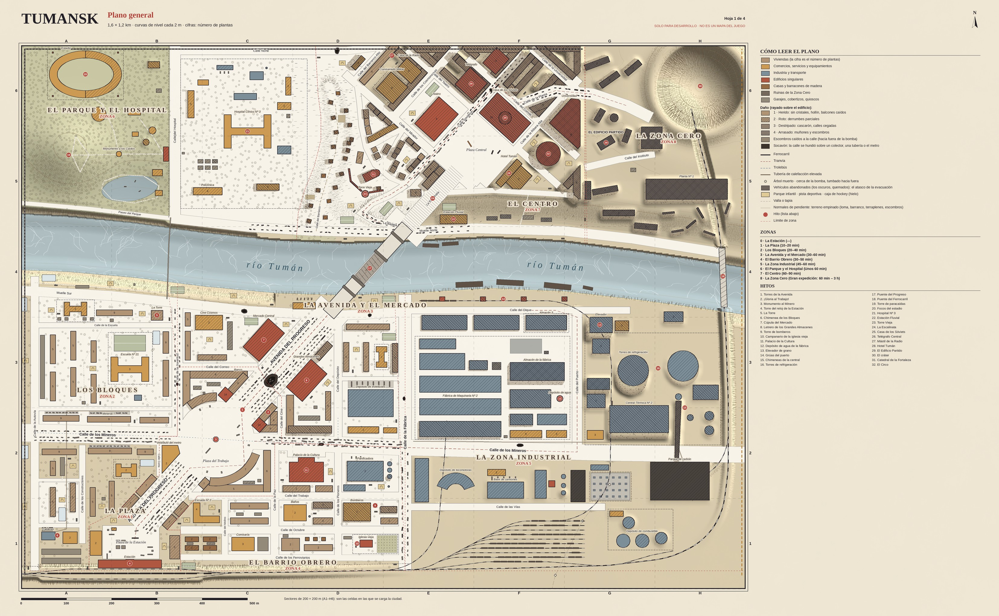

## 1. La ciudad en cifras

| | |
|---|---|
| Superficie jugable | 1,6 × 1,2 km (192 ha), en 48 sectores de 200 × 200 m (A1–H6) |
| Zonas | 8, más el río y los túneles |
| Edificios | 357; se entra en 314; 44 son sitios clave hechos a mano |
| Viviendas que se recorren | 110 edificios de viviendas, con portales, escaleras, pisos y sótanos |
| Superficie construida | 30,7 ha en planta; unos 946 000 m² de suelo entre todas las plantas |
| Calles | 16,3 km, más pasos, escaleras y sendas |
| Vehículos | 818 (coches, autobuses, tranvías, trolebuses, camiones, vagones, barcos) |
| Árboles | 2685: 2254 en pie, secos; 431 tumbados, todos apuntando lejos de la bomba; a menos de 380 m de ella no queda ninguno |
| Relieve | De −18 m (fondo del cráter) a +26 m (colina del parque); el río helado, a −6 m |
| Cruzarla | 1,6 km de oeste a este: unos 20 minutos andando sin parar; más de una hora con cuidado |

## 2. Cómo es una ciudad de verdad (y cómo se aplica aquí)

El error habitual en los videojuegos es un edificio aquí y otro allá, iguales y sin relación. Una ciudad real es continua y cada cosa está donde está por una razón. Tumansk sigue la lógica de las ciudades rusas y soviéticas:

- **El río manda.** El Tumán corre hacia el oeste. Su orilla derecha (la norte) es alta y empinada, porque el río la erosiona; la izquierda (la sur) es una vega baja y llana. La ciudad nació arriba, a salvo, y la industria se extendió abajo, junto al agua y al ferrocarril.
- **La ciudad crece por capas, y todas se ven:**
  1. **La fortaleza**, en el cabo entre el río y el barranco. Queda una torre, trozos de muralla y la catedral.
  2. **El barrio de los mercaderes**, pegado a ella: calles torcidas, casas de ladrillo de dos o tres plantas, una galería comercial.
  3. **El ferrocarril** (siglo XIX), por la vega, con la estación al sur y una playa de vías al este.
  4. **La fábrica y su barrio obrero** (años 30): barracones de madera, casas bajas, el Palacio de la Cultura, los baños, la panificadora.
  5. **El plan estalinista** (años 50): un eje monumental que une la estación, la plaza del Trabajo, el puente, la Escalinata, la plaza Central y la Casa de los Sóviets. Manzanas cerradas con patios y arcos, y casas con comercios en los bajos.
  6. **Los microdistritos** (años 60–80), en el terreno libre del oeste: jrushchovkas en hileras, bloques de 9 plantas, una torre de 16, la escuela y las guarderías en medio, los garajes y la sala de calderas en el borde.
  7. **La autovía elevada**, en el límite oeste y norte.
- **Jerarquía de calles:** avenida (76 m de fachada a fachada, con el tranvía por la mediana), calles principales (36–40 m), calles (14–28 m), pasos de servicio (8–12 m), callejones, sendas y escaleras.
- **Tres maneras de construir manzanas:**
  - En el centro, manzanas cerradas hechas por tramos, cada uno con su altura.
  - En la ciudad vieja, hileras de casas pegadas a lo largo de calles torcidas.
  - En los microdistritos, bloques sueltos con orientación norte-sur (para que entre el sol por los dos lados) y separados entre 30 y 45 m, según las normas de la época.
- **Cada servicio donde le corresponde:**
  - Las tiendas, en los bajos de las calles.
  - La farmacia y el universam, en el bloque de 9 plantas de la calle principal.
  - La escuela y las guarderías, a menos de 300 m de cada casa.
  - Las calderas y los transformadores, en los patios; los garajes, junto a la vía.
  - El hospital, en alto y junto al parque; los bomberos, con su torre de vigilancia; la central térmica, junto al río porque necesita agua.
- **Las redes:**
  - El metro va bajo la avenida y bajo la calle de los Mineros; el tranvía y el trolebús, por la superficie.
  - El calor sale de la central por tuberías elevadas en la zona industrial y por galerías bajo las aceras en la ciudad.
  - Las alcantarillas desaguan en el río.
- **Los patios están vivos:** parques infantiles, pistas, cajas de hockey (en invierno, pistas de hielo), contenedores, trasteros, palomares, aparcamientos y garajes de chapa.
- **Las series se repiten, como en la realidad, pero ningún edificio es igual a otro:** cambia la orientación, el largo, la altura de cada tramo, el daño, el incendio y lo que pasó dentro.

## 3. Lo que pasó: la historia escrita en el plano

- **La bomba** cayó en el nudo ferroviario y la Planta Nº 1, al noreste. Otra, más lejos, al suroeste (fuera del mapa), tiró la autovía elevada.
- **Los daños** dependen de la distancia a la Zona Cero, con una variación fija para cada edificio. Las casas de madera ardieron casi todas. Algunos casos se fijan a mano: el Edificio Partido, el puente, las chimeneas y la aguja de la Casa de los Sóviets.

  | Distancia a la bomba | Nivel | Qué se ve |
  |---|---|---|
  | Menos de 400 m | 4 · Arrasado | Muñones de una o dos plantas y campos de escombros |
  | 400–800 m | 3 · Destripado | Cascarones: forjados caídos, quedan muros y estructura; calles cegadas |
  | 800–1250 m | 2 · Roto | Derrumbes parciales (una esquina, las últimas plantas), fachadas abiertas |
  | Más de 1250 m | 1 · Herido | Sin cristales, hollín de incendios, balcones y paneles caídos, cubiertas cedidas por la nieve |

- **La dirección cuenta la historia:**
  - Los escombros caen del lado contrario a la bomba y ciegan esas calles.
  - Los árboles de los alrededores están tumbados y todos apuntan lejos de ella, una pista para orientarse.
  - La chimenea de la central cayó hacia el sur, sobre la calle de los Mineros.
  - La aguja de la Casa de los Sóviets quedó doblada hacia el suroeste.
- **La lluvia radiactiva** cayó en una franja hacia el sureste. El este de la zona industrial está contaminado y, pasada la vía, la dosis es mortal en minutos.
- **La evacuación:**
  - Atascos en dirección al metro y al puente.
  - Un tren de pasajeros que no salió.
  - Un control del ejército junto al vestíbulo del metro.
  - Autobuses y tiendas en la plaza de la Estación.
  - El hospital de campaña de la Cruz Roja y, detrás del hospital, la zanja.
- **Dos años de invierno:**
  - Tejados hundidos por la nieve.
  - Tuberías reventadas y carámbanos.
  - Saqueos, guaridas, campamentos y rastros del mundo vivo.

## 4. Las zonas

| # | Zona | Salida | Lo principal | Amenazas |
|---|---|---|---|---|
| 0 | **La Estación** | — | Tu depósito, bajo la plaza del Trabajo. La última estación habitada hacia el norte y el este | Ninguna |
| 1 | **La Plaza** | 10–20 min | La plaza redonda del Trabajo, las torres de la avenida, el vestíbulo del metro, el paso subterráneo, el primer patio, el Banco, el Gastronom, la plaza de la Estación con el tren de la evacuación | La Jauría, a veces |
| 2 | **Los Bloques** | 20–40 min | Microdistrito: Mineros 7 (farmacia y universam), la Torre de 16, la escuela Nº 21 con su refugio de defensa civil, dos guarderías, la sala de calderas, los garajes Volga, la playa | La Jauría (madriguera en los garajes) y el Inquilino de Mineros 7 |
| 3 | **La Avenida y el Mercado** | 30–60 min | El Mercado Central y su cúpula, los Grandes Almacenes, el cine Cosmos, el depósito de trolebuses, la gasolinera, el socavón, el paso del Mercado, el club náutico | Saqueadores (vigía en los Grandes Almacenes) y el Llamador del Mercado |
| 4 | **El Barrio Obrero** | 30–50 min | El Palacio de la Cultura, la panificadora, los baños, los bomberos y su torre, la comisaría, barracones de madera, la iglesia vieja junto a la vía | La Jauría, de paso; saqueadores en las rondas |
| 5 | **La Zona Industrial** | 45–60 min | La fábrica de maquinaria y su búnker, la playa de vías, el depósito de locomotoras, la chatarrería, el puerto con sus grúas y el elevador, la central térmica, el parque de carbón que aún arde, el depósito de combustible | La guarida principal de los saqueadores (Almacén 3), radiación al este, humo |
| 6 | **El Parque y el Hospital** | Unos 60 min | Al otro lado del río: el parque de la Cultura (colina, torre de paracaídas, estanque, estadio) y el Hospital Clínico Nº 3 con la Cruz Roja | La segunda jauría y el Inquilino del hospital |
| 7 | **El Centro** | 60–90 min | La ciudad vieja (fortaleza, catedral, museo, mercaderes) y el centro estalinista (Escalinata, plaza Central, Casa de los Sóviets, teatro, hotel Tumán, circo, telégrafo, universidad, comisariado); en el barranco, las casas de madera | Saqueadores (comisariado y vigía en la torre), el Inquilino del hotel y el Llamador del barranco |
| 8 | **La Zona Cero** | Gran expedición: 60 min – 3 h | El cráter, la Planta Nº 1 y su búnker de mando, el nudo ferroviario y **el Edificio Partido** (el antiguo Instituto Nº 9), a 245 m del centro de la explosión | Todas, más radiación extrema y aire irrespirable |
| — | **El río** | — | El Tumán helado: la frontera entre el sur y el norte, con cinco cruces | Hielo fino, el vigía de la torre |
| — | **Los túneles** | Variable | Dos líneas de metro, estaciones muertas, galerías y colectores | Oscuridad, agua helada, los Llamadores |

## 5. El relieve

| Lugar | Altura |
|---|---|
| Hielo del río | −6 m |
| Vega sur (de la orilla a la vía) | 0 a +5 m |
| Terraplén del ferrocarril | +5 m sobre la vega |
| Muelle Norte, al pie de la loma | +1 m |
| La loma (de 80 a 110 m de ancho) | De +1 a +12 m |
| Meseta del centro | +12 a +16 m |
| Colina del parque | +23 m |
| Fondo del barranco | De +1 m (en el río) a +9 m (en la cabecera) |
| Socavón de la avenida | −11 m respecto a la calle |
| Cráter | Fondo a −18 m; borde levantado unos 7 m sobre la meseta |

El relieve decide qué se ve y desde dónde:

- Desde el centro se domina la orilla sur.
- El barranco es un camino escondido del río a la ciudad vieja.
- El terraplén de la vía es un camino alto y expuesto.
- Los montones de escombros cortan calles y abren pasos por encima.

Los edificios con modelo propio (los singulares de [la sección 14](#14-cómo-se-construye)) se asientan en una explanada a su cota: el terreno se allana bajo su huella y unos metros alrededor (lo que el modelo sale de ella: el pórtico de la Casa de los Sóviets, por ejemplo), y vuelve a su altura en una transición suave. Tampoco reciben montones de escombros del plano: traen el suyo ([D-051](DECISIONES.md)).

El relieve se exporta en `data/ciudad/relieve.png`: 16 bits, 2 m por píxel, y metros = valor / 100 − 50.

## 6. El río y sus cinco cruces

| Cruce | Cómo es |
|---|---|
| **El tubo** (oeste) | La tubería de calefacción cruza el río con una pasarela de servicio; la pasarela peatonal que iba al lado se cayó. Silencioso, estrecho, con viento; se ve desde las dos orillas |
| **El puente hundido** (avenida) | El vano central descansa inclinado sobre el hielo: se baja con cuerda y se sube por el otro lado. Es el paso de los saqueadores, que lo vigilan |
| **El hielo** (frente al puerto) | Rápido y abierto. Lo ven el vigía de la torre y el del elevador. Hay hielo fino bajo los desagües |
| **El puente del ferrocarril** (este) | Celosía de acero intacta, pero dentro del rastro radiactivo |
| **El túnel inundado** (metro) | Bajo el río, a oscuras, con el agua helada al pecho. Territorio del Llamador |

El río no está helado del todo: la corriente y el agua templada de la central abren agua de verdad, pero los cinco cruces siguen helados (ver [El río: hielo y agua](#el-río-hielo-y-agua)).

## 7. El subsuelo

- **Línea 1 (roja):** bajo la avenida y bajo el río.
  - S1 Plaza del Trabajo: tu estación.
  - S2 Mercado: inundada.
  - S3 Plaza Central: hundida.
  - S4 Planta: destruida.
- **Línea 2 (azul):** bajo la calle de los Mineros. Al oeste sigue la red habitada (fuera del mapa); al este está S5 Fábrica, abandonada.
- **Las rejas del gobierno civil** cierran los túneles a la salida de tu estación (Reja Norte y Reja Este). Los stalkers con permiso salen por ellas.
- **Pozos de ventilación:** seis (V1–V6), con escalera de pates. Son entradas y salidas alternativas; V4 es la única salida de la estación hundida.
- **Galerías:**
  - La de la calefacción, bajo la acera de Mineros (de pie, 2 m).
  - La de cables, bajo la avenida.
- **Colectores:**
  - El de pluviales del muelle Sur, agachado; desagua en la playa y bajo el puerto.
  - El arroyo enterrado, bajo la ciudad vieja; es la guarida del segundo Llamador.
  - El gran colector del centro.
- **Pasos subterráneos:** el de la plaza (en cruz), el del Mercado y el túnel de los andenes de la estación de tren.
- **Sótanos:** cada jrushchovka tiene un sótano de punta a punta, con salida en cada portal.

## 8. Hitos para orientarse

Sin mapas, el jugador se orienta por lo que ve de lejos. Hay al menos dos hitos visibles desde cualquier punto, para poder triangular al dibujar el mapa. La lista completa está en la hoja 1; los principales son:

- **Sur:** las torres de la avenida, las letras ¡GLORIA AL TRABAJO!, el reloj parado de la estación, la Torre de 16 y las chimeneas.
- **Este:** el elevador de grano, las grúas, las chimeneas y las torres de refrigeración de la central.
- **Norte:** la torre de la Casa de los Sóviets con la aguja doblada (110 m, se ve desde toda la ciudad), el mástil de la radio, la catedral, la torre de paracaídas, los focos del estadio, la aguja de la estación fluvial y el Edificio Partido junto al cráter.

## 9. Amenazas sobre el plano

| Amenaza | Guarida | Territorio | Rutina |
|---|---|---|---|
| La Jauría | Garajes Volga | Los Bloques, la playa, la plaza de la Estación | Caza al amanecer y al atardecer; duerme de noche |
| La segunda jauría (Fase 6) | Bajo las gradas del estadio | El parque y el hielo de esa orilla | Igual; se pelea con la primera por la playa |
| El Inquilino | Mineros 7 · Hospital · Hotel Tumán | Su edificio, nunca sale | Quieto de día en los huecos; recorre las plantas de noche |
| El Llamador | Estación Mercado (inundada) | Paso del Mercado y mercado | Duerme de día; caza al anochecer |
| El Llamador del barranco (Fase 6) | El arroyo enterrado | El barranco hasta el río | Nocturno |
| Saqueadores | Almacén 3 (unas diez personas) · Comisariado Militar (unas seis) | El puerto y la fábrica · el centro | Salen de día en grupos de tres; de noche, encerrados con guardia y fuego |

- **Patrullas:**
  - P1: relevo del vigía de los Grandes Almacenes.
  - P2: suministros entre las dos guaridas, por el puente hundido.
  - P3: relevo del vigía de la torre.
  - P4: ronda del puerto.
- **Vigías:**
  - En la azotea de los Grandes Almacenes: ve la avenida entera.
  - En lo alto del elevador: ve el puerto, la playa de vías y el hielo.
  - En la planta 20 de la torre de la Casa de los Sóviets: ve el río, los puentes y la Escalinata.

## 10. Peligros

- **Radiación:**
  - El rastro radiactivo, en tres niveles, al este.
  - Focos: la morgue, los camiones de bomberos de la plaza Central, los vagones del nudo, las cubiertas planas del centro (polvo acumulado), los sedimentos de la curva del río, el tren de la evacuación y el agua del socavón.
- **Hace falta máscara** en la Zona Cero (polvo radiactivo), junto al parque de carbón (humo) y en la estación hundida (aire viciado).
- **Hielo fino** junto al puente hundido, bajo los desagües, en la curva de la central y bajo la autovía caída.

## 11. Rutas: siempre hay otra

Tiempos de ida a paso prudente, sin contar imprevistos.

| Destino | Ruta | Perfil | Distancia | Tiempo |
|---|---|---|---|---|
| Farmacia de Mineros 7 | R1a · Por la calle | Rápida y expuesta | 210 m | 6 min |
| | R1b · Por los patios y el sótano | Lenta y segura | 230 m | 14 min |
| | R1c · Por la galería de la calefacción | A oscuras; exige palanca | 380 m | 12 min |
| Hospital Nº 3 | R2a · Por el tubo | Silenciosa y expuesta al viento | 770 m | 25 min |
| | R2b · Por el hielo de la playa | Rápida, abierta; la segunda jauría | 880 m | 22 min |
| | R2c · Por el puente y el barranco | Larga; cruza el paso de los saqueadores | 1210 m | 40 min |
| Plaza Central | R3a · Por la avenida y la Escalinata | Directa; bajo el vigía de la torre | 890 m | 25 min |
| | R3b · Por el túnel inundado | A oscuras, con agua helada; el Llamador | 860 m | 35 min |
| | R3c · Por el hielo y el barranco | Rodeo largo fuera de la vista del vigía | 1420 m | 45 min |
| El Edificio Partido | R4a · Por el centro | La más corta; la más vigilada | 1450 m | 60 min |
| | R4b · Por el este | Por el puerto y el puente del ferrocarril; mucha radiación | 1940 m | 90 min |
| | R4c · Por debajo | Metro y colectores; oscura, fría y lenta | 1350 m | 100 min |
| | R4d · Por el hielo | Abierta; hielo fino junto al puerto | 1450 m | 80 min |
| | R4e · Por el oeste | La más larga; la más tranquila hasta el centro | 1960 m | 150 min |

Las cinco rutas a la Zona Cero explican la duración de la gran expedición: de 60 minutos con la mejor preparación a 2 o 3 horas dando rodeos, esperando a que pase una patrulla o pasando la noche en un refugio.

## 12. Los bordes del mapa

Cada borde tiene una razón dentro del mundo:

| Lado | Qué hay | Por qué no se pasa |
|---|---|---|
| Oeste y norte | La autovía elevada, caída | Una muralla de hormigón y coches de 10 m; al norte, además, los edificios tumbados por la onda ciegan las calles |
| Sur | El terraplén del ferrocarril, con su valla y el tren quemado | Detrás, el Barrio Quemado: un llano de ceniza sin nada en pie |
| Este | La vía del este | Más allá cayó toda la lluvia radiactiva: dosis mortal en minutos |
| Noreste | El cráter | Radiación extrema |

## 13. Catálogo de edificios

Los tipos siguen las medidas de las series soviéticas reales. Los interiores de cada tipo salen de su distribución de serie (portales, escaleras, pisos, sótanos); los 44 sitios clave se hacen a mano.

| Tipo | Medidas | Plantas | En la ciudad |
|---|---|---|---|
| Casa estalinista (tramos de manzana y fachadas) | 16 m de fondo | 5–8 | 49 |
| Casa anterior a la revolución | 10–12 m de fondo | 2–3 | 24 |
| Casa de madera (isba) | 9 × 8 m | 1 | 24 |
| Jrushchovka | 64 × 12 m (de 2 a 4 portales) | 5 | 18 |
| Bloque de paneles | 48–96 × 13 m | 9 | 10 |
| Torre | 26 × 22 m | 16 | 1 |
| Casa obrera y barracón | 30–85 × 10–14 m | 2–3 | 12 |
| Escuela y guardería | En H o en L | 2–4 | 6 |
| Naves, almacenes e industria | Hasta 180 × 36 m | 1–2 | 34 |
| Públicos, comercios y monumentales | Teatro, mercado, almacenes, palacio, hospital, oficinas, pabellones… | 1–14 | 55 |
| Torres, chimeneas, depósitos, grúas, murallas y montones | — | — | 43 |
| Ruinas de la Zona Cero | Muñones y pórticos | 1–2 | 20 |
| Menores | Garajes, cobertizos, quioscos, transformadores, tiendas de campaña | 1 | 61 |

## 14. Cómo se construye

1. **El plano son datos.** `tools/ciudad/datos.py` decide la posición, el tipo, las plantas, el uso y las notas de cada cosa. `plano.py` calcula el daño, los incendios, los escombros y el relieve, y lo exporta a `data/ciudad/plano.json`.
2. **Maqueta automática** (hecha, F3-15): un generador en Godot lee el plano y levanta la ciudad en volúmenes sencillos (relieve, calles, edificios a su altura, escombros) para probar recorridos, vistas y rendimiento antes de construir nada. Ver [la sección 15](#15-la-maqueta).
3. **Kit modular** (hecho para las viviendas, F3-16): cada tipo de edificio se monta con las piezas del kit de arquitectura soviética (paneles, ventanas, balcones, portales, escaleras, cubiertas), con el daño de su nivel y las variaciones de su semilla. Ya se montan las 138 viviendas del plano (las estalinistas y las casas obreras, las de antes de la revolución, las isbas, las jrushchovkas, los bloques, la torre y los barracones), con las mismas reglas de daño que la maqueta, y ya están en ella; el resto de los tipos sigue en volúmenes. Ver [DESARROLLO.md](DESARROLLO.md#el-kit-de-arquitectura-f3-16).

   
4. **Sitios clave a mano:** los 44 edificios con interior hecho a mano y los lugares de las misiones se terminan uno a uno, como modelos enteros ([D-038](DECISIONES.md)). Hechos los tres primeros: el vestíbulo del metro (PLZ-06), con la sala, la esclusa y las escaleras; el Edificio Partido (ZC-01), con sus catorce plantas abiertas al cráter y la escalera hasta la azotea, y la Casa de los Sóviets con su torre (CEN-SOV y CEN-SOVT). Ver [DESARROLLO.md](DESARROLLO.md#los-edificios-singulares). Ya están en la maqueta, cada uno en su explanada y sin el escombro del plano, y el terreno no tapa el foso de las escaleras del metro.
5. **Carga por sectores:** la ciudad se carga en celdas de 200 × 200 m. Hay detalle completo en la celda del jugador y en las de alrededor, y versiones simplificadas más lejos. Las manzanas sirven de oclusores (lo que tapan no se dibuja), algo imprescindible para llegar a 60 fps con la gráfica integrada.

**Para cambiar algo:** se edita `tools/ciudad/datos.py` y se ejecuta `make ciudad`. Si algo se solapa, pisa la calle o cae en la zona equivocada, el generador lo dice y la CI no pasa.

## 15. La maqueta

La maqueta (`scenes/debug/maqueta_ciudad.tscn`, F3-15) levanta la ciudad entera desde los datos del plano en unos nueve segundos (cuatro son la red de tránsito, que se levanta sector a sector en varios hilos, y uno y medio, los edificios del kit). Se recorre a pie (a 1,4 m/s y con colisión) o volando, y tiene herramientas para medir. Cómo se abre y sus teclas, en [DESARROLLO.md](DESARROLLO.md#la-maqueta-de-la-ciudad-f3-15).

- **Lo que se levanta:**
  - El relieve, cada 2 m, pintado con el suelo del plano (el hielo, las vías, los patios y los escombros) bajo la nieve vieja.
  - El río: el hielo con su grosor, que se pisa, y el agua abierta ([abajo](#el-río-hielo-y-agua)).
  - La red de tránsito: calzadas, aceras, plazas, sendas, escaleras y el tablero del puente, con sus bordillos, muros, pretiles, pasos de cebra, tapas y sumideros. Ver [la sección 16](#16-la-red-de-tránsito).
  - Los 357 edificios, a su altura y con lo que queda en pie según su daño. Las torres llevan aguja (la de la Casa de los Sóviets, doblada hacia el suroeste), las chimeneas se estrechan, las torres de refrigeración tienen su forma y las casas de madera y las de antes de la revolución llevan tejado a dos aguas.
  - Los 142 que sabe montar el kit de arquitectura (las 138 viviendas y los cuatro singulares) son, de cerca, sus modelos; de lejos, sus volúmenes ([la sección de abajo](#los-edificios-del-kit-en-la-maqueta)).
  - Los 818 vehículos (cada uno, su modelo: [la sección 17](#17-la-superficie-rota)), los 2685 árboles y los puentes (el del Progreso, con su vano hundido sobre el hielo, y el del ferrocarril, de celosía).
  - Las tuberías elevadas (el tubo cruza el río con su pasarela), las vallas, la línea eléctrica y el muro de la autovía caída al oeste y al norte.
- **El daño en volumen:**
  - Nivel 2: se hunde el extremo que mira a la bomba.
  - Nivel 3: un cascarón de alturas desiguales, más bajo del lado de la bomba.
  - Nivel 4: muñones de una o dos plantas, medio enterrados en su escombro.
  - Las casas de madera ardieron (quedan los restos) y el Edificio Partido conserva solo la mitad que no miraba a la bomba.
  - Las torres, las chimeneas, los depósitos, las ruinas y los hitos conservan la altura del plano.
- **Sectores:** los 48 sectores tienen una versión lejana (del color de la niebla, barata) y una detallada, que se dibuja a menos de 450 m. Los edificios grandes y el relieve son oclusores.

### Los edificios del kit en la maqueta

Los edificios que sabe montar el kit (F3-16) se levantan con su ficha del plano: su huella, sus plantas, su daño y su incendio, los patios de su manzana y dónde cayó la bomba. Levantar la ciudad con ellos cuesta un segundo y medio más.

- **De cerca, su modelo; de lejos, su volumen** ([D-052](DECISIONES.md)). Dentro de la versión detallada de su sector, cada edificio tiene tres escalones: su volumen a más de 200 m; de 200 a 60 m, su modelo sin sombras (las proyecta su volumen); y, más cerca, el modelo entero. Lo que va en los huecos de las fachadas (ventanas, puertas, escaparates y los cuartos de detrás) no proyecta sombra nunca. Los hitos siguen viéndose de lejos, solos, como siempre.
- **En ladera**, el kit pone el edificio a su cota y la maqueta le añade un zócalo de piedra hasta 40 cm por debajo del punto más bajo de su huella, para que no flote por el lado de abajo. Lo llevan 41 de los 138 (los que tienen más de 15 cm de desnivel bajo la huella); bajo las isbas de la loma hay hasta 1,7 m.
- **Los singulares** (el vestíbulo del metro, el Edificio Partido y la Casa de los Sóviets con su torre) están en su explanada, sin el escombro del plano. Chocan con su propia colisión, así que en ellos se entra, y no tapan la vista como oclusores (se ve a través de su peristilo, sus plantas abiertas y su boquete). En el vestíbulo, el terreno no se dibuja ni choca donde bajan las escaleras: se sale del metro por su foso. En la Casa de los Sóviets se sube por el escombro de la fachada reventada hasta el boquete y se baja al cuarto quemado que quedó detrás.
- **Los demás** chocan como su volumen: no se entra en ellos.

| | |
|---|---|
|  |  |

### El río: hielo y agua

El Tumán ya no es una textura: es hielo con su grosor sobre agua de verdad (`tools/ciudad/rio.py`, [D-071](DECISIONES.md)). Casi todo el río está helado de orilla a orilla y se cruza a pie por los cruces de siempre, pero la corriente y el calor abren unos 16.000 m² de agua:

- **El canal de la corriente** serpentea por el centro del río y se abre y se cierra (hasta 22 m de ancho). Lo cortan puentes de hielo donde se cruza: el tubo, el puente hundido (su vano caído descansa en el hielo) y el hielo frente al puerto.
- **Las bolsas del hielo fino del plano**: el agua templada de la central, la mayor, que corre río abajo pegada a la orilla sur (en ella flota el remolcador); la de los desagües del puerto, donde se quedó una barcaza; los remolinos junto a las pilas del puente hundido y la de bajo la autovía caída.

Alrededor del agua el hielo es fino (oscuro y casi sin nieve, unos 22.000 m²), y en su borde está roto en unos 1.600 témpanos, con el agua entre ellos y alguno montado sobre los demás; un centenar van sueltos por el agua. El hielo de orilla es gris azulado, con la nieve a parches que deja el viento, para que el río se distinga de la tierra nevada. El agua es negra y fría (`assets/shaders/agua.gdshader`): refleja el cielo de refilón, sus rizos bajan con la corriente (el Tumán corre al oeste), tiene aguanieve junto al hielo y hielo menudo flotando, y a veces brilla el sol en ella. Debajo está el lecho, que baja hasta 3,5 m bajo el hielo en el centro del río.

En la maqueta, el hielo son losas con su grosor que se pisan (tienen colisión); el agua no se pisa, y quien entra cae al lecho. Los barcos están a la altura del agua o del hielo, según dónde se quedaron.

| | |
|---|---|
| 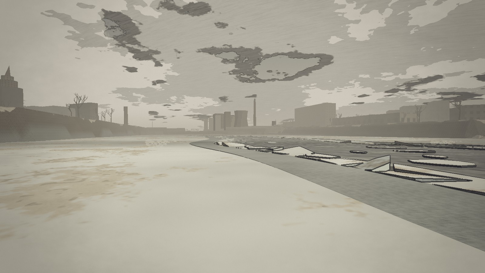 | 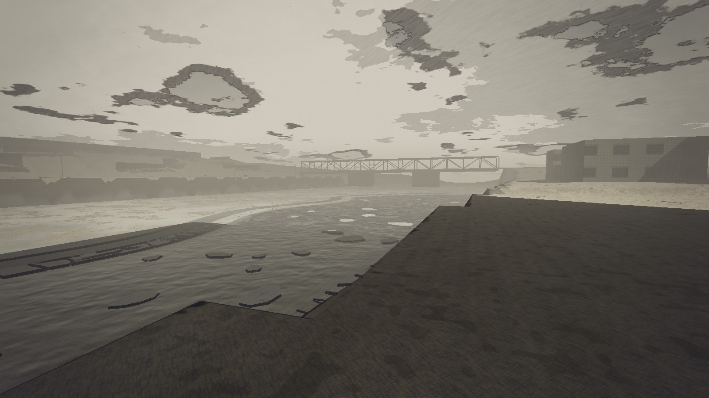 |

### Lo que ha enseñado la maqueta

- **Los hitos se ven desde casi toda la calle, pero no desde los patios.** Con línea de visión desde la altura de los ojos (cada 20 m, fuera de los edificios), desde el 92 % de los 4055 puntos se ven al menos dos hitos. Por zonas:

  | Zona | Se ven dos o más |
  |---|---|
  | El río, el Parque y el Hospital, la Zona Industrial | 97–100 % |
  | El Centro, la Zona Cero | 91–93 % |
  | La Avenida y el Mercado, el Barrio Obrero, La Plaza | 80–84 % |
  | Los Bloques | 75 % |

  Los puntos ciegos son casi todos patios cerrados: los de los microdistritos, los del Barrio Obrero y los de las manzanas estalinistas (rosa: ningún hito; amarillo: uno). La regla del plano («desde cualquier punto») se cumple en las calles; en los patios habría que aceptarlo o añadir hitos que asomen por encima de los tejados (una chimenea de calefacción, un depósito de agua, una antena).

  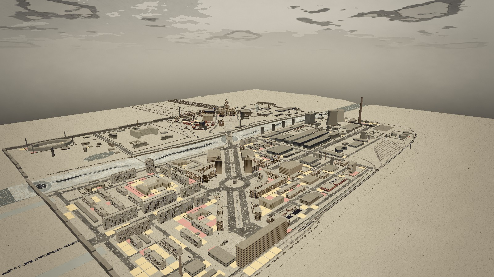

- **La niebla de día tapa la ciudad a partir de unos 300 m.** Solo los hitos la atraviesan ([D-027](DECISIONES.md)): por eso desde la avenida se ve la torre de la Casa de los Sóviets a 850 m, pero no el resto del centro.
- **Rendimiento** (contado en el entorno de desarrollo, sin gráfica; los fps hay que medirlos en tu PC con la tecla B): a pie de calle, con la red de tránsito y los edificios del kit, se dibujan entre 120 y 1.250 objetos por imagen (llamadas de dibujo, contando las de las sombras) y entre 0,4 y 1,9 millones de triángulos. Las calles con edificios del kit son las más caras (entre 900 y 1.250 llamadas; con volúmenes, entre 400 y 670), y las sombras se llevan entre un tercio y la mitad. La oclusión activa quita hasta una cuarta parte de las llamadas en la zona industrial. Si hiciera falta aligerar, lo siguiente es juntar las piezas iguales de los edificios de una manzana en una sola malla (ahora cada edificio tiene una por pieza).

| | |
|---|---|
| 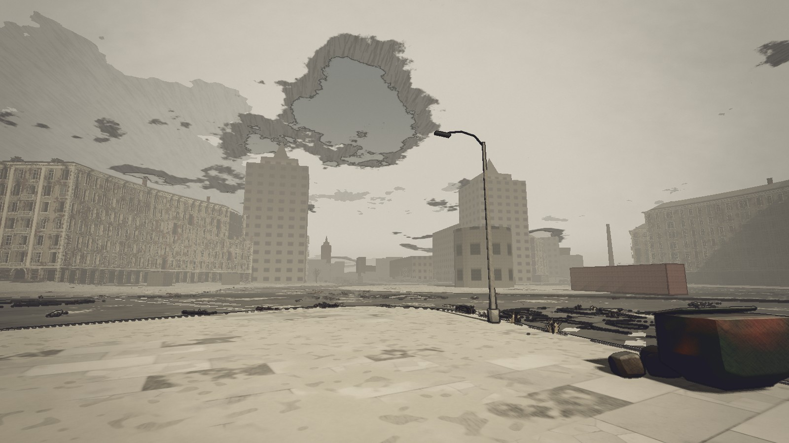 |  |
|  | 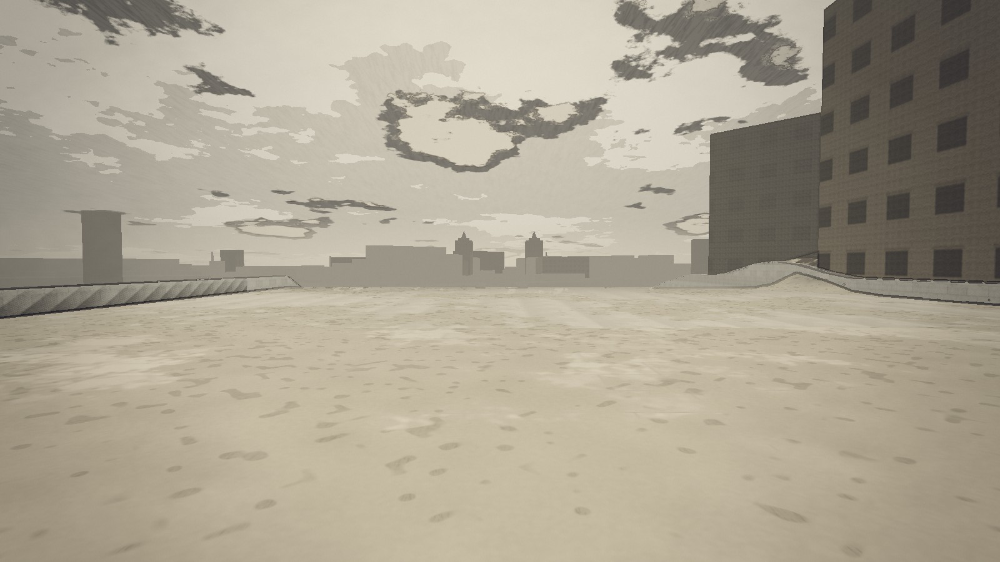 |
| 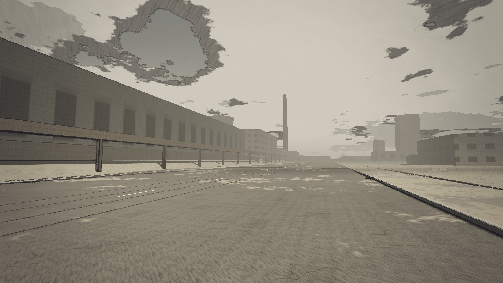 |  |
|  |  |

## 16. La red de tránsito

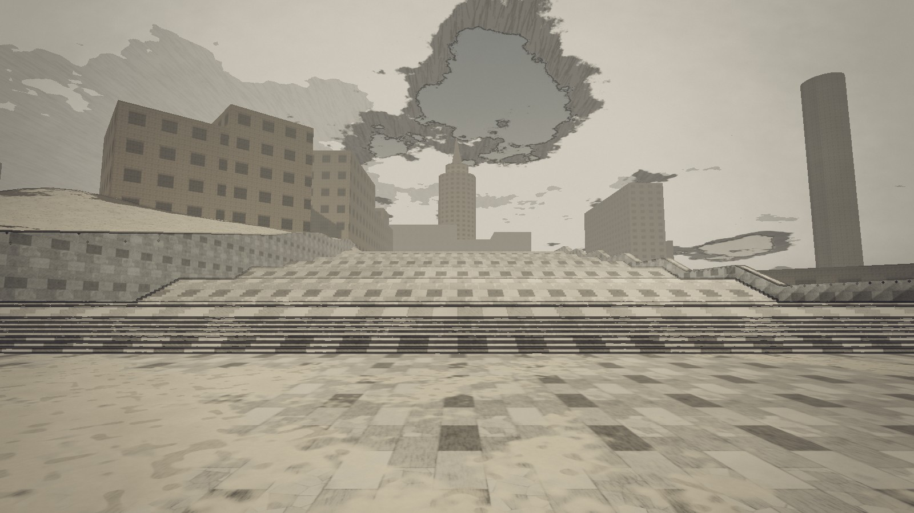

Todo lo que se pisa para ir de un sitio a otro, levantado en 3D: 211.000 m² de calzada, 106.000 de aceras (asfalto en los barrios, losas en el centro), 32.000 de plazas de granito, 7.600 de isletas, el adoquín de la ciudad vieja, las sendas de grava de los parques, el camino de tierra del barranco, la Escalinata, las escaleras de las sendas y el tablero del puente del Progreso. Y las vías: 8 km de vía de tren (la principal, la estación con sus andenes, los apartaderos y la playa de vías) con sus 19 desvíos y 13 topes, 5,6 km de vía de tranvía y cinco pasos a nivel. En las lindes: 31 km de bordillos, 24 km de bordes de jardín, las contrahuellas, los muros de las escaleras, los pretiles del puente y del muelle, los bordes rotos del vano hundido, 72 alcorques y las caras de los andenes. Encima: 126 pasos de cebra, la línea del eje de las calles principales y del puente, 434 tapas de registro y 973 sumideros.

**Niveles.** Respecto a la rasante (el terreno nivelado, sin escombros):

| Superficie | Altura |
|---|---|
| Aceras, plazas, paseos e isletas | +3 cm (junto a la tierra, el bordillo de jardín asoma 2 cm más) |
| Calzada y adoquín | −12 cm: el bordillo tiene 15 cm (asoma 1 cm sobre la acera) |
| Sendas | +5 cm, con un bordillo bajo |
| Camino de tierra | −3 cm (un poco hundido) |
| Alcorques | −5 cm, con su cerco |
| Losa de los pasos a nivel y cama del tranvía | −12 cm, como la calzada: a ras del carril |
| Andenes de la estación | 1,10 m sobre lo alto del carril |

**Cómo se hace.** `tools/ciudad/transito.py` decide la forma en planta con las mismas figuras de shapely que valida el plano, y la reparte en *grupos*: un trozo de una clase de superficie con su *regla* de altura (la rasante más el nivel de la clase, un plano fijo para los peldaños o la rampa del tablero del puente) y la orientación de su textura (las losas siguen la calle). Las *aristas* entre grupos, y entre un grupo y la tierra, salen ya clasificadas: bordillo, borde, contrahuella, escalón, muro, pretil (el desnivel con el terreno pasa de 40 cm), rotura o fachada. `tools/ciudad/rejilla.py` decide qué hace la maqueta con cada triángulo de la rejilla del relieve de 2 m: si el tránsito lo tapa, no se dibuja; donde una acera llega a la tierra, se dibuja el terreno debajo (la acera va 3 cm más alta); donde lo que se pisa va por debajo del terreno (una calzada, un camino, los peldaños excavados), se dibuja aparte, exacto, lo que queda de tierra. Con eso, `CityTransit` levanta cada sector en su hilo: corta las superficies por la rejilla donde la rasante no es plana (para que sigan el terreno igual que su malla) y extruye el perfil de cada arista. El terreno ni asoma entre las losas ni deja zanjas junto a las aceras, y los montones de escombros que cayeron a la calle siguen ahí, asomando sobre el asfalto.

**La Escalinata.** Sube 11 m por la loma en 73 contrahuellas de 15 cm y huellas de 33-38 cm, en siete tramos de once peldaños con descansillos donde la ladera se allana. Los peldaños van horizontales de lado a lado y la ladera cae de través (un 14 %): a un lado va excavada (muro de contención) y al otro en alto (muro con pretil), con el pretil siguiendo la línea de los peldaños. La parte de la plaza del Puente Norte que queda al pie es su rellano de abajo, a la cota del muelle; lo que la plaza tenía ladera arriba, al otro lado de la Bajada, queda en tierra. Arriba, el Bulevar del Río la cruza por la plaza de la cabeza (allanada de lado a lado); su trozo que caía sobre los tramos desaparece. Las escaleras de la loma (74 peldaños) y del barranco (33) son de hormigón, con muretes y barandillas de tubo.

**El puente.** Sobre el río, el tablero va en línea recta de la cota del Muelle Sur (0) a la del Muelle Norte (1 m), con su calzada de 21 m, aceras de 5,5 m, pretiles y los bordes rotos donde se hundió el vano central. En los muelles de granito la orilla cae a pico: la rasante se rellena hasta el borde del agua y un pretil cierra el muelle.

**Para caminar.** Los bordillos y los peldaños llevan una rampa de colisión invisible (unos 30°): se suben andando, sin saltar. Bajo el tránsito, la colisión del relieve baja al menos 30 cm (y lo que haga falta bajo los peldaños excavados).

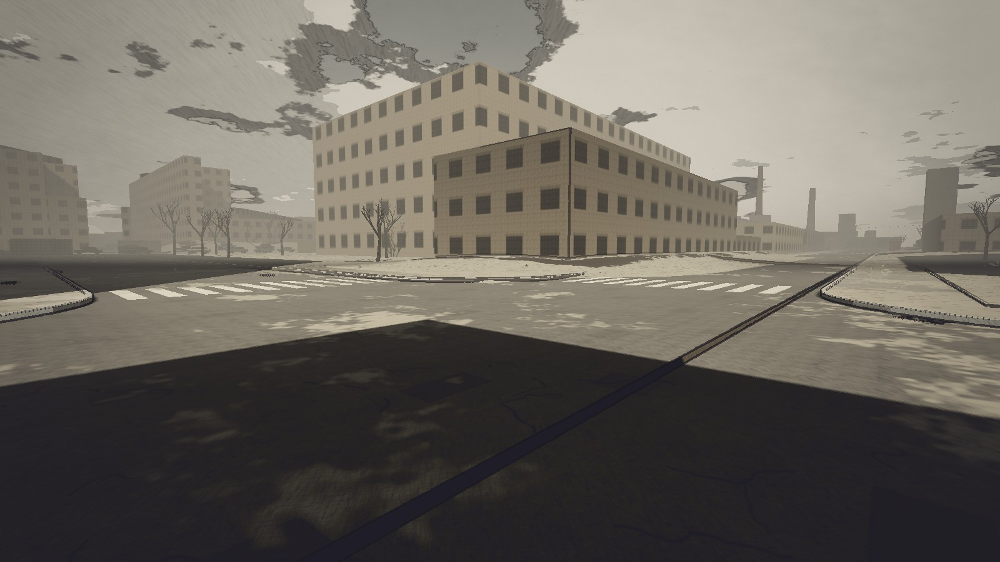

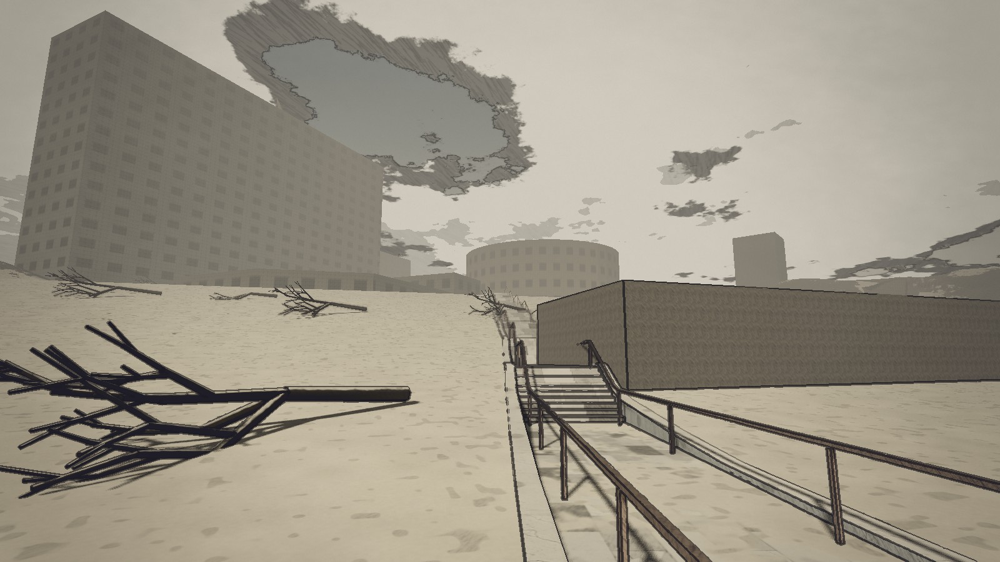

**Las vías del tren.** 18 vías: la línea principal (con el puente del Ferrocarril), las dos vías de andén de la estación, los apartaderos de la fábrica, el puerto, el carbón y el combustible, el escape de la playa de vías y sus nueve vías. `tools/ciudad/vias.py` hace el trazado: cada vía es un cuerpo (sus puntos del plano, con las esquinas redondeadas: 300 m de radio la principal, 150 los apartaderos, 120 la playa) y, en cada punta, un desvío en su vía madre seguido de la curva que la lleva hasta su cuerpo (con un tramo recto antes si hace falta: así salen y vuelven en paralelo las vías de los andenes). `tools/ciudad/ferrocarril.py` da a cada una su rasante (el plano de formación): sigue el terreno sin pasar de la pendiente de su clase (1,2 % la principal y la playa, 2,5 % los apartaderos), no baja de la corona de su terraplén, va recta de estribo a estribo por el puente y, a lo largo de cada desvío, a la altura de la madre. El relieve se nivela a lo largo de cada vía: una caja llana a cada lado del eje y un talud hasta el terreno (bajo el puente no, que debajo está el río). En la maqueta (`TransitRails`), cada vía lleva su balasto de 30 cm con sus taludes, traviesas de hormigón Ш1 cada 55 cm (12.600, como instancias: más bajas en el centro, con su placa, sus clemas y sus tornillos en cada asiento) y carriles de 15 cm con su patín, su alma y su cabeza, con el ancho de vía soviético de 1520 mm. Los vagones y los coches de tren abandonados se apoyan en lo alto del carril.

**Los desvíos.** Cada uno sale tangente a la vía madre en la punta de sus agujas y gira con el radio de su marca hasta el ángulo de su corazón: 1/9 (150 m) en la línea y la estación, 1/6 (100 m) en la playa y los apartaderos. Llevan las agujas afiladas pegadas a sus contraagujas, el corazón de fundición con su punta y sus patas de liebre (un modelo por marca), los contracarriles frente a él, traviesas de madera que se alargan conforme las dos vías se separan (con el balasto ensanchado debajo) y, junto a la punta, la palanca del cambio con su contrapeso a rayas y su farol. La maqueta corta los carriles de las dos vías donde van las agujas y el corazón.

**La playa de vías.** En el plano, sus diez vías salían todas de un mismo punto de la principal, en abanico de hasta 68°: eso no se puede construir con agujas. Ahora entra por un escape que sale de la principal y sube en diagonal por la playa; de él salen, desvío tras desvío, ocho de sus vías, que giran hasta quedar paralelas cada 10 m, y la de arriba es el propio escape, que acaba en ella. La de abajo sale de la principal y vuelve a ella por el otro lado; las demás acaban en un tope, así que la playa tiene forma de trapecio y las vías de arriba son más cortas. El apartadero de la fábrica sale ahora de la principal antes de la playa, y el del puerto, de la vía de arriba de la playa. Los vagones abandonados están en lo recto de cada vía.

**Los topes.** Uno en cada punta suelta de vía (13: las de la playa y los finales de los apartaderos): un bastidor de carriles viejos con el madero de choque a franjas a la altura del enganche, la señal roja encima y una pila de traviesas viejas detrás. No dejan pasar.

**Tapas, sumideros y traviesas.** Son modelos de Blender (`tools/blender/recipes/transito.py`): la tapa redonda del alcantarillado con su estrella de nervios y sus aros, la cuadrada de la red de cables con su rejilla de tacos, el sumidero de la cuneta con sus barrotes sobre el pozo oscuro y las traviesas. En las tapas y los sumideros no cuaja la nieve: el calor de la alcantarilla la funde.

**La estación.** Va sobre su terraplén, 5 m por encima de la plaza. Dos andenes isla de 210 m entre la principal y las vías de andén, a 1,10 m sobre lo alto del carril (los andenes altos soviéticos), con su cara de hormigón, la línea blanca de seguridad a 15 cm del borde y una rampa del 12 % en cada punta.

**Los pasos a nivel.** Donde una vía cruza una calle (cinco veces, en los apartaderos de la fábrica y del puerto), una losa de hormigón a ras del carril cruza la calle de lado a lado, con los carriles a ras y su garganta. La calle sube hasta la losa con una rampa de 10 m a cada lado, siguiendo el carril (que puede ir en pendiente), y el terreno sube con ella como el terraplén de sus rampas; solo la caja de la vía se queda abajo, y en cada punta de la losa una cara de hormigón baja hasta el balasto. Las aceras llegan a la losa por su bordillo y en ningún otro sitio se acercan a menos de 3 m del eje de una vía.

**El tranvía.** Dos líneas de vía doble, con los carriles a ras y su garganta: por la calzada y, donde la deja (la mediana de la Avenida, la Plaza, una curva que corta una esquina), por una cama de losas a la altura de la calzada, con bordillo. Las curvas tienen 20 m de radio, o menos donde no caben: en el plano, el trazado giraba en seco, y casi en redondo al salir del puente hacia la Bajada. Los carriles acaban en los bordes rotos del vano hundido. Dos quioscos de la Plaza se apartaron de la curva del tranvía.

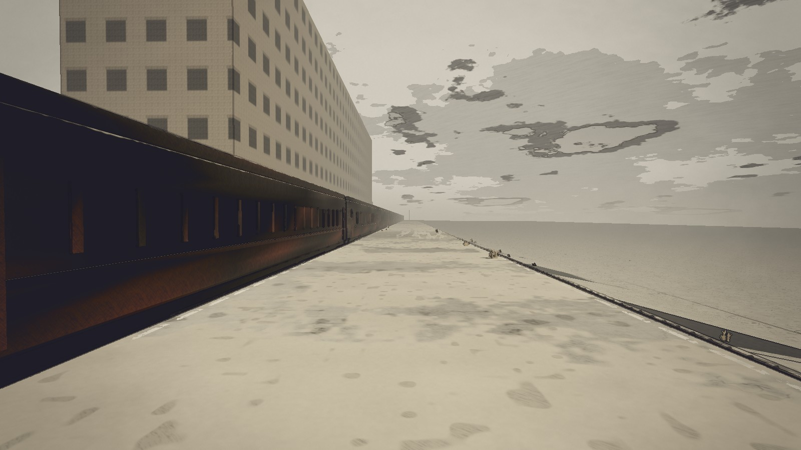

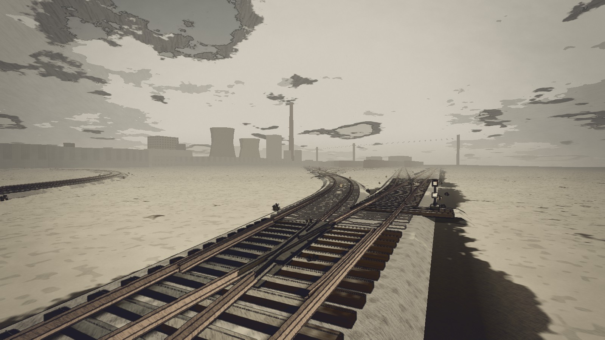

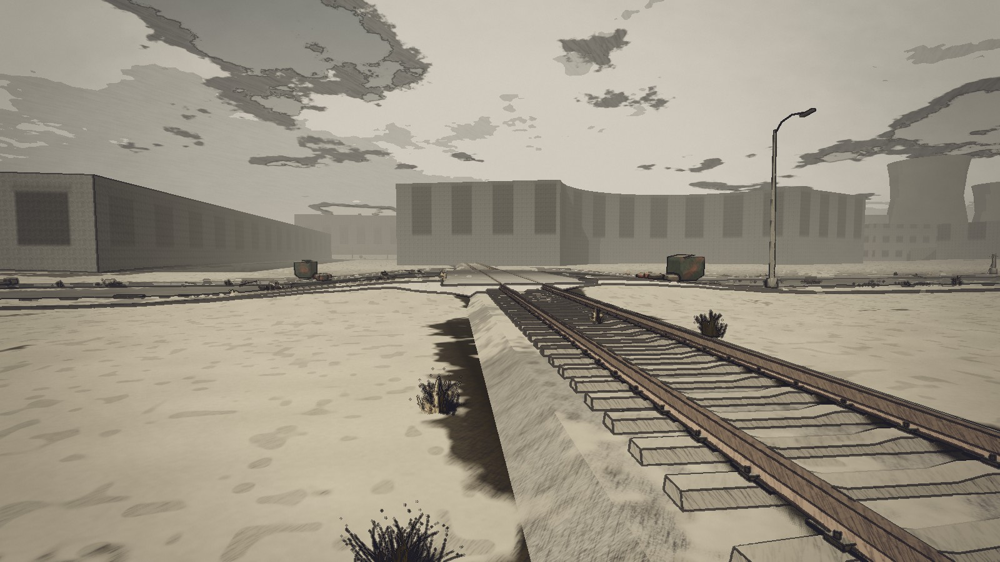

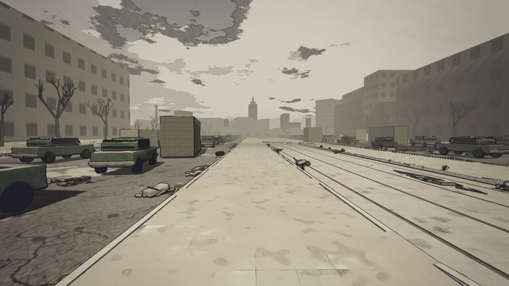

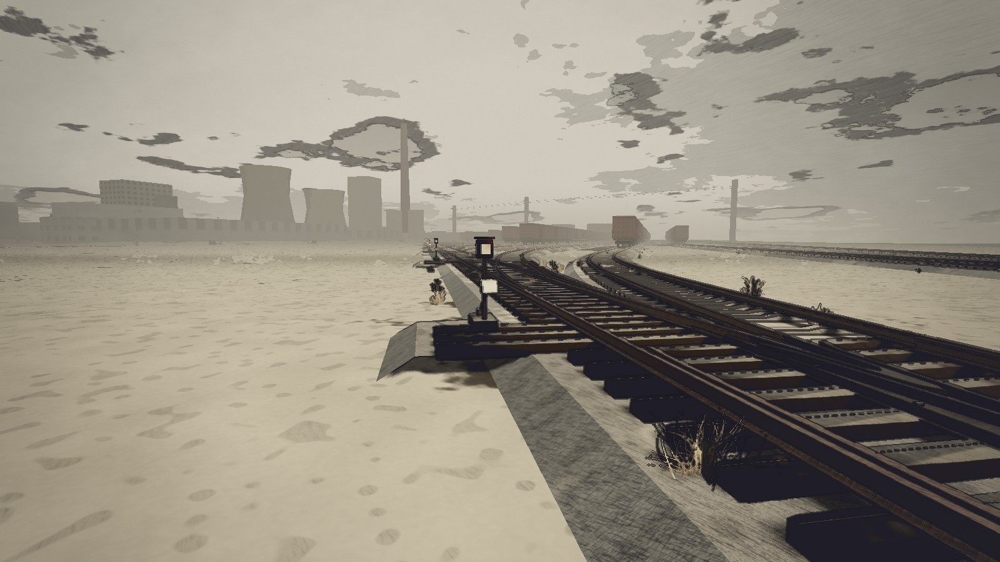

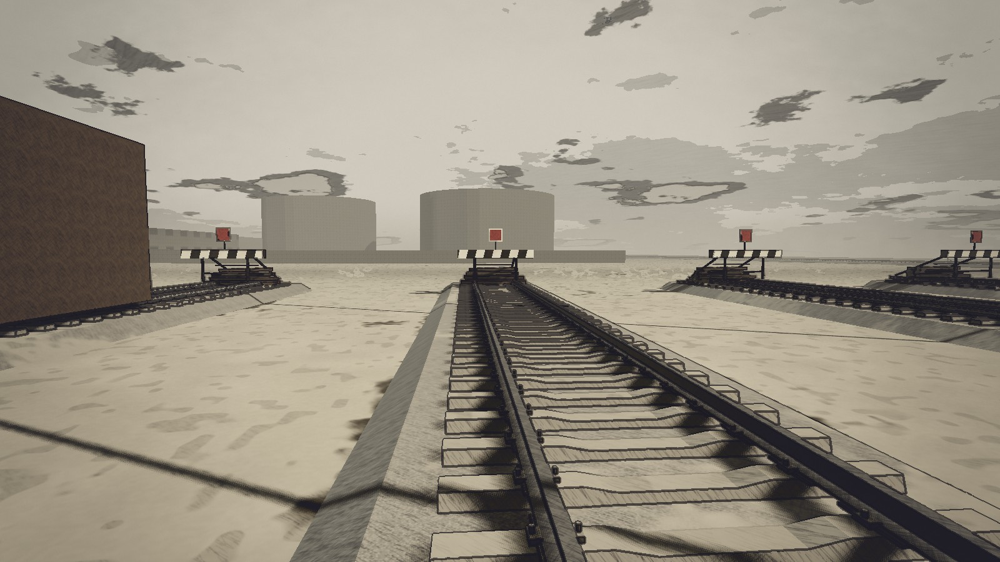

**Pendiente.** El cruce del tranvía con el apartadero de la fábrica (los carriles se cruzan a ras, sin el rombo de un cruzamiento).

## 17. La superficie, rota

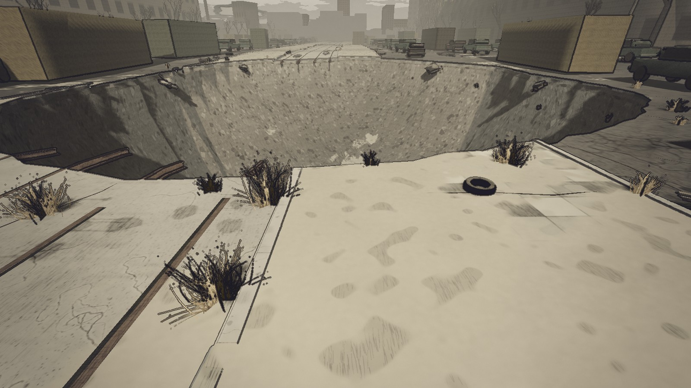

Nada de lo que hay fuera está intacto (README, «La ambientación de la superficie»): la ciudad ya estaba gastada antes de la guerra, la bomba cayó a unos kilómetros y lleva dos inviernos sin que nadie la toque. La calle no es un plano: el firme se ha roto en placas, hay escombros y basura por todas partes y las farolas están torcidas, caídas o arrancadas. `tools/ciudad/deterioro.py`, `firmes.py` y `restos.py` lo ponen en el plano con datos y reglas, siempre igual (el azar sale de la clave de cada cosa), y la maqueta lo levanta. Cerca de la Zona Cero, todo es más.

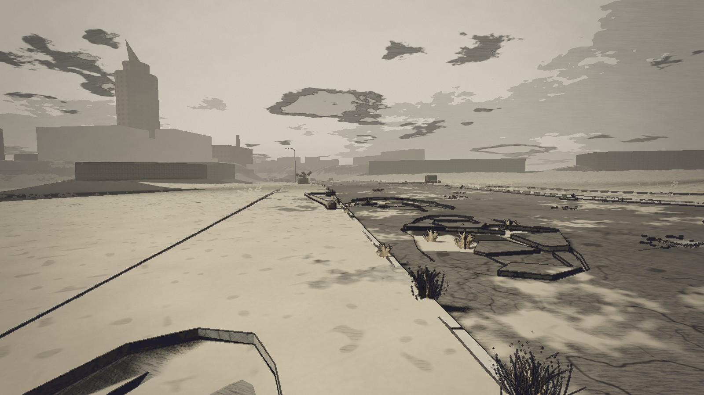

**El firme roto.** En 520 sitios (casi 20.000 m²) la calle ya no es una superficie, sino placas sueltas: el agua entró por las grietas, se heló y levantó el asfalto, y al fundirse se llevó la grava de debajo; cerca de la Zona Cero, la onda y los incendios rompieron mucho más (hasta cuatro veces más zonas, y más grandes). Cada zona es un hueco irregular dentro de una sola clase de superficie (330 en la calzada; las demás en aceras, plazas, adoquín, isletas y entre los carriles del tranvía), alargado a lo largo de la calle. Dentro, la base de grava y tierra unos centímetros más baja, y encima unas 15.000 placas de su costra (asfalto, losas, adoquín u hormigón), con la junta abierta: cada una sube, baja y se inclina a su aire; en la mayoría de las zonas se levantan a lo largo de un lomo de presión, de través, hasta 40 cm; en otras, la zona se hunde en cubeta y las placas caen hacia el centro; algunas faltan. Bajo los coches del atasco no queda placa: se hundieron en la grava. En el borde, el corte de la calle (la arista «derrumbe», como en los socavones). La maqueta levanta cada placa como un prisma con su colisión: se camina por encima, tropezando.

**Las texturas.** El asfalto, con piel de cocodrilo, grietas largas desgranadas, parches viejos también rotos, baches pequeños y manchas; el hormigón, de mala calidad: poros, juntas del encofrado, desconchones con la armadura oxidada que chorrea y grietas con salitre; las losas, el granito y el adoquín, de tonos dispares, partidos, hundidos o que faltan; la pintura vial, a trozos. Encima, el pavimento lleva manchas grandes de hollín, aceite y humedad que no se repiten con la textura.

**Socavones.** Como en *Metro 2033*: donde reventó lo que va bajo la calle, el agua se llevó la tierra y la calle cayó al hueco. Hay diez (`datos.HUNDIMIENTOS`), cada uno sobre lo que reventó y alargado a lo largo de ello:

| Socavón | Qué reventó | Medidas |
|---|---|---|
| El de la avenida | La bóveda del túnel de la línea 1 | 34 × 25 m, 11 m de hondo; por el fondo se baja al túnel |
| Dos en la calle de los Mineros | La galería de la calefacción | Zanjas de 12-15 m, 2,5 m de hondo, con los tubos forrados al aire |
| Tres en el Muelle Sur y junto al gran colector | Los colectores de pluviales y del centro | 6-13 m, de 3 a 4 m de hondo |
| El de la calle Norte | La bóveda de ladrillo del arroyo enterrado | 14 × 10 m, 5 m de hondo |
| Tres en la Juventud, la Fábrica y el Hospital | Tuberías del agua que se helaron | 5-8 m, unos 2 m de hondo |

El tránsito se corta por el contorno de cada uno (irregular, con los dientes de la costra rota) y una malla propia, con la altura de cada vértice, baja de la calle al fondo: en el borde, el corte de la calle (la costra de asfalto o de losas, desigual, volando sobre la base de grava que se llevó el agua, y la tierra); debajo, la pared casi a pico; luego el talud de cascotes, con sus desprendimientos y las cárcavas del agua, y el fondo, donde cuaja la nieve. Cuanto más hondo, más oscuro. Alrededor, la calle se hunde unos palmos antes de romperse (la cubeta) y se abre en grietas, radiales y en arco. Dentro, lo que cayó: trozos de asfalto y losas por el talud, algunos colgando del borde, y en el fondo lo que reventó (el tubo de fundición, el colector de hormigón o la galería con sus tubos y sus tapas caídas), con el charco helado. Los coches que estaban encima están en el fondo, de morro (tres en el de la avenida, uno en Mineros); las vías del tranvía se cortan en el borde y sus carriles asoman doblados sobre el hueco. Se puede caer dentro: la colisión del relieve baja bajo la malla y la malla es lo que se pisa.

**Grietas.** Unas 2.500, pintadas a ras del pavimento como tiras oscuras que se afilan en las puntas: alrededor de los socavones y, por todas partes, las de la helada (la mitad a lo largo de la calle, por las rodadas y la junta del centro; otras de través; alguna sin orden). Cada una va dentro de una sola clase de superficie y lleva su nieve: donde la nieve tapa el pavimento, las tapa igual.

**Baches.** Unos 1.000, a grupos (donde se encharca el agua y la helada levanta el asfalto), casi todos en la calzada: el agujero oscuro, a veces con hielo, la corona de asfalto desmigado y trozos sueltos alrededor. Van sobre la calle, inclinados con ella; no la cortan (son poco hondos y no hacen falta para andar).

**Tapas, bordillos y pintura.** De las 388 tapas de registro, 68 están abiertas (la tapa, tirada al lado) y 29 ya no están: se las llevaron para chatarra y queda la boca negra del pozo. Los bordillos van de metro en metro, como sus piezas: faltan unas 1.200 (la helada las levantó: en su hueco se ve la tierra del asiento, y la mitad sigue tirada en la calzada) y otras 7.000 se han movido: hundidas, levantadas, ladeadas o salidas hacia la calzada, con sus testas a la vista. De los pasos de cebra faltan franjas enteras y de los ejes, rayas; lo que queda está gastado a trozos.

**Vías.** Los carriles están oxidados (y las barandillas de tubo), faltan traviesas (podridas, rotas o arrancadas para leña) y otras se han movido.

**Escombros, basura y farolas.** Unas 11.800 cosas tiradas (`tools/ciudad/restos.py`): cascotes y ladrillos al pie de las fachadas dañadas (más cuanto peor está el edificio) y montones de escombros junto a las destripadas; cartones, ramas, neumáticos y cascotes en las cunetas; 236 contenedores en las aceras, cien de ellos volcados con la basura alrededor; lo suelto por todas partes, también en las medianas; los cascotes que trajo la onda y, cerca de la Zona Cero, escombro de verdad sobre los montones del relieve (que solo dan el bulto). Las calles con calzada tienen farolas a los dos lados, alternas, con el brazo sobre la calle: de 342, solo 116 siguen en pie; 78 están torcidas hacia fuera de la bomba, 87 caídas lejos de ella (sin caer sobre un edificio ni un coche) y de 61 queda el muñón. Los modelos pequeños solo se dibujan de cerca (110 m).

**Los vehículos.** Los 818 vehículos son modelos (`tools/blender/recipes/vehiculos.py`): ninguno es real, pero tienen el aire de los de una ciudad soviética de provincias. El autobús de morro chato con sus tres puertas, el trolebús con sus pértigas (una sigue en su gancho y la otra se soltó y apunta al cielo), el tranvía de dos colores con los testeros estrechos, el camión de cabina redonda con los arcos del toldo y la lona a jirones, la furgoneta «hogaza», el blindado de ocho ruedas del control junto al metro, el camión de bomberos con su escalera, los vagones, los coches de viajeros, la locomotora de maniobras y, en el río, las tres barcazas, el remolcador, los dos barcos de pasajeros y las barcas. Todos llevan dos inviernos encima: óxido en las juntas y los bajos, la mitad de los cristales rotos (se ve el negro de dentro), ruedas pinchadas, abolladuras y nieve. Los 188 quemados tienen su propio modelo: sin pintura ni goma, sin un cristal, hundidos sobre las llantas y con el hollín que salió por las ventanas (el tren de la vía 1 entero: trece coches y la locomotora). Cada modelo se escala a lo que mide en el plano por su caja de colisión, que es su medida ([D-059](DECISIONES.md)). Los dos tranvías que tumbó la onda yacen de costado (en el puente del Progreso y en la plaza Central); de las barcas sacadas a la orilla del Muelle Sur, unas están boca abajo, como se guardan en invierno; los barcos, con el casco metido en el hielo, se quedaron escorados.

| | |
|---|---|
| 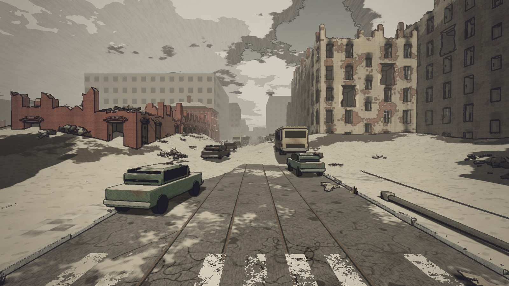 | 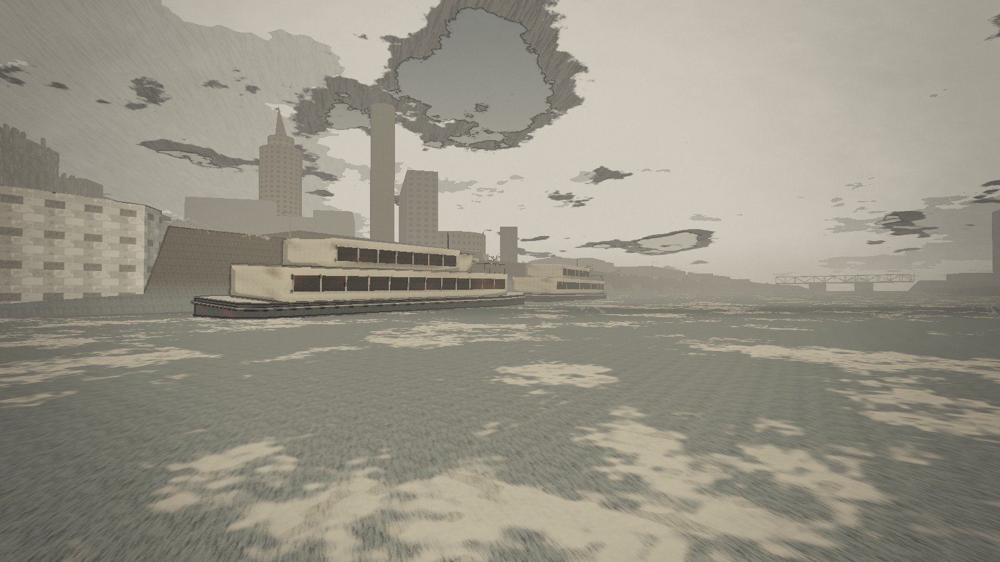 |

**El tendido del tranvía y del trolebús.** Sobre las dos líneas de tranvía y la de trolebús (`tools/ciudad/tendido.py`) va su tendido aéreo: un hilo de contacto sobre cada vía del tranvía y dos por sentido sobre el carril del trolebús, a 5,8 m de la calle, colgados con péndolas de un tirante que cruza de un poste a otro (en la acera, la mediana, una plaza o el tablero del puente) o, si a un lado no hay sitio, de la ménsula de un poste solo. Los apoyos van cada 30 m y, en las curvas, más juntos, para que el hilo no se separe de la vía; donde el tranvía 3 y el trolebús comparten la calle de los Mineros, comparten también los tirantes. Los postes son de tubo de acero de 8,5 m, verde gris, con la franja blanca a la altura de los faros. Como las farolas, peor cuanto más cerca de la Zona Cero: de unos 240 postes, la mitad sigue en pie, 63 están torcidos hacia fuera de la bomba, 34 caídos y de 22 queda el muñón (la punta, tirada al lado). Un apoyo que pierde un poste deja de sostener: su tirante cuelga hasta la calle y sus hilos se vienen abajo. De los demás vanos, unos siguen tensos; en otros el hilo se partió y cada mitad cuelga en J de su apoyo hasta la calle, o se soltó de las péndolas y está tirado en el suelo. Sobre los socavones y el vano hundido del puente, siempre roto. Los cables (unos 6 km entre lo que cuelga y lo que está en el suelo) son vigas finas del tránsito, sin colisión.

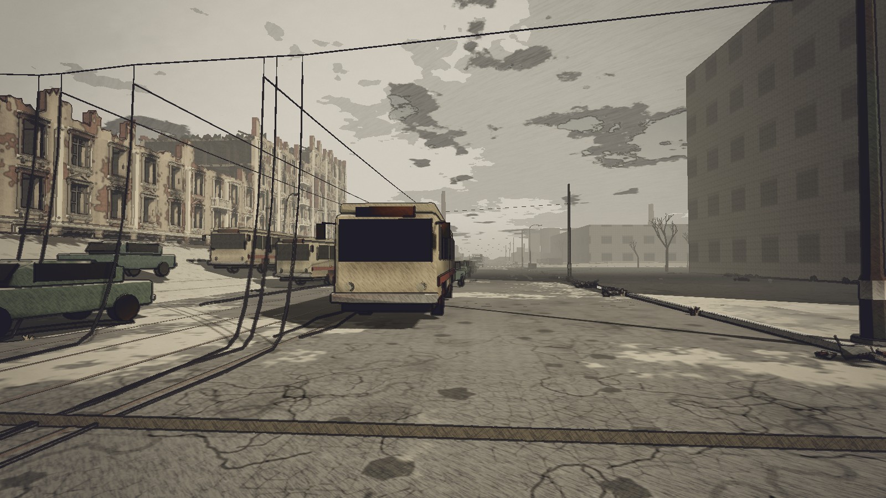

**Matojos.** Unos 9.500 matojos de hierba seca salen por donde el pavimento se abre: junto a los bordillos y al pie de las fachadas, en las grietas y en las juntas del firme roto, en los alcorques, alrededor de los socavones y por todo el balasto de las vías que ya no se usan. Son tres planos cruzados con la mata dibujada (`assets/textures/pavimentos/matojo.png`).

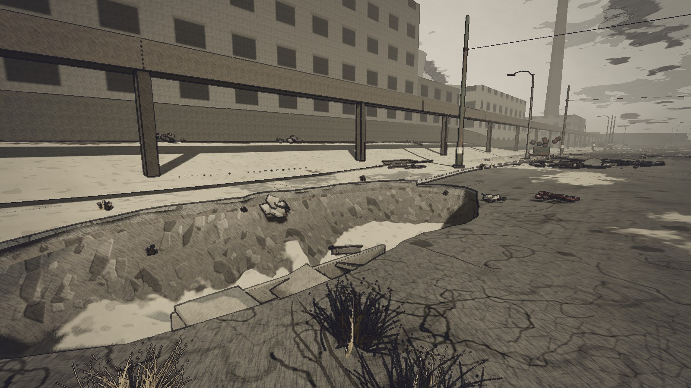

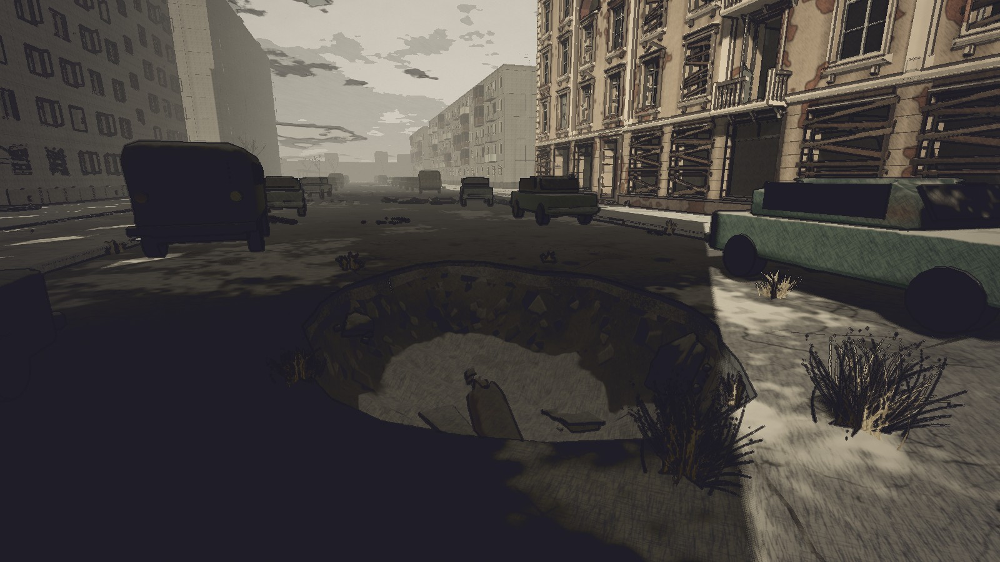

**Lo que cuesta.** La red de tránsito pasa de 0,65 a 1,3 millones de triángulos y se levanta en unos 9 s (antes, 4); `transito.json` ocupa 6 MB (las piezas sueltas van por columnas, sin repetir los nombres de los campos).

**Pendiente.** Los baches y los pozos abiertos no son agujeros de verdad (se dibujan encima de la calle): si hace falta caer en un pozo, habrá que cortar la calle como en los socavones. Las farolas, los postes del tendido y los contenedores no chocan todavía. Los patios y los solares (fuera de la calle) siguen lisos salvo cerca de la Zona Cero, y los edificios todavía no llevan su deterioro. Los vehículos no chocan en la maqueta (son instancias sin colisión).
