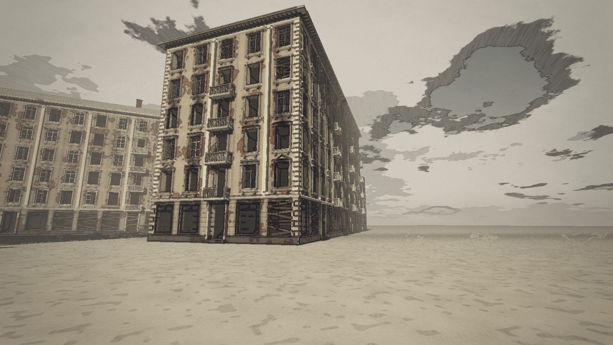
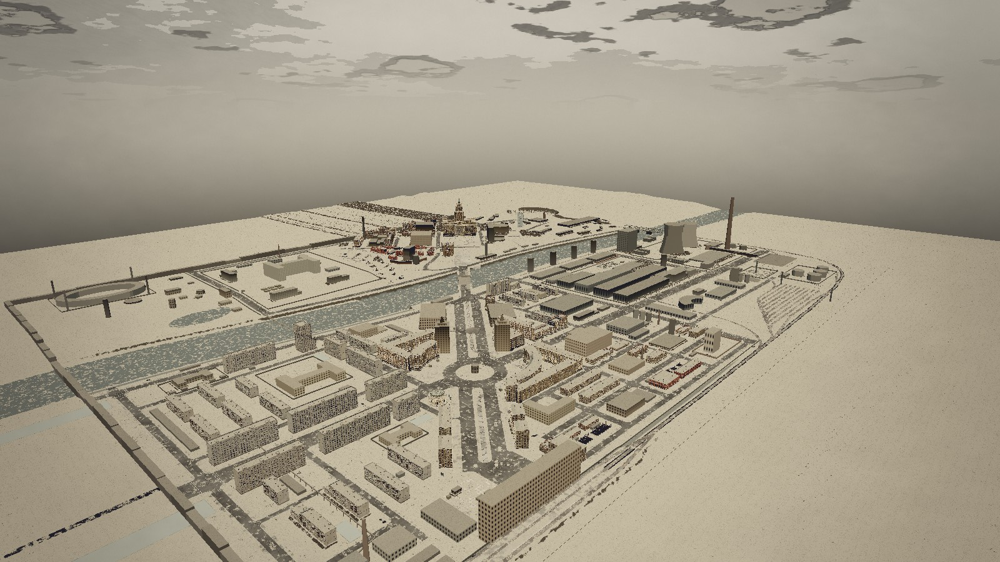
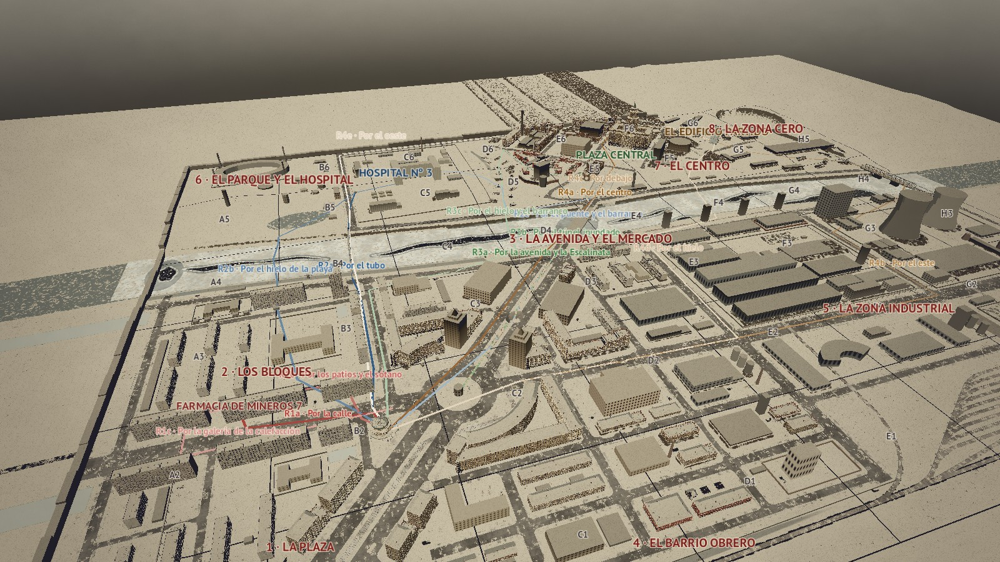
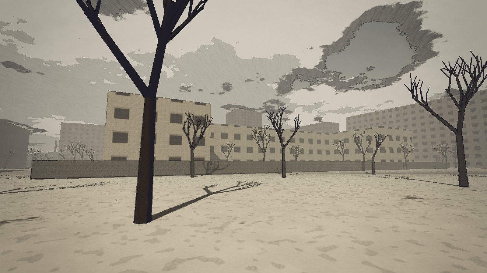
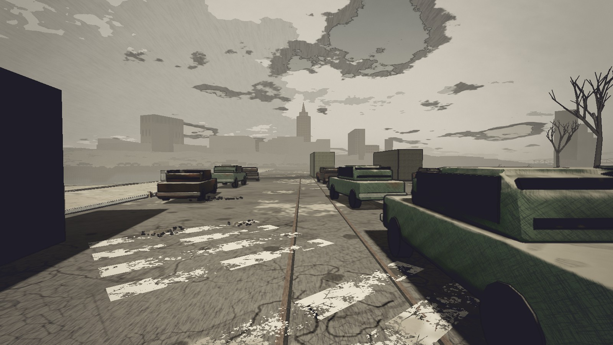
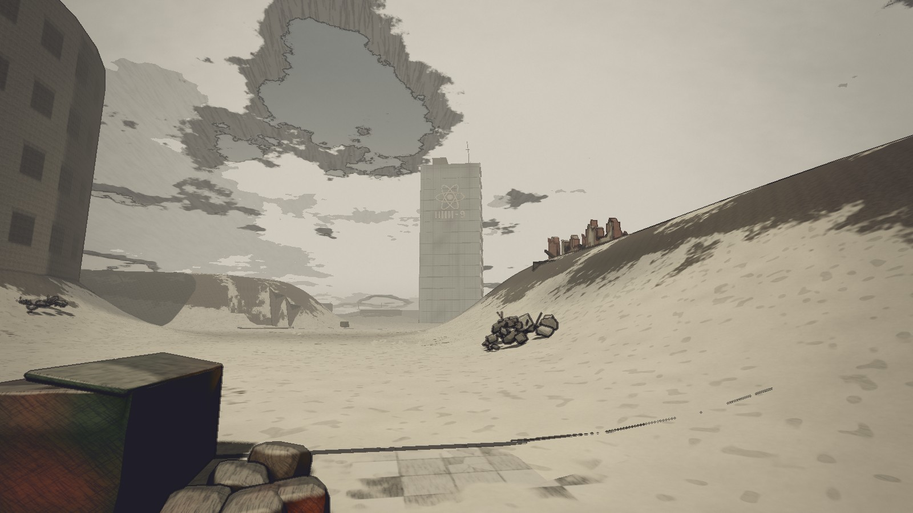
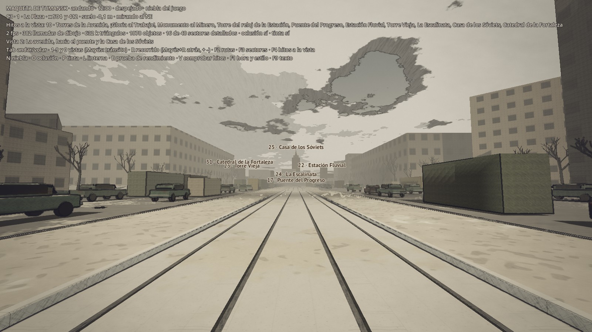
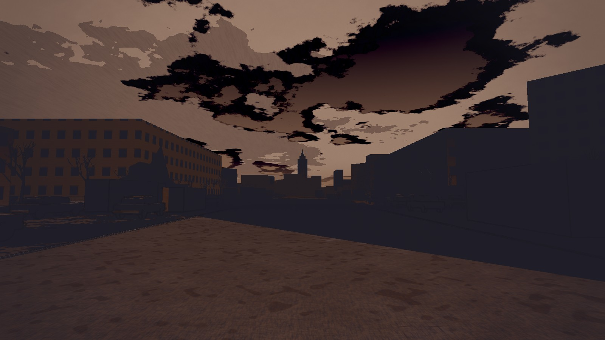

# La ciudad: el plano de Tumansk

Este documento fija **dónde está cada cosa** en Tumansk: calles, manzanas, edificios, relieve, metro, amenazas, peligros y rutas. Es un plano **solo para desarrollo**: el jugador nunca lo verá, porque en el juego no hay mapas y cada uno dibuja el suyo.

La fuente de verdad son los datos de [`tools/ciudad/datos.py`](../tools/ciudad/datos.py). `make ciudad` los valida (nada se solapa, nada pisa la calle ni el río, cada edificio está en su zona), calcula los daños, los escombros y la cota de cada edificio, exporta [`data/ciudad/plano.json`](../data/ciudad/plano.json), el relieve en 16 bits y el suelo de la maqueta, y dibuja las cuatro hojas de abajo. La CI comprueba que el plano sigue siendo válido en cada cambio. Con esos datos se levanta [la maqueta](#15-la-maqueta), la ciudad entera en 3D.

| Hoja | Qué muestra |
|---|---|
| [1 · Plano general](ciudad/plano_tumansk.jpg) | Calles, manzanas, cada edificio con su número de plantas y su daño, relieve, vías, tranvías, vehículos, patios, árboles, zonas e hitos |
| [2 · El subsuelo](ciudad/plano_tumansk_subsuelo.jpg) | Metro, estaciones, rejas, pozos de ventilación, galerías, colectores, pasos subterráneos y sótanos |
| [3 · Amenazas y peligros](ciudad/plano_tumansk_peligros.jpg) | Territorios y guaridas, patrullas, vigías y lo que ven, radiación, máscara, hielo fino y anillos de daño |
| [4 · Rutas y objetivos](ciudad/plano_tumansk_rutas.jpg) | Varias rutas a cada objetivo con su perfil y su tiempo, botín, refugios posibles, miradores y los rastros de tu padre |

## 1. La ciudad en cifras

| | |
|---|---|
| Superficie jugable | 1,6 × 1,2 km (192 ha), en 48 sectores de 200 × 200 m (A1–H6) |
| Zonas | 8, más el río y los túneles |
| Edificios | 357; se entra en 314; 44 son sitios clave hechos a mano |
| Viviendas que se recorren | 110 edificios de viviendas, con portales, escaleras, pisos y sótanos |
| Superficie construida | 30,7 ha en planta; unos 946 000 m² de suelo entre todas las plantas |
| Calles | 16,3 km, más pasos, escaleras y sendas |
| Vehículos | 866 (coches, autobuses, tranvías, trolebuses, camiones, vagones, barcazas) |
| Árboles | 2685: 2254 en pie, secos; 431 tumbados, todos apuntando lejos de la bomba; a menos de 380 m de ella no queda ninguno |
| Relieve | De −18 m (fondo del cráter) a +26 m (colina del parque); el río helado, a −6 m |
| Cruzarla | 1,6 km de oeste a este: unos 20 minutos andando sin parar; más de una hora con cuidado |

## 2. Cómo es una ciudad de verdad (y cómo se aplica aquí)

El error habitual en los videojuegos es un edificio aquí y otro allá, iguales y sin relación. Una ciudad real es continua y cada cosa está donde está por una razón. Tumansk sigue la lógica de las ciudades rusas y soviéticas:

- **El río manda.** El Tumán corre hacia el oeste. Su orilla derecha (la norte) es alta y empinada, porque el río la erosiona; la izquierda (la sur) es una vega baja y llana. La ciudad nació arriba, a salvo, y la industria se extendió abajo, junto al agua y al ferrocarril.
- **La ciudad crece por capas, y todas se ven:**
  1. **La fortaleza**, en el cabo entre el río y el barranco. Queda una torre, trozos de muralla y la catedral.
  2. **El barrio de los mercaderes**, pegado a ella: calles torcidas, casas de ladrillo de dos o tres plantas, una galería comercial.
  3. **El ferrocarril** (siglo XIX), por la vega, con la estación al sur y una playa de vías al este.
  4. **La fábrica y su barrio obrero** (años 30): barracones de madera, casas bajas, el Palacio de la Cultura, los baños, la panificadora.
  5. **El plan estalinista** (años 50): un eje monumental que une la estación, la plaza del Trabajo, el puente, la Escalinata, la plaza Central y la Casa de los Sóviets. Manzanas cerradas con patios y arcos, y casas con comercios en los bajos.
  6. **Los microdistritos** (años 60–80), en el terreno libre del oeste: jrushchovkas en hileras, bloques de 9 plantas, una torre de 16, la escuela y las guarderías en medio, los garajes y la sala de calderas en el borde.
  7. **La autovía elevada**, en el límite oeste y norte.
- **Jerarquía de calles:** avenida (76 m de fachada a fachada, con el tranvía por la mediana), calles principales (36–40 m), calles (14–28 m), pasos de servicio (8–12 m), callejones, sendas y escaleras.
- **Tres maneras de construir manzanas:**
  - En el centro, manzanas cerradas hechas por tramos, cada uno con su altura.
  - En la ciudad vieja, hileras de casas pegadas a lo largo de calles torcidas.
  - En los microdistritos, bloques sueltos con orientación norte-sur (para que entre el sol por los dos lados) y separados entre 30 y 45 m, según las normas de la época.
- **Cada servicio donde le corresponde:**
  - Las tiendas, en los bajos de las calles.
  - La farmacia y el universam, en el bloque de 9 plantas de la calle principal.
  - La escuela y las guarderías, a menos de 300 m de cada casa.
  - Las calderas y los transformadores, en los patios; los garajes, junto a la vía.
  - El hospital, en alto y junto al parque; los bomberos, con su torre de vigilancia; la central térmica, junto al río porque necesita agua.
- **Las redes:**
  - El metro va bajo la avenida y bajo la calle de los Mineros; el tranvía y el trolebús, por la superficie.
  - El calor sale de la central por tuberías elevadas en la zona industrial y por galerías bajo las aceras en la ciudad.
  - Las alcantarillas desaguan en el río.
- **Los patios están vivos:** parques infantiles, pistas, cajas de hockey (en invierno, pistas de hielo), contenedores, trasteros, palomares, aparcamientos y garajes de chapa.
- **Las series se repiten, como en la realidad, pero ningún edificio es igual a otro:** cambia la orientación, el largo, la altura de cada tramo, el daño, el incendio y lo que pasó dentro.

## 3. Lo que pasó: la historia escrita en el plano

- **La bomba** cayó en el nudo ferroviario y la Planta Nº 1, al noreste. Otra, más lejos, al suroeste (fuera del mapa), tiró la autovía elevada.
- **Los daños** dependen de la distancia a la Zona Cero, con una variación fija para cada edificio. Las casas de madera ardieron casi todas. Algunos casos se fijan a mano: el Edificio Partido, el puente, las chimeneas y la aguja de la Casa de los Sóviets.

  | Distancia a la bomba | Nivel | Qué se ve |
  |---|---|---|
  | Menos de 400 m | 4 · Arrasado | Muñones de una o dos plantas y campos de escombros |
  | 400–800 m | 3 · Destripado | Cascarones: forjados caídos, quedan muros y estructura; calles cegadas |
  | 800–1250 m | 2 · Roto | Derrumbes parciales (una esquina, las últimas plantas), fachadas abiertas |
  | Más de 1250 m | 1 · Herido | Sin cristales, hollín de incendios, balcones y paneles caídos, cubiertas cedidas por la nieve |

- **La dirección cuenta la historia:**
  - Los escombros caen del lado contrario a la bomba y ciegan esas calles.
  - Los árboles de los alrededores están tumbados y todos apuntan lejos de ella, una pista para orientarse.
  - La chimenea de la central cayó hacia el sur, sobre la calle de los Mineros.
  - La aguja de la Casa de los Sóviets quedó doblada hacia el suroeste.
- **La lluvia radiactiva** cayó en una franja hacia el sureste. El este de la zona industrial está contaminado y, pasada la vía, la dosis es mortal en minutos.
- **La evacuación:**
  - Atascos en dirección al metro y al puente.
  - Un tren de pasajeros que no salió.
  - Un control del ejército junto al vestíbulo del metro.
  - Autobuses y tiendas en la plaza de la Estación.
  - El hospital de campaña de la Cruz Roja y, detrás del hospital, la zanja.
- **Dos años de invierno:**
  - Tejados hundidos por la nieve.
  - Tuberías reventadas y carámbanos.
  - Saqueos, guaridas, campamentos y rastros del mundo vivo.

## 4. Las zonas

| # | Zona | Salida | Lo principal | Amenazas |
|---|---|---|---|---|
| 0 | **La Estación** | — | Tu depósito, bajo la plaza del Trabajo. La última estación habitada hacia el norte y el este | Ninguna |
| 1 | **La Plaza** | 10–20 min | La plaza redonda del Trabajo, las torres de la avenida, el vestíbulo del metro, el paso subterráneo, el primer patio, el Banco, el Gastronom, la plaza de la Estación con el tren de la evacuación | La Jauría, a veces |
| 2 | **Los Bloques** | 20–40 min | Microdistrito: Mineros 7 (farmacia y universam), la Torre de 16, la escuela Nº 21 con su refugio de defensa civil, dos guarderías, la sala de calderas, los garajes Volga, la playa | La Jauría (madriguera en los garajes) y el Inquilino de Mineros 7 |
| 3 | **La Avenida y el Mercado** | 30–60 min | El Mercado Central y su cúpula, los Grandes Almacenes, el cine Cosmos, el depósito de trolebuses, la gasolinera, el socavón, el paso del Mercado, el club náutico | Saqueadores (vigía en los Grandes Almacenes) y el Llamador del Mercado |
| 4 | **El Barrio Obrero** | 30–50 min | El Palacio de la Cultura, la panificadora, los baños, los bomberos y su torre, la comisaría, barracones de madera, la iglesia vieja junto a la vía | La Jauría, de paso; saqueadores en las rondas |
| 5 | **La Zona Industrial** | 45–60 min | La fábrica de maquinaria y su búnker, la playa de vías, el depósito de locomotoras, la chatarrería, el puerto con sus grúas y el elevador, la central térmica, el parque de carbón que aún arde, el depósito de combustible | La guarida principal de los saqueadores (Almacén 3), radiación al este, humo |
| 6 | **El Parque y el Hospital** | Unos 60 min | Al otro lado del río: el parque de la Cultura (colina, torre de paracaídas, estanque, estadio) y el Hospital Clínico Nº 3 con la Cruz Roja | La segunda jauría y el Inquilino del hospital |
| 7 | **El Centro** | 60–90 min | La ciudad vieja (fortaleza, catedral, museo, mercaderes) y el centro estalinista (Escalinata, plaza Central, Casa de los Sóviets, teatro, hotel Tumán, circo, telégrafo, universidad, comisariado); en el barranco, las casas de madera | Saqueadores (comisariado y vigía en la torre), el Inquilino del hotel y el Llamador del barranco |
| 8 | **La Zona Cero** | Gran expedición: 60 min – 3 h | El cráter, la Planta Nº 1 y su búnker de mando, el nudo ferroviario y **el Edificio Partido** (el antiguo Instituto Nº 9), a 245 m del centro de la explosión | Todas, más radiación extrema y aire irrespirable |
| — | **El río** | — | El Tumán helado: la frontera entre el sur y el norte, con cinco cruces | Hielo fino, el vigía de la torre |
| — | **Los túneles** | Variable | Dos líneas de metro, estaciones muertas, galerías y colectores | Oscuridad, agua helada, los Llamadores |

## 5. El relieve

| Lugar | Altura |
|---|---|
| Hielo del río | −6 m |
| Vega sur (de la orilla a la vía) | 0 a +5 m |
| Terraplén del ferrocarril | +5 m sobre la vega |
| Muelle Norte, al pie de la loma | +1 m |
| La loma (de 80 a 110 m de ancho) | De +1 a +12 m |
| Meseta del centro | +12 a +16 m |
| Colina del parque | +23 m |
| Fondo del barranco | De +1 m (en el río) a +9 m (en la cabecera) |
| Socavón de la avenida | −11 m respecto a la calle |
| Cráter | Fondo a −18 m; borde levantado unos 7 m sobre la meseta |

El relieve decide qué se ve y desde dónde:

- Desde el centro se domina la orilla sur.
- El barranco es un camino escondido del río a la ciudad vieja.
- El terraplén de la vía es un camino alto y expuesto.
- Los montones de escombros cortan calles y abren pasos por encima.

El relieve se exporta en `data/ciudad/relieve.png`: 16 bits, 2 m por píxel, y metros = valor / 100 − 50.

## 6. El río y sus cinco cruces

| Cruce | Cómo es |
|---|---|
| **El tubo** (oeste) | La tubería de calefacción cruza el río con una pasarela de servicio; la pasarela peatonal que iba al lado se cayó. Silencioso, estrecho, con viento; se ve desde las dos orillas |
| **El puente hundido** (avenida) | El vano central descansa inclinado sobre el hielo: se baja con cuerda y se sube por el otro lado. Es el paso de los saqueadores, que lo vigilan |
| **El hielo** (frente al puerto) | Rápido y abierto. Lo ven el vigía de la torre y el del elevador. Hay hielo fino bajo los desagües |
| **El puente del ferrocarril** (este) | Celosía de acero intacta, pero dentro del rastro radiactivo |
| **El túnel inundado** (metro) | Bajo el río, a oscuras, con el agua helada al pecho. Territorio del Llamador |

## 7. El subsuelo

- **Línea 1 (roja):** bajo la avenida y bajo el río.
  - S1 Plaza del Trabajo: tu estación.
  - S2 Mercado: inundada.
  - S3 Plaza Central: hundida.
  - S4 Planta: destruida.
- **Línea 2 (azul):** bajo la calle de los Mineros. Al oeste sigue la red habitada (fuera del mapa); al este está S5 Fábrica, abandonada.
- **Las rejas del gobierno civil** cierran los túneles a la salida de tu estación (Reja Norte y Reja Este). Los stalkers con permiso salen por ellas.
- **Pozos de ventilación:** seis (V1–V6), con escalera de pates. Son entradas y salidas alternativas; V4 es la única salida de la estación hundida.
- **Galerías:**
  - La de la calefacción, bajo la acera de Mineros (de pie, 2 m).
  - La de cables, bajo la avenida.
- **Colectores:**
  - El de pluviales del muelle Sur, agachado; desagua en la playa y bajo el puerto.
  - El arroyo enterrado, bajo la ciudad vieja; es la guarida del segundo Llamador.
  - El gran colector del centro.
- **Pasos subterráneos:** el de la plaza (en cruz), el del Mercado y el túnel de los andenes de la estación de tren.
- **Sótanos:** cada jrushchovka tiene un sótano de punta a punta, con salida en cada portal.

## 8. Hitos para orientarse

Sin mapas, el jugador se orienta por lo que ve de lejos. Hay al menos dos hitos visibles desde cualquier punto, para poder triangular al dibujar el mapa. La lista completa está en la hoja 1; los principales son:

- **Sur:** las torres de la avenida, las letras ¡GLORIA AL TRABAJO!, el reloj parado de la estación, la Torre de 16 y las chimeneas.
- **Este:** el elevador de grano, las grúas, las chimeneas y las torres de refrigeración de la central.
- **Norte:** la torre de la Casa de los Sóviets con la aguja doblada (110 m, se ve desde toda la ciudad), el mástil de la radio, la catedral, la torre de paracaídas, los focos del estadio, la aguja de la estación fluvial y el Edificio Partido junto al cráter.

## 9. Amenazas sobre el plano

| Amenaza | Guarida | Territorio | Rutina |
|---|---|---|---|
| La Jauría | Garajes Volga | Los Bloques, la playa, la plaza de la Estación | Caza al amanecer y al atardecer; duerme de noche |
| La segunda jauría (Fase 6) | Bajo las gradas del estadio | El parque y el hielo de esa orilla | Igual; se pelea con la primera por la playa |
| El Inquilino | Mineros 7 · Hospital · Hotel Tumán | Su edificio, nunca sale | Quieto de día en los huecos; recorre las plantas de noche |
| El Llamador | Estación Mercado (inundada) | Paso del Mercado y mercado | Duerme de día; caza al anochecer |
| El Llamador del barranco (Fase 6) | El arroyo enterrado | El barranco hasta el río | Nocturno |
| Saqueadores | Almacén 3 (unas diez personas) · Comisariado Militar (unas seis) | El puerto y la fábrica · el centro | Salen de día en grupos de tres; de noche, encerrados con guardia y fuego |

- **Patrullas:**
  - P1: relevo del vigía de los Grandes Almacenes.
  - P2: suministros entre las dos guaridas, por el puente hundido.
  - P3: relevo del vigía de la torre.
  - P4: ronda del puerto.
- **Vigías:**
  - En la azotea de los Grandes Almacenes: ve la avenida entera.
  - En lo alto del elevador: ve el puerto, la playa de vías y el hielo.
  - En la planta 20 de la torre de la Casa de los Sóviets: ve el río, los puentes y la Escalinata.

## 10. Peligros

- **Radiación:**
  - El rastro radiactivo, en tres niveles, al este.
  - Focos: la morgue, los camiones de bomberos de la plaza Central, los vagones del nudo, las cubiertas planas del centro (polvo acumulado), los sedimentos de la curva del río, el tren de la evacuación y el agua del socavón.
- **Hace falta máscara** en la Zona Cero (polvo radiactivo), junto al parque de carbón (humo) y en la estación hundida (aire viciado).
- **Hielo fino** junto al puente hundido, bajo los desagües, en la curva de la central y bajo la autovía caída.

## 11. Rutas: siempre hay otra

Tiempos de ida a paso prudente, sin contar imprevistos.

| Destino | Ruta | Perfil | Distancia | Tiempo |
|---|---|---|---|---|
| Farmacia de Mineros 7 | R1a · Por la calle | Rápida y expuesta | 210 m | 6 min |
| | R1b · Por los patios y el sótano | Lenta y segura | 230 m | 14 min |
| | R1c · Por la galería de la calefacción | A oscuras; exige palanca | 380 m | 12 min |
| Hospital Nº 3 | R2a · Por el tubo | Silenciosa y expuesta al viento | 770 m | 25 min |
| | R2b · Por el hielo de la playa | Rápida, abierta; la segunda jauría | 880 m | 22 min |
| | R2c · Por el puente y el barranco | Larga; cruza el paso de los saqueadores | 1210 m | 40 min |
| Plaza Central | R3a · Por la avenida y la Escalinata | Directa; bajo el vigía de la torre | 890 m | 25 min |
| | R3b · Por el túnel inundado | A oscuras, con agua helada; el Llamador | 860 m | 35 min |
| | R3c · Por el hielo y el barranco | Rodeo largo fuera de la vista del vigía | 1420 m | 45 min |
| El Edificio Partido | R4a · Por el centro | La más corta; la más vigilada | 1450 m | 60 min |
| | R4b · Por el este | Por el puerto y el puente del ferrocarril; mucha radiación | 1940 m | 90 min |
| | R4c · Por debajo | Metro y colectores; oscura, fría y lenta | 1350 m | 100 min |
| | R4d · Por el hielo | Abierta; hielo fino junto al puerto | 1450 m | 80 min |
| | R4e · Por el oeste | La más larga; la más tranquila hasta el centro | 1960 m | 150 min |

Las cinco rutas a la Zona Cero explican la duración de la gran expedición: de 60 minutos con la mejor preparación a 2 o 3 horas dando rodeos, esperando a que pase una patrulla o pasando la noche en un refugio.

## 12. Los bordes del mapa

Cada borde tiene una razón dentro del mundo:

| Lado | Qué hay | Por qué no se pasa |
|---|---|---|
| Oeste y norte | La autovía elevada, caída | Una muralla de hormigón y coches de 10 m; al norte, además, los edificios tumbados por la onda ciegan las calles |
| Sur | El terraplén del ferrocarril, con su valla y el tren quemado | Detrás, el Barrio Quemado: un llano de ceniza sin nada en pie |
| Este | La vía del este | Más allá cayó toda la lluvia radiactiva: dosis mortal en minutos |
| Noreste | El cráter | Radiación extrema |

## 13. Catálogo de edificios

Los tipos siguen las medidas de las series soviéticas reales. Los interiores de cada tipo salen de su distribución de serie (portales, escaleras, pisos, sótanos); los 44 sitios clave se hacen a mano.

| Tipo | Medidas | Plantas | En la ciudad |
|---|---|---|---|
| Casa estalinista (tramos de manzana y fachadas) | 16 m de fondo | 5–8 | 49 |
| Casa anterior a la revolución | 10–12 m de fondo | 2–3 | 24 |
| Casa de madera (isba) | 9 × 8 m | 1 | 24 |
| Jrushchovka | 64 × 12 m (de 2 a 4 portales) | 5 | 18 |
| Bloque de paneles | 48–96 × 13 m | 9 | 10 |
| Torre | 26 × 22 m | 16 | 1 |
| Casa obrera y barracón | 30–85 × 10–14 m | 2–3 | 12 |
| Escuela y guardería | En H o en L | 2–4 | 6 |
| Naves, almacenes e industria | Hasta 180 × 36 m | 1–2 | 34 |
| Públicos, comercios y monumentales | Teatro, mercado, almacenes, palacio, hospital, oficinas, pabellones… | 1–14 | 55 |
| Torres, chimeneas, depósitos, grúas, murallas y montones | — | — | 43 |
| Ruinas de la Zona Cero | Muñones y pórticos | 1–2 | 20 |
| Menores | Garajes, cobertizos, quioscos, transformadores, tiendas de campaña | 1 | 61 |

## 14. Cómo se construye

1. **El plano son datos.** `tools/ciudad/datos.py` decide la posición, el tipo, las plantas, el uso y las notas de cada cosa. `plano.py` calcula el daño, los incendios, los escombros y el relieve, y lo exporta a `data/ciudad/plano.json`.
2. **Maqueta automática** (hecha, F3-15): un generador en Godot lee el plano y levanta la ciudad en volúmenes sencillos (relieve, calles, edificios a su altura, escombros) para probar recorridos, vistas y rendimiento antes de construir nada. Ver [la sección 15](#15-la-maqueta).
3. **Kit modular** (hecho para las viviendas, F3-16): cada tipo de edificio se monta con las piezas del kit de arquitectura soviética (paneles, ventanas, balcones, portales, escaleras, cubiertas), con el daño de su nivel y las variaciones de su semilla. Ya se montan las 138 viviendas del plano (las estalinistas y las casas obreras, las de antes de la revolución, las isbas, las jrushchovkas, los bloques, la torre y los barracones), con las mismas reglas de daño que la maqueta; el resto de los tipos sigue en volúmenes. Ver [DESARROLLO.md](DESARROLLO.md#el-kit-de-arquitectura-f3-16).

   
4. **Sitios clave a mano:** los 44 edificios con interior hecho a mano y los lugares de las misiones se terminan uno a uno.
5. **Carga por sectores:** la ciudad se carga en celdas de 200 × 200 m. Hay detalle completo en la celda del jugador y en las de alrededor, y versiones simplificadas más lejos. Las manzanas sirven de oclusores (lo que tapan no se dibuja), algo imprescindible para llegar a 60 fps con la gráfica integrada.

**Para cambiar algo:** se edita `tools/ciudad/datos.py` y se ejecuta `make ciudad`. Si algo se solapa, pisa la calle o cae en la zona equivocada, el generador lo dice y la CI no pasa.

## 15. La maqueta

La maqueta (`scenes/debug/maqueta_ciudad.tscn`, F3-15) levanta la ciudad entera desde los datos del plano en un segundo y medio. Se recorre a pie (a 1,4 m/s y con colisión) o volando, y tiene herramientas para medir. Cómo se abre y sus teclas, en [DESARROLLO.md](DESARROLLO.md#la-maqueta-de-la-ciudad-f3-15).

- **Lo que se levanta:**
  - El relieve, cada 2 m, pintado con el suelo del plano (calzadas, aceras, plazas, el hielo, las vías, los patios y los escombros) bajo la nieve vieja.
  - Los 357 edificios, a su altura y con lo que queda en pie según su daño. Las torres llevan aguja (la de la Casa de los Sóviets, doblada hacia el suroeste), las chimeneas se estrechan, las torres de refrigeración tienen su forma y las casas de madera y las de antes de la revolución llevan tejado a dos aguas.
  - Los 866 vehículos, los 2685 árboles y los puentes (el del Progreso, con su vano hundido sobre el hielo, y el del ferrocarril, de celosía).
  - Las tuberías elevadas (el tubo cruza el río con su pasarela), las vallas, la línea eléctrica y el muro de la autovía caída al oeste y al norte.
- **El daño en volumen:**
  - Nivel 2: se hunde el extremo que mira a la bomba.
  - Nivel 3: un cascarón de alturas desiguales, más bajo del lado de la bomba.
  - Nivel 4: muñones de una o dos plantas, medio enterrados en su escombro.
  - Las casas de madera ardieron (quedan los restos) y el Edificio Partido conserva solo la mitad que no miraba a la bomba.
  - Las torres, las chimeneas, los depósitos, las ruinas y los hitos conservan la altura del plano.
- **Sectores:** los 48 sectores tienen una versión lejana (del color de la niebla, barata) y una detallada, que se dibuja a menos de 450 m. Los edificios grandes y el relieve son oclusores.

### Lo que ha enseñado la maqueta

- **Los hitos se ven desde casi toda la calle, pero no desde los patios.** Con línea de visión desde la altura de los ojos (cada 20 m, fuera de los edificios), desde el 92 % de los 4039 puntos se ven al menos dos hitos. Por zonas:

  | Zona | Se ven dos o más |
  |---|---|
  | El río, el Parque y el Hospital, la Zona Industrial | 97–100 % |
  | El Centro, la Zona Cero | 93–95 % |
  | La Avenida y el Mercado, el Barrio Obrero, La Plaza | 82–83 % |
  | Los Bloques | 73 % |

  Los puntos ciegos son casi todos patios cerrados: los de los microdistritos, los del Barrio Obrero y los de las manzanas estalinistas (rosa: ningún hito; amarillo: uno). La regla del plano («desde cualquier punto») se cumple en las calles; en los patios habría que aceptarlo o añadir hitos que asomen por encima de los tejados (una chimenea de calefacción, un depósito de agua, una antena).

  

- **La niebla de día tapa la ciudad a partir de unos 300 m.** Solo los hitos la atraviesan ([D-027](DECISIONES.md)): por eso desde la avenida se ve la torre de la Casa de los Sóviets a 850 m, pero no el resto del centro.
- **Rendimiento** (contado en el entorno de desarrollo, sin gráfica; los fps hay que medirlos en tu PC con la tecla B): a pie de calle se dibujan entre 80 y 200 objetos por imagen (llamadas de dibujo) y entre 0,48 y 0,6 millones de triángulos, con la oclusión activa (quita hasta una cuarta parte de las llamadas en la zona industrial y alrededor de un 12 % en la plaza). La mayor parte de los triángulos es el relieve detallado, no los edificios: es lo primero que habría que aligerar si hiciera falta.

| | |
|---|---|
|  |  |
|  |  |
|  |  |
|  |  |

