# Guía de estilo: ilustración entintada

Estado: **Fase 1 completa**, pendiente de tu aprobación final. Los valores de esta guía son los que usan ahora mismo los shaders, `StyleDirector` y `Atmosphere`.

**Revisión 1** (tu respuesta): contorno y tramado, bien; el depósito cálido, muy bien; el exterior estaba demasiado blanco y pálido, sin ambiente posapocalíptico, y el cielo no podía ser negro. La segunda pasada cambia el exterior (secciones 2, 3, 5 y 6).

**Revisión 2**: el exterior transmite la sensación; hay que mantener ese nivel en toda la ciudad. La noche, mucho más oscura (sin linterna casi no se ve). El anochecer, bien, con un ligero retoque: ahora es algo más marrón y menos saturado.

**Cierre de la Fase 1**:

- Contorno de casco invertido para los objetos clave.
- Huellas en la nieve y ventisca.
- El kit de modelos completo (57), con el equipo y los muebles de la rama de modelos: el depósito amueblado por rincones y la mesa del equipo.
- La hora del día continua.
- El panel de depuración.
- Las primeras piezas de interfaz y las tipografías.
- Un [vídeo de 33 segundos](capturas/fase1_dioramas.mp4) con todos los dioramas.

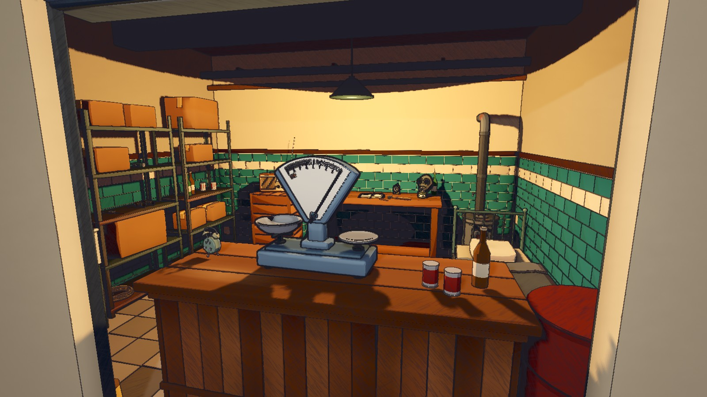

## 1. Cómo se construye la imagen

| Capa | Dónde está | Qué hace |
|---|---|---|
| Color base | Recetas de Blender (`tools/blender/`) | Cada pieza lleva su color pintado en los vértices, con oclusión, cavidades y manchas (óxido, humedad, suciedad) |
| Sombreado por bandas | `assets/shaders/tinta.gdshaderinc` | Tres bandas (sombra, medio tono, luz) según el ángulo con la luz. La banda de sombra vale 0: ahí solo llega la luz ambiente, así que las sombras propias y las proyectadas tienen el mismo color |
| Caída de la luz | Mismo shader | La distancia y las sombras proyectadas se aplican suaves, encima de las bandas |
| Nieve | Mismo shader (`snow_amount`) | Blanquea lo que mira hacia arriba, con ruido para que no sea uniforme |
| Post-proceso | `assets/shaders/post_tinta.gdshader` | Gradación, tramado, relleno de tinta, contorno, trazo vivo, papel, grano y viñeta |
| Estado del dibujo | `scripts/core/style_director.gd` | Mezcla el preajuste de la zona con el miedo y la radiación y lo publica en los parámetros globales `tinta_*` |

El post-proceso es un rectángulo que cubre la pantalla (`scenes/style/ink_post.tscn`). Se dibuja antes que los objetos transparentes, así que las partículas (nieve, polvo) y las telarañas quedan limpias encima del dibujo.

### Contorno de casco invertido (objetos clave, personas y criaturas)

El contorno del post-proceso es fino y uniforme. Lo importante lleva además un **casco invertido** (`InkHull.add_to(nodo)`, `assets/shaders/contorno_casco.gdshader`):

- Es una copia de la malla con las normales suavizadas: los vértices que comparten posición promedian su normal, así el casco no se abre en las aristas vivas.
- Se hincha unos píxeles (2,6 px a 1080p, igual de cerca que de lejos) y se pinta de tinta solo por detrás.
- Tiembla a saltos con el trazo vivo y engorda con el miedo.
- Sirve también al juego: lo que se puede coger destaca con un trazo de pincel.

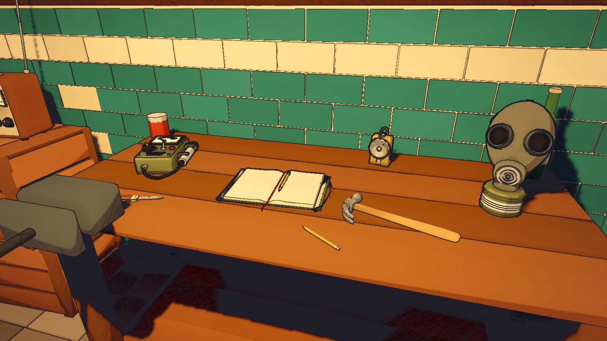

## 2. Preajustes por zona

| Parámetro (`tinta_*`) | Depósito | Superficie | Superficie de noche | Qué controla |
|---|---|---|---|---|
| `trazo_fps` | 4 | 8 | 8 | Cuántas veces por segundo se "redibuja" el contorno |
| `trazo_amplitud` | 0,6 px | 1,0 px | 1,0 px | Cuánto tiembla el contorno |
| `grosor` | 1,6 px | 2,2 px | 2,2 px | Grosor del contorno a 1080p |
| `tramado` | 0,5 | 0,85 | 0,75 | Fuerza de las rayas de lápiz |
| `tramado_umbral` | 0,07 | 0,30 | 0,10 | Luminancia por debajo de la cual empieza el tramado |
| `relleno` | 0,003 | 0,018 | 0,002 | Luminancia por debajo de la cual todo es tinta |
| `saturacion` | 1,0 | 0,62 | 0,7 | Saturación del color |
| `contraste` | 1,05 | 1,18 | 1,1 | Contraste alrededor del gris medio |
| `papel` | 0,3 | 0,4 | 0,35 | Cuánto se nota el grano del papel |
| `grano` | 0,025 | 0,06 | 0,07 | Grano de película |
| `vineta` | 0,3 | 0,5 | 0,45 | Oscurecimiento de los bordes |
| `rampa` | 1 | 2 | 2 | Fila de `rampas.png` |
| `tinte` | `#FFF7EB` | `#F7F2E6` | `#E6F2FF` | Tinte de la imagen |
| `negro` | 0 | 0 | 1 | Cuánto se oscurece el relleno de tinta; con 1 casi negro, y los contornos desaparecen donde no llega la luz |

**Miedo** (`StyleDirector.fear`, de 0 a 1): el trazo tiembla hasta 3,5 veces más y más deprisa, el contorno engorda hasta 1,5 px, el color pierde saturación y el tramado invade la imagen desde los bordes. **Radiación** (`StyleDirector.radiation`): el grano crece. Con la opción de accesibilidad "trazo vivo reducido", el temblor baja al 30 % y no pasa de 4 fps.

## 3. Paletas

**Depósito: "Ámbar y madera"**

| Uso | Hex |
|---|---|
| Tinta | `#1B1A22` |
| Azulejo de metro | `#2F6F73` (franja crema `#D3C8AC`) |
| Yeso | `#CDBF9F`, manchas `#9C8F72` |
| Suelo | `#8E857A` y `#7C746A`, mortero `#3B3631` |
| Madera | `#8A5A3B`, oscura `#6E4A32` |
| Cartón | `#A8794E`, cinta `#D8B26A` |
| Metal de estanterías | `#55615A`, óxido `#8E4A2F` |
| Luz de la bombilla | `#FFCC8F` |

**Superficie: "Ceniza y óxido"** (más sucia y oscura desde la revisión 1)

| Uso | Hex |
|---|---|
| Nieve vieja | `#B3AEA2`, con barro `#7A7266` y hollín `#1E1B19` |
| Paneles de hormigón | `#7E7A72`, oscuros `#625E58` |
| Cristal | `#1F2228`; quemado `#0D0C0E` |
| Balcones (pintados por los vecinos, ya desvaídos) | `#6A7F8B`, `#7D8C78`, `#9A8F78`, `#86706B` |
| Óxido | `#7E4128` |
| Corteza | `#34302C` |

**Cielo** (`scripts/surface/atmosphere.gd`). Nunca es negro del todo, pero la noche es muy oscura: sin linterna solo se distinguen el cielo y las siluetas (revisión 2).

- **Hora continua:** `Atmosphere.apply_hour(entorno, sol, hora)` interpola entre los momentos de referencia.

  | Hora | Momento |
  |---|---|
  | 0:00–5:00 | Noche |
  | 6:30 | Amanecer: el anochecer con el sol al este |
  | 8:00–16:30 | Día |
  | 18:00 | Anochecer |
  | Desde las 19:30 | Noche |

  El preajuste de estilo cambia de día a noche con una transición. El reloj del mundo (Fase 4) usará esta función.
- **Clima:** con ventisca, la niebla se cierra (densidad 0,055) y se vuelve gris, nunca blanca. La luz baja, el cielo se cubre y la nieve cruza de lado con ráfagas.

| Momento | Cénit | Horizonte | Nubes (claro / oscuro) | Luz |
|---|---|---|---|---|
| Día | `#6E7273` | `#9A968C` | `#AEABA2` / `#6A6967` | Sol velado `#F2E6CC` |
| Anochecer | `#2E3040` | `#B47A55` | `#C58560` / `#3E3541` | Sol bajo `#FFA06A` |
| Noche | `#0A0D14` | `#161B25` | `#2A3142` / `#0E1118` | Luna muy débil `#7D8DB5` |

Regla: el rojo (`#C8323C`) se reserva para lo importante.

### La noche y la linterna

De noche la luz ambiente y la de la luna son casi nulas (`tinta_negro` = 1): el relleno de tinta es casi negro y los contornos solo se dibujan donde llega algo de luz. La linterna (`scripts/surface/flashlight.gd`) es un foco de luz cálida que sale de la mano: dentro de su cono vuelven el color, el tramado y la tinta. Los copos de nieve reciben la luz de la escena, así que de noche solo se ven dentro del cono.

### Huellas y ventisca

- **Huellas:** las de bota y las de perro son calcomanías (`Decal`) sobre la nieve vieja.
  - Sus texturas (`huella_bota.png` y `huella_perro.png`) las genera `tools/textures/generate_textures.py`: nieve pisada, más oscura, con el borde algo levantado y el dibujo de la suela en espiga.
  - Funcionan con el shader propio y sobre los montones de nieve.
  - Son información: tú ves las de los demás y ellos ven las tuyas.
- **Ventisca:** el diorama `diorama_patio_ventisca` muestra el clima.
  - Mucha más nieve, rápida y de lado.
  - Ráfagas como trazos casi horizontales.
  - Niebla cerrada y gris.

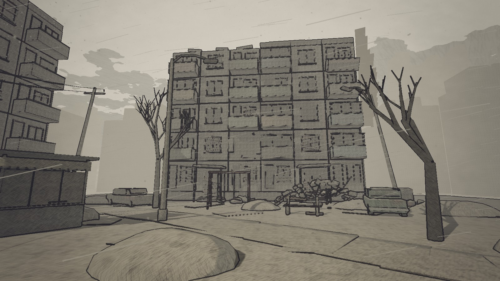
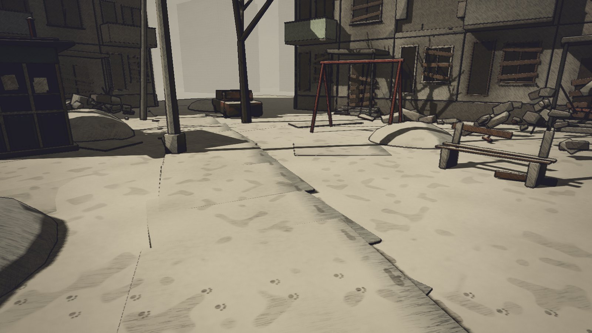

## 4. Reglas de modelado (recetas)

- **Biseles** de 3 a 20 mm según el tamaño. Las piezas sin bisel se sombrean planas.
- **Imperfección** siempre con semilla: `wobble` (ondulación de 2 a 6 mm en objetos, hasta 22 cm en montones de nieve), `dent` (abolladuras), `apply_bulge` (cartón hinchado), giros de 0,5 a 2° en baldosas y tablones.
- **Variación de color** por pieza de un 4 a un 10 % (`jitter`), más manchas (`stain`). Con `stretch_z` < 1 las manchas se alargan en vertical, como chorretones bajo los balcones.
- **Subdivisión**: las manchas y las abolladuras se pintan por vértice. Una cara grande necesita `cuts` (en las cajas) o más pasos en el perfil (en las piezas de torno) para recogerlas.
- **Pintura** (`paint`): oclusión de 8 a 32 muestras según el tamaño, cavidades oscuras y aristas algo más claras.
- **Destrucción** (superficie): hollín de incendio sobre las ventanas quemadas (`scorch`), paneles caídos con el hueco oscuro y varillas, balcones desplomados que cuelgan de la bisagra, cornisas rotas, escombros al pie de la fachada y puertas tapiadas con tablones.
- **Nombres de material**: `metal` (rampa de metal), `vidrio`, `bombilla` (emite luz), `nevado` (nieve vieja), `lejano_*` (siluetas del horizonte) y, en los edificios del kit, `muro`, `azulejo`, `ladrillo`, `estuco` e `interior` (ver la [sección 9](#9-los-edificios-del-kit-f3-16)). El resto usa el material base.
- **Nada plano y estrecho:** una cara de pocos centímetros vista casi de canto ocupa menos de un píxel, y el contorno de tinta la dibuja a puntos. Las reglas para evitarlo, en la [sección 9](#9-los-edificios-del-kit-f3-16).

## 5. Interfaz y tipografías

**Interfaz:** las primeras piezas en el estilo final están en `scenes/ui/prueba_interfaz.tscn`.

- Las ilustraciones son SVG dibujados con rough.js (`tools/svg/generate.mjs`). Los textos los pone Godot con las fuentes del juego, a partir del `.json` que acompaña a cada SVG ([D-007](DECISIONES.md)).
- Las piezas:
  - El cuaderno de cuadros con el mapa a lápiz de La Plaza. Sale del plano de la ciudad, con colores de lápiz: rojo para el peligro, azul para la ruta, verde para el refugio.
  - La etiqueta de precio.
  - El recibo del impuesto, a máquina, con el sello violeta **PAGADO**.
  - La ficha de encargo clavada con una chincheta, con el peligro en puntos rojos.

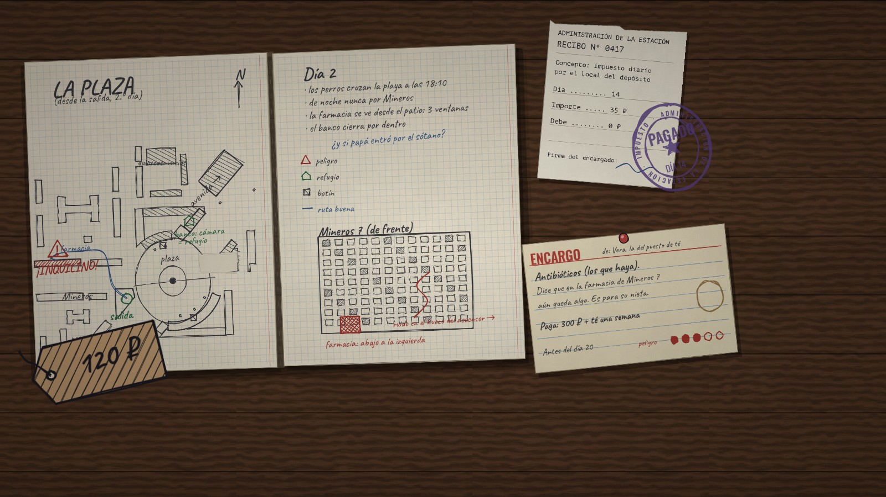

**Tipografías** (`scripts/ui/ui_fonts.gd`): todas OFL, con español y cirílico.

| Uso | Familia | Mínimo a 1080p |
|---|---|---|
| Manuscrita: cuaderno, notas, etiquetas | Caveat | 30 px |
| A máquina: recibos e impresos | PT Mono | 20 px |
| Rótulos: carteles, sellos, cabeceras | Oswald | 20 px |
| Texto: textos largos y opciones | PT Sans | 18 px |

La prueba de legibilidad está en `scenes/ui/prueba_tipografia.tscn`:

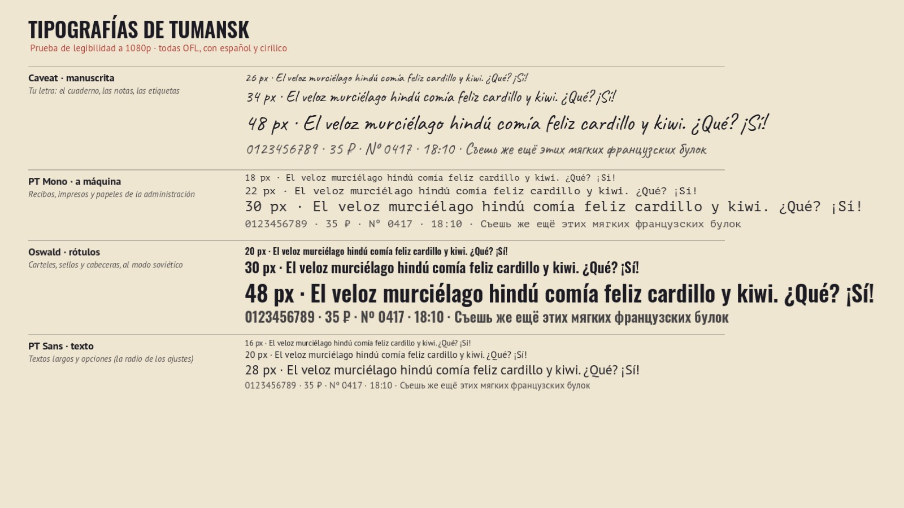

## 6. Herramientas de revisión

- `tools/capture.sh escena salida.png [ancho] [alto] [fotogramas]` hace una captura por cada cámara del grupo `capture_camera`.
- `CAPTURE_ARGS="--hide=InkPost"` captura sin post-proceso.
- `CAPTURE_ARGS="--post=debug_view=N"` muestra una capa del post-proceso: 1 profundidad, 2 normales, 3 contorno, 4 tramado, 5 color de entrada, 6 relleno.
- `CAPTURE_ARGS="--call=Nodo:metodo[:valor]"` llama a un método antes de capturar (por ejemplo, `--call=PanelDepuracion:toggle`).
- Escenas de revisión en `scenes/style/`:
  - Depósito: `diorama_deposito_limpio` y `diorama_deposito_abandonado`.
  - Equipo: `diorama_equipo`, la mesa con el equipo del stalker y las herramientas, cada pieza con su etiqueta.
  - Patio: `diorama_patio_dia`, `diorama_patio_anochecer`, `diorama_patio_noche`, `diorama_patio_noche_linterna` y `diorama_patio_ventisca`.
  - Edificios del kit (F3-16): `diorama_edificios`, `diorama_plaza` y `diorama_mercaderes`, a cualquier hora (ver la [sección 9](#9-los-edificios-del-kit-f3-16)).
  - `prueba_estilo`.
- El visor (`visor_estilo`, la escena principal) recorre todas esas escenas.
- **Panel de depuración** (F1 en el visor): miedo, radiación, hora del día, clima, linterna, trazo reducido y estilo de zona, en vivo.
- **Vídeo:** `tools/video.sh salida.mp4` graba los dioramas con el modo película de Godot (`scenes/debug/video_dioramas.tscn`) y lo convierte con ffmpeg.
- **Capturas de la documentación:** `tools/capturas_docs.sh [filtro]` rehace todas las de `docs/capturas/` (1600×900) con las mismas cámaras y nombres.

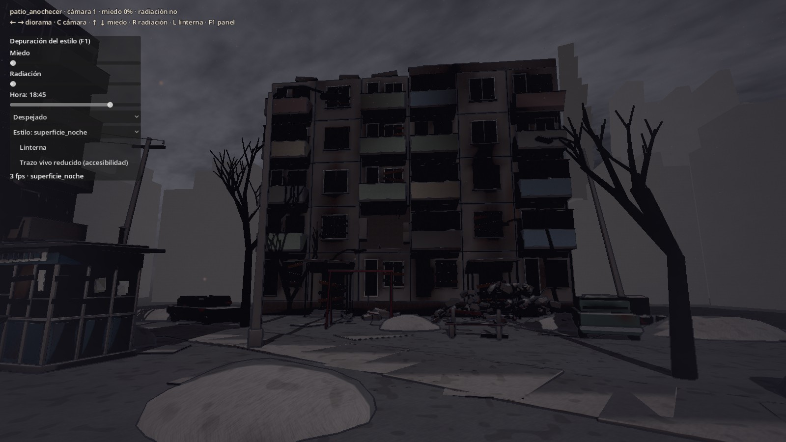

## 7. Fase 1: lo que falta

Nada, salvo tu aprobación. Lo que se ajuste a partir de tu revisión se apuntará aquí.

## 8. La ciudad: suelo, fachadas, lejanía e hitos (maqueta, F3-15)

La maqueta de la ciudad usa el mismo sombreado por bandas, con tres variantes del cuerpo común (`tinta.gdshaderinc`, por `#define`) y un shader para lo lejano. Los materiales existentes no cambian.

| Shader | Para qué |
|---|---|
| `tinta_suelo` | El suelo: color y nieve de `data/ciudad/suelo.png` (calzadas, aceras, plazas, hielo, vías, patios, escombros), proyectado desde arriba. La nieve vieja cubre a parches lo que pide cada clase de suelo y resbala de las cuestas |
| `tinta_fachada` | Las fachadas: ventanas pintadas (una textura de un vano que se repite por vano y por planta) donde el alfa del color de vértice lo pide. Las cubiertas cogen nieve y el hollín de los incendios oscurece la parte alta |
| `tinta_hito` | Los hitos: como las fachadas, pero con su propia niebla y un tope (`hito_niebla_max` = 0,78): nunca desaparecen del todo ([D-027](DECISIONES.md)) |
| `tinta_silueta` | La versión lejana de cada sector: color plano de la niebla, sin luz ([D-026](DECISIONES.md)) |

`Atmosphere` publica el color y la densidad de la niebla de cada hora en dos parámetros globales nuevos, `tinta_niebla` y `tinta_niebla_densidad`, para que lo lejano y los hitos casen con la niebla del motor a cualquier hora y con cualquier clima.

| | |
|---|---|
| 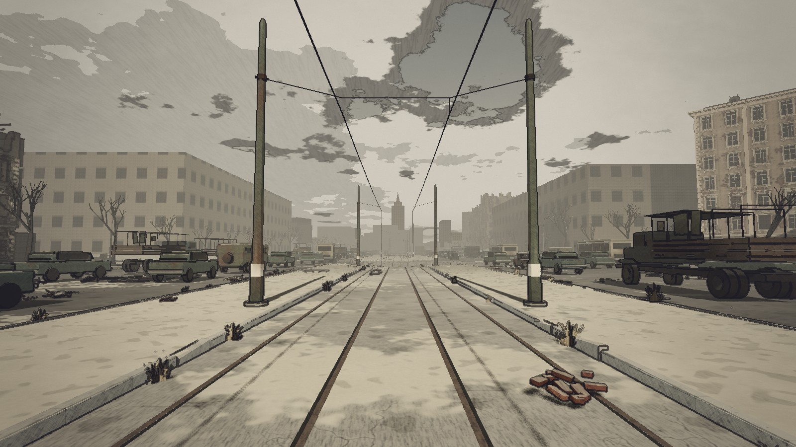 | 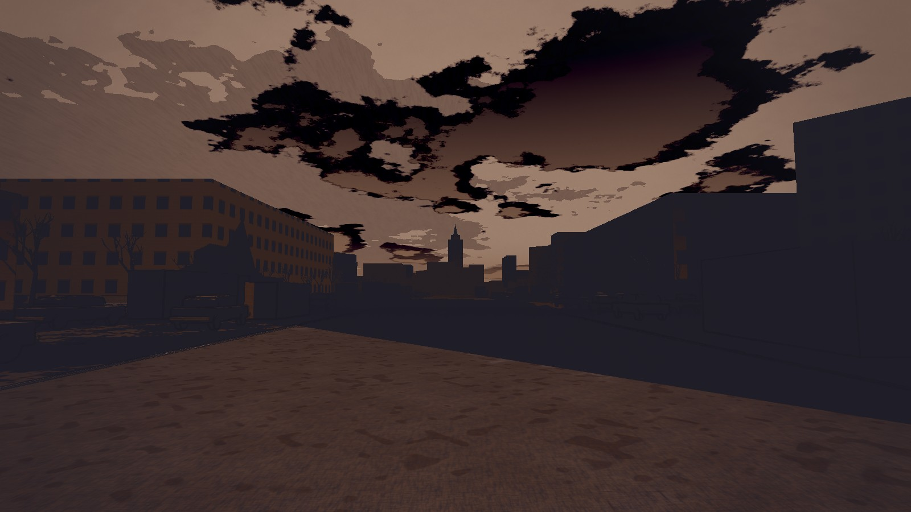 |
| 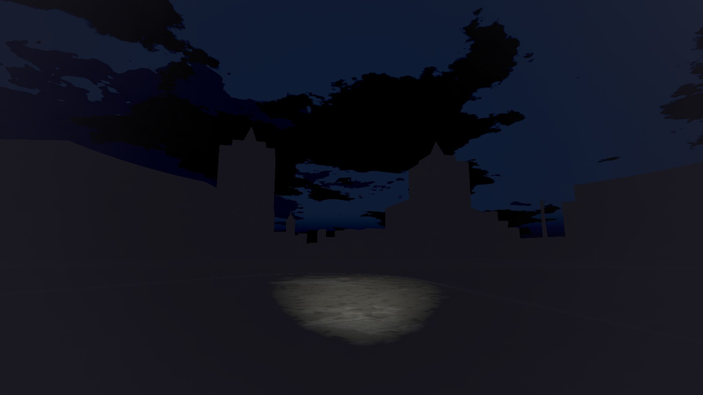 | 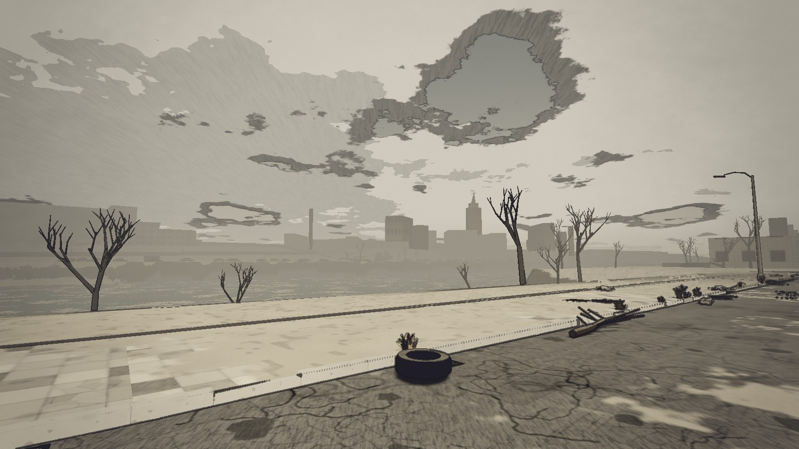 |

## 9. Los edificios del kit (F3-16)

Los edificios de la superficie se montan con las piezas del kit de arquitectura ([DESARROLLO.md](DESARROLLO.md#el-kit-de-arquitectura-f3-16)). Usan el mismo sombreado por bandas y el mismo contorno que todo lo demás; lo propio de los muros lo pone `tinta_muro.gdshader` (`TINTA_MURO` en `tinta.gdshaderinc`).

| Material | Qué es |
|---|---|
| `muro` | Hormigón pintado (los paneles) |
| `azulejo` | El mismo, con plaqueta cerámica de 10 cm en las caras de fachada: de lejos se funde y de cerca se ven las juntas y alguna pieza caída (el bloque de 9 plantas y la torre) |
| `ladrillo` | Ladrillo visto: el aparejo (25 × 6,5 cm, con su junta) se dibuja en el shader |
| `estuco` | Revoque sobre ladrillo: se cae a manchas, más junto a los huecos y abajo (el alfa del color de vértice) y más cuanto más dañada está la casa, y deja ver el ladrillo con un borde de tinta |
| `nevado`, `vidrio`, `interior` | Lo que coge nieve (alféizares, cubiertas, aleros), los cristales y el falso interior tras los huecos (casi negro, como en un grabado) |

- **En el espacio del mundo:** la suciedad a manchas, los chorretones de lluvia, el aparejo y el revoque caído se calculan con la posición en el mundo, así que siguen de una pieza a la de al lado sin repetirse ([D-035](DECISIONES.md)).
- **Por casa y por pieza:** el ensamblador tiñe cada casa (ocre, salmón, crema, gris, el rojo del ladrillo) y cada panel con un tono algo distinto, y le pasa a cada pieza su desgaste y el hollín de su incendio: una pluma negra que sube desde lo alto de cada hueco quemado y oscurece la planta de arriba.
- **Pintado al generar:** la oclusión de lo que tendrá alrededor al montarla, cavidades, chorretones de óxido bajo los alféizares de chapa, manchas y el hollín de las casas de madera quemadas.

### Reglas de modelado para la tinta

El contorno sale de las diferencias de profundidad y de normal entre píxeles vecinos. Una cara de pocos centímetros vista casi de canto ocupa menos de un píxel: unas veces se dibuja y otras no, y el contorno la pinta como una fila de puntos. Pasa con las caras de abajo de lo que está por encima de los ojos (alféizares, cornisas, impostas), con las de arriba de lo que está por debajo (zócalos) y con los cantos a escuadra de lo que sobresale poco (recercados, sillares). Se ve sobre todo de lejos, a ras de fachada y en sombra. Las reglas ([D-036](DECISIONES.md)):

1. **Ninguna cara plana y estrecha.** Las molduras llevan perfil: vierteaguas arriba y la cara de abajo en derrame, inclinadas unos 30° sobre la horizontal y con al menos 4 o 5 cm de alto. Así su altura se sigue viendo a ras y su normal difiere lo bastante de la cara de delante para que el contorno la dibuje entera (`kit.moulding`, `kit.moulding_run`, `kit.ring`).
2. **Cantos en derrame, no a escuadra.** Lo que sobresale del muro tiene los cantos inclinados unos 60° y con unos 4 cm de ancho visto de frente: recercados, frontones, sillares, ménsulas, claves, rótulos (`kit.outline`, `kit.block`).
3. **Esquinas a inglete y extremos vueltos.** Las molduras corridas doblan las esquinas (`kit.corner`) y las que acaban en el aire vuelven al muro (`mitre`); los sillares de esquina abrazan la arista.
4. **Juntas enrasadas y de color.** Ni una ranura, ni siquiera de un milímetro: deja asomar el canto de lo que la rodea. Las juntas de los paneles, del almohadillado y de las tablas son franjas de color en el mismo plano.
5. **Las piezas no se mueven al montarlas.** Unos milímetros de desajuste abren rendijas por las que asoman los cantos. Varían de tono, no de sitio.
6. **Más hondo que en la realidad.** Las molduras salen de 8 a 25 cm, y las prichelinas de las isbas son tablas anchas y gruesas, no listones.
7. **Un chaflán a 45° no dibuja línea** (las normales difieren menos que el umbral del contorno): sirve para suavizar sin que salga contorno, no para marcar una arista.

Para encontrar estos fallos: los dioramas a ras de fachada (`CamaraBarraconRas`) y `CAPTURE_ARGS="--post=debug_view=2"`, que enseña las normales: los píxeles sueltos de otro color son los que salen a puntos. Queda un caso conocido: los travesaños de las carpinterías, vistos desde abajo y en sombra, todavía salen algo punteados; con el cristal enrasado desaparecería, pero se perderían las líneas de los paños de cerca.

| | |
|---|---|
| 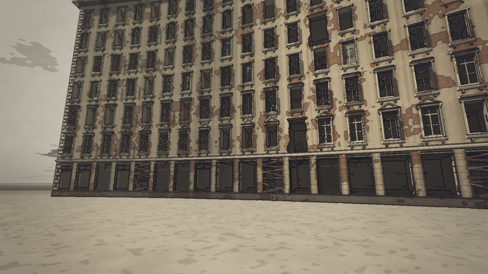 | 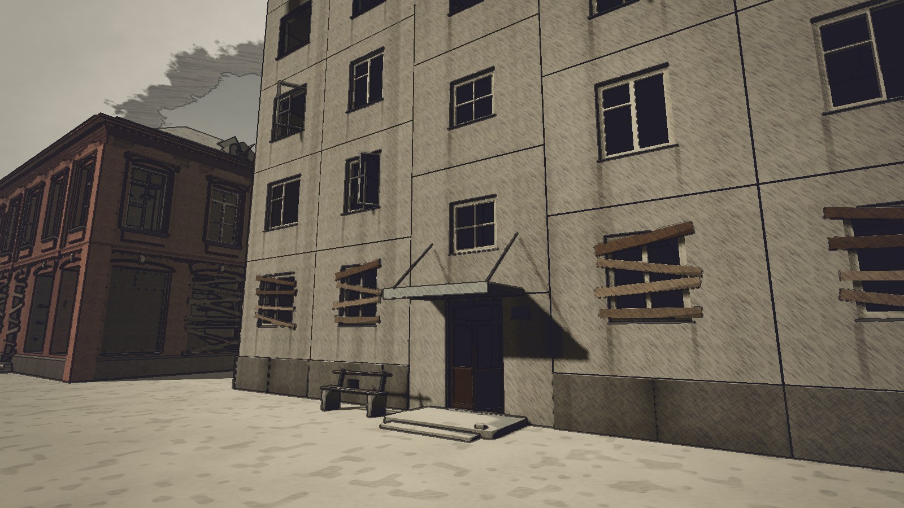 |
| 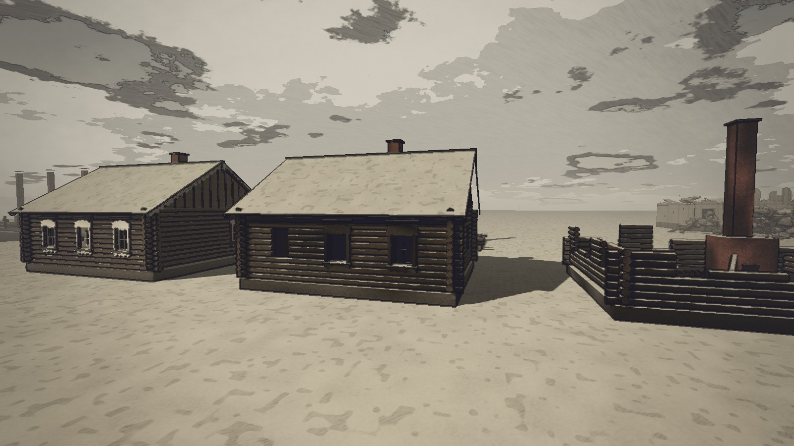 | 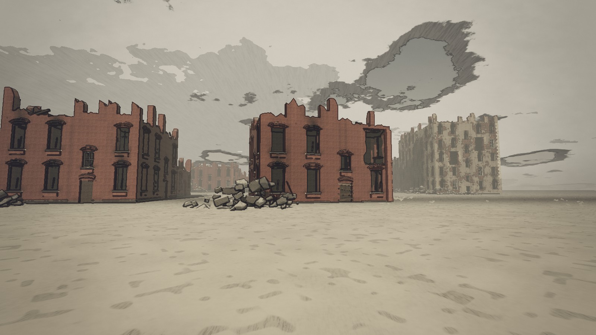 |
| 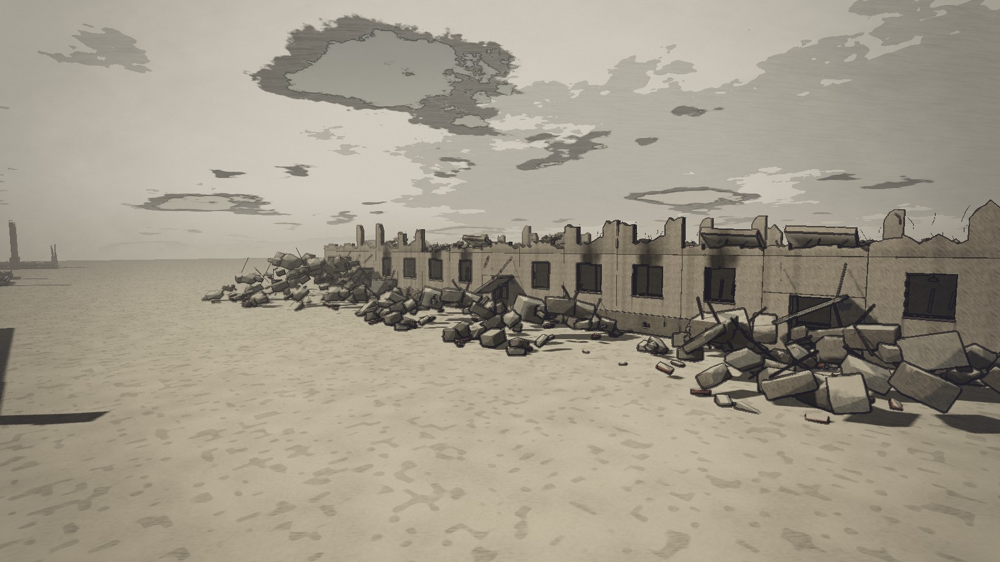 | 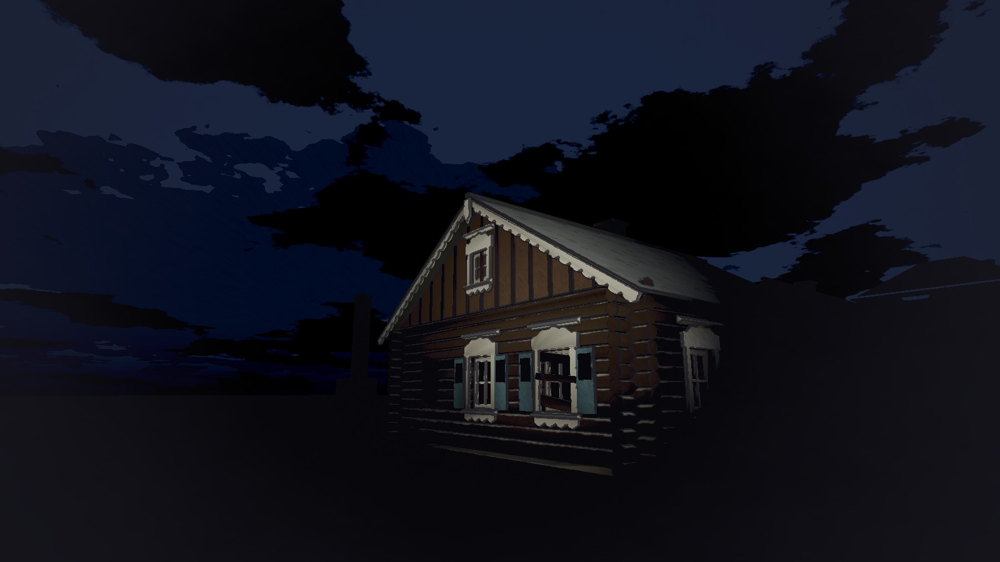 |
